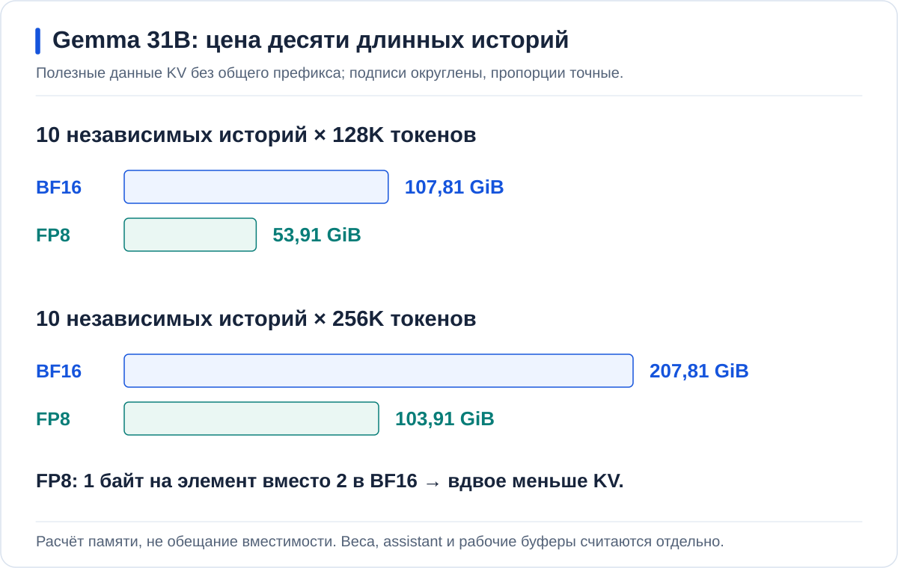
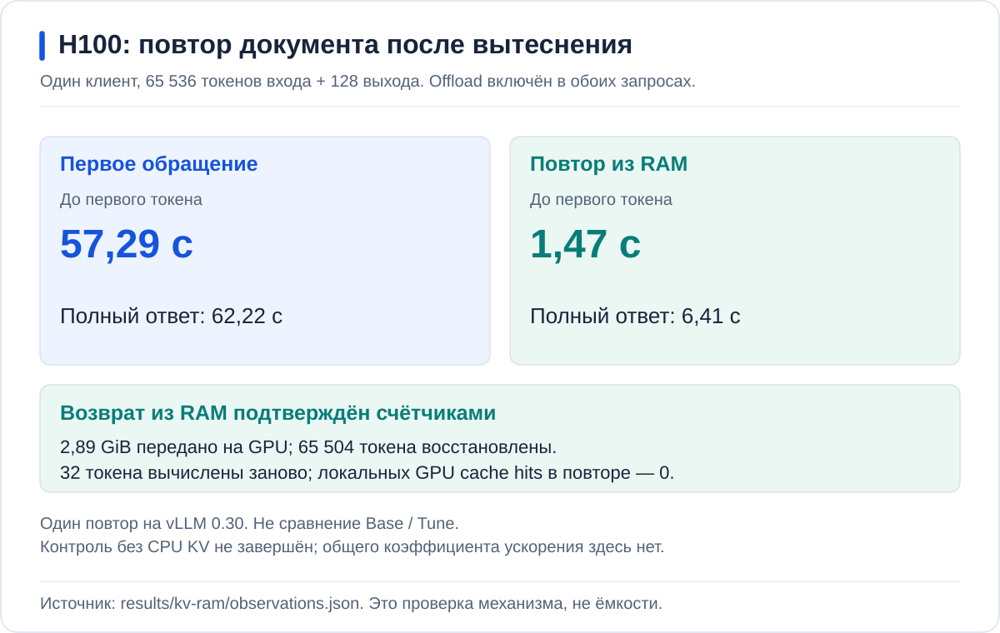
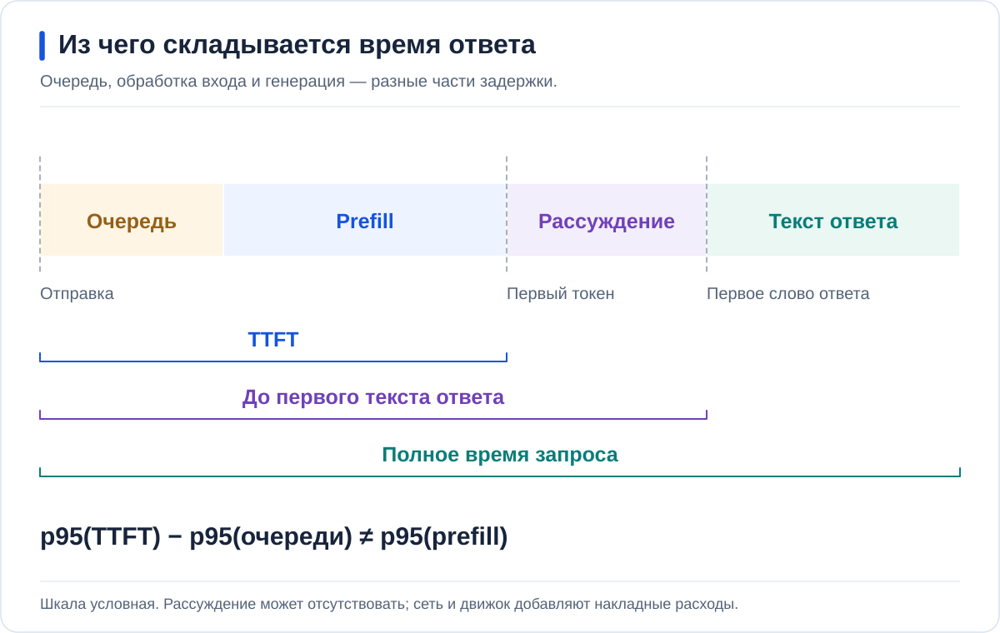
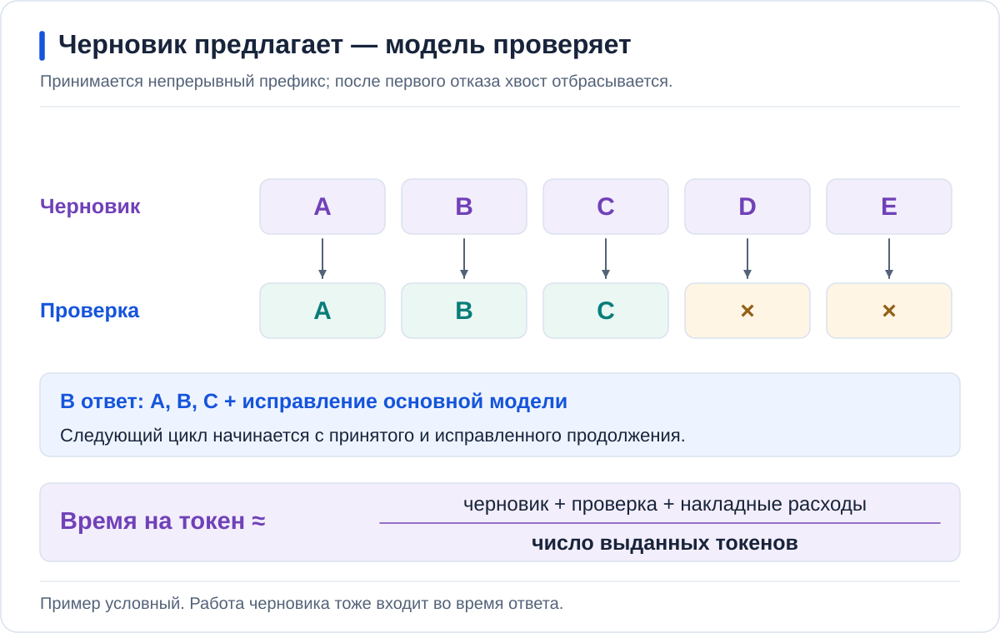
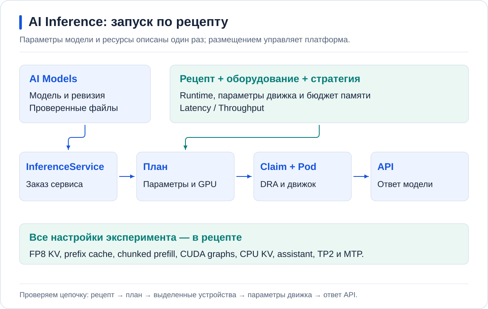
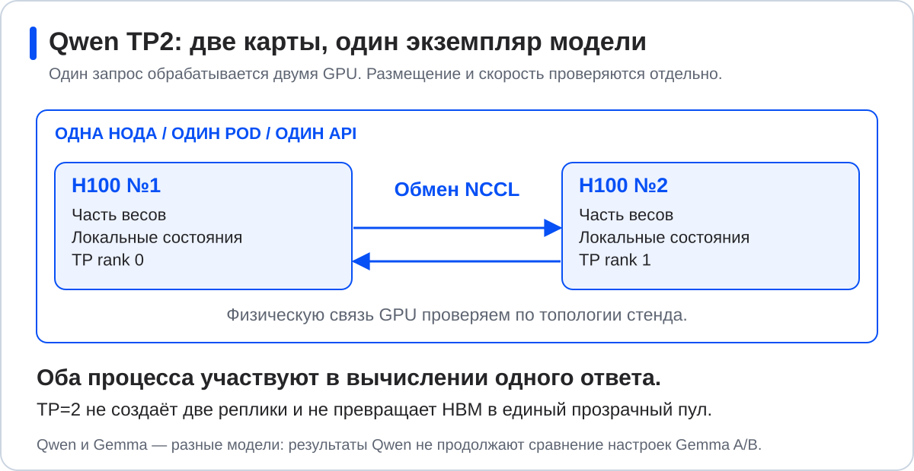

<p align="center">
  <a href="https://github.com/aleksandr-podmoskovniy/hardfest-gpu-workshop">
    
  </a>
</p>

# Инференс без простоя GPU: чиним LLM-сервис руками и делим карту на живом кластере

Александр Подмосковный, Флант / Deckhouse Platform

**Стенд: две H100, Gemma 4 31B и Qwen3.8; отдельная A30 для небольших моделей.**

[H100](README.md) | [RTX 5060 Ti](RTX5060.md) | [RTX PRO 6000](RTXPRO6000.md)

<a id="contents"></a>
## Содержание

1. [Модель под нагрузкой](#ab)
2. [Память и длинный контекст](#memory)
3. [Ускорение обработки запроса](#speculation)
4. [Несколько моделей на одной GPU](#placement)
5. [Автоматический подбор конфигурации](#platform)
6. [Когда нужны дополнительные GPU](#conclusion)
7. [Доступ пользователей и учёт запросов](#results)
8. [Большая модель на двух GPU](#tp2)

Разбор начинается с подготовленной Gemma A, доступной в чате.
Далее настройки меняются поэтапно: сначала память, затем обработка запроса.
Для каждого изменения есть способ проверить результат.
[Подготовка стенда](docs/SETUP.md) выполняется заранее.

---

<a id="ab"></a>
## 1. Модель под нагрузкой

**Gemma A — Base уже запущена** и отвечает в [Open WebUI](https://ai.ap4y.ru).
После регистрации и одобрения аккаунта доступ выдаётся автоматически.
Один законченный ответ подтверждает, что модель работает. Чтобы понять,
справляется ли она с несколькими пользователями, нужна серия одновременных запросов.

Обработка запроса моделью называется **инференсом**. Перед обработкой текст
разбивается на **токены** — части слов и знаки. Из токенов модель формирует продолжение.

<a id="chat"></a>
При росте нагрузки запросы могут ждать свободных ресурсов: ответ начинается позже,
в метриках появляется очередь. По одному чату нельзя определить её причину.

У Base окно **16K**. Это контрольный профиль для сравнения скорости,
**не предел H100**. Настроенная Gemma Tune использует **128K**, Qwen — **256K**.
Для настроенного чата целевой лимит ответа — **32K**; он входит в общее окно
вместе с запросом.

<a id="monitoring"></a>
### Очередь, память и загрузка GPU

Дашборд **AI Inference / Service performance** показывает, что происходит
во время запросов. Для Base используются namespace `hardfest-demo`,
Service `hf-gemma-a` и интервал контрольной серии.

| Что сравнивать | На какой вопрос отвечает |
| --- | --- |
| Running / Waiting | Сколько запросов выполняется, сколько ждёт? |
| Использованная память GPU | Помещается ли состояние запросов? |
| GPU utilization | Какую долю времени GPU выполняет операции? |

Очередь сама по себе не указывает на неисправность, а занятая память не означает,
что GPU непрерывно вычисляет. Ограничение может быть в трёх местах:

- **Память:** состояние активных запросов не помещается на карту.
- **Вычисления:** обработка входа и генерация занимают слишком много времени.
- **Размещение:** ресурсы распределены между моделями неэффективно.

Для сравнения используется второй экземпляр той же Gemma — B.
Изменения вносятся в B, а настройки A остаются неизменными.

### Что находится за чатом


**Open WebUI** — интерфейс чата. **Bifrost** проверяет доступ и направляет
сообщение выбранной модели. **vLLM** обрабатывает запрос на GPU.
Gemma A и B используют разные настройки; после их сравнения обе карты
освобождаются для Qwen.

Поиск по документам и распознавание речи работают на соседней A30.
[Полная схема стенда и подготовка](docs/SETUP.md).

<details>
<summary>Профиль Base и контрольная серия</summary>

Контрольная серия содержит **8 запросов по 8192 входных и 2048 выходных токенов,
4 одновременно**. Фоновых запросов нет. Такая нагрузка нужна для сравнения
скорости, а не для проверки предельного окна.

Сервер — **vLLM 0.31**, развёрнутый через Helm. В [профиле A](values/gemma-a.yaml) выключены
prefix cache, KV-offload, chunked prefill, CUDA graphs и speculative decoding.
Окно 16K выбрано для контрольного профиля, а не измерено как предел H100.

Application `hardfest-gemma-a` применён при подготовке.
Команда выполняется из частного `k8s-config` с переменными из
[подготовки](docs/SETUP.md). `SLOT` выбирает экземпляр модели,
`SERIES` задаёт каталог результатов.

```bash
export SLOT=a SERIES=a-base-1
# B1: export SLOT=cache SERIES=b-cache-1
# B2: export SLOT=b SERIES=b-spec-1
export TOKENIZER_PATH=/data/modelcache/models/gemma-4-31b
mkdir -p "results/hardfest/$SERIES"
set -o pipefail
kubectl --context "$GPU_CONTEXT" -n hardfest-demo exec "deployment/hf-gemma-$SLOT" -- \
  vllm bench serve --backend vllm \
    --base-url "http://hf-gemma-$SLOT.hardfest-demo.svc.cluster.local:8000" \
    --endpoint /v1/completions --model gemma-4-31b --tokenizer "$TOKENIZER_PATH" \
    --dataset-name random --seed 42 \
    --random-input-len 8192 --random-output-len 2048 --random-range-ratio 0 \
    --num-prompts 8 --max-concurrency 4 --ignore-eos --temperature 0 \
    --ready-check-timeout-sec 0 --num-warmups 0 \
    --save-result --result-dir /dev --result-filename stdout \
  | tee "results/hardfest/$SERIES/bench.txt"
```

Критерии: `completed=8`, `failed=0`, `total_input_tokens=65536`,
`total_output_tokens=16384`. Первый проход и повтор сохраняются отдельно:
одинаковые запросы могут использовать прогретый кеш.

Этот клиент делит с сервером CPU узла.
Для итогового сравнения ручного и автоматического запуска используется
[отдельный CPU-клиент](#gemma-compare).

</details>

Длинный разговор увеличивает состояние каждого запроса, хотя сама модель
не меняется. Поэтому прежде чем настраивать вычисления, нужно понять,
сколько памяти требуют одновременные разговоры.

---

<a id="memory"></a>
## 2. Память и длинный контекст

Память GPU занята не только весами. Для каждого активного запроса движок
хранит результаты обработки предыдущих токенов, а для вычислений выделяет
рабочие буферы.

### Зачем нужен KV-кеш

Веса — параметры модели — общие для всех запросов и не растут от длины разговора.
**KV cache (Key–Value cache)** хранит ключи и значения уже обработанных токенов.
Благодаря ему модель не вычисляет их заново при создании каждого следующего токена.

**KV-кеш не хранит готовые ответы.** Он хранит состояние контекста:
чем длиннее история и чем больше независимых разговоров, тем больше требуется памяти.

### Расчёт для Gemma 31B на 128K и 256K

**Attention** связывает текущий токен с контекстом. Full attention хранит KV
всей истории; sliding-window attention — последних токенов. Поэтому цена
контекста зависит от архитектуры, а не только от числа параметров модели.


У Gemma 4 31B полную историю хранят 10 слоёв, а последние 1024 токена — ещё 50.
**1024 здесь — локальное окно слоёв, не длина запроса.** Для одной истории:

```text
KV в BF16 ≈ 80 KiB × S + 0,78125 GiB, при S ≥ 1024
```

`S` — длина входа вместе с уже созданным ответом.
**BF16** хранит элемент в двух байтах, **FP8** — в одном.
Переход на FP8 вдвое уменьшает объём самих K/V-данных.
Веса модели не уменьшаются; буферы и резервы учитываются отдельно.



На схеме `N=8` означает восемь **независимых** историй. Это объём только KV:
веса и буферы нужно учесть отдельно. Если запросы разделяют один префикс,
его общие блоки не умножаются на восемь.

Расчёт объясняет, почему большая карта не гарантирует много длинных сессий.
Снизить потребность в памяти можно более компактным форматом KV
и повторным использованием уже вычисленных блоков.

<details>
<summary>Полный расчёт Gemma 31B: архитектура, формула и awk</summary>

| Контекст | 1 история, BF16 | N=8, BF16 | N=8, FP8 |
| --- | ---: | ---: | ---: |
| **128K = 131 072** | 10,78125 GiB | **86,25 GiB** | **43,125 GiB** |
| **256K = 262 144** | 20,78125 GiB | **166,25 GiB** | **83,125 GiB** |

В **GQA (Grouped-Query Attention)** несколько attention-голов используют
общие K/V. Для памяти важны KV-головы `Hkv`, их размерность `D`,
число слоёв, история `S` и байты элемента `b`.
Множитель 2 учитывает ключи и значения.
Для `N` независимых историй одинаковой длины результат умножается на `N`.

[Закреплённый config.json](https://huggingface.co/google/gemma-4-31B-it/blob/842da3794eaa0b77d5f08bae87a17459d91ff475/config.json):

| Attention | Слоёв | Hkv | D | Сохранённых токенов |
| --- | ---: | ---: | ---: | --- |
| Full | 10 | 4 | 512 | `S` |
| Sliding | 50 | 16 | 256 | `min(S, 1024)` |

```text
KV(S) = 2 × b × [10 × 4 × 512 × S + 50 × 16 × 256 × min(S, 1024)] байт
```

Для BF16: полная часть — `2 × 2 × 10 × 4 × 512 = 80 KiB` на токен;
локальная — `2 × 2 × 50 × 16 × 256 × 1024 = 0,78125 GiB`.
При увеличении контекста со 128K до 256K удваивается только полная часть.

```bash
awk -v S=131072 -v N=8 -v b=2 'BEGIN {
  W = S < 1024 ? S : 1024
  full = 2*b*10*4*512*S / 1073741824
  local = 2*b*50*16*256*W / 1073741824
  printf "Full %.5f + sliding %.5f = %.5f GiB/history; %d histories = %.5f GiB\n", full, local, full+local, N, N*(full+local)
}'
```

Для 256K — `S=262144`, для FP8 — `b=1`.
[Формат хранения в vLLM 0.31](https://github.com/vllm-project/vllm/blob/v0.31.0/vllm/model_executor/models/gemma4.py).

Для KV доступна только память, оставшаяся после загрузки модели и выделения буферов:

```text
Kpool ≈ G × u − W − R
```

Здесь `G` — память GPU, `u` — доля памяти, разрешённая движку,
`W` — веса, `R` — буферы и резервы.
Размер зарезервированного пула берётся из логов, занятость блоков — из метрик.
Одного `nvidia-smi` для этого недостаточно.
[Проверка пула](docs/MEMORY_BUDGET.md#verify-kv).

</details>

<a id="ram"></a>
### Повторное использование KV-кеша

Если несколько запросов начинаются одним документом, его обработка каждый раз
повторяет ту же работу. **Prefix caching** позволяет использовать готовый KV
для совпадающего начала запроса — префикса. Вопросы в конце могут различаться;
изменения в начале сокращают общую часть.

GPU-кеш ограничен. **KV RAM offload** сохраняет вытесненные блоки в оперативной
памяти и возвращает их на GPU, когда они снова нужны. Это позволяет сохранить
больше вычисленного контекста, но не превращает RAM в дополнительную VRAM:
для работы модели активные блоки должны находиться на GPU.


Первый вариант B называется **Gemma B — Cache**. Он сохраняет окно Base в 16K,
но включает prefix cache, FP8 KV и **32 GiB RAM** для offload.
Профиль подготовлен как отдельный Deployment `hf-gemma-cache`.

**На узле со 128 GiB сначала A останавливается в Deckhouse Console**,
после отключения маршрута и завершения запросов. Совместный запуск требует
достаточного [бюджета RAM](docs/MEMORY_BUDGET.md#ram-выбрать-порядок-запуска).

<details>
<summary>Включение Cache и его параметры</summary>

В Console, в разделе **Контейнеризация / Deployments**, у `hf-gemma-cache`
задаётся `spec.replicas: 1`. До показа его Application уже синхронизирован
с нулём реплик; autosync выключен, изменение реплик защищено от Sync.
[Подготовка Applications](docs/GITOPS.md#2-подготовить-файлы-площадки).

В полном [профиле Cache](values/gemma-b.yaml) Triton attention работает
с CPU KV-пулом:

```yaml
kv-transfer-config:
  kv_connector: OffloadingConnector
  kv_role: kv_both
  kv_connector_extra_config:
    cpu_bytes_to_use: 34359738368
```

После Ready нужен ответ API и доступная **Gemma B — Cache** в чате.
Включение реплики не меняет профиль: новые параметры движка готовятся
заранее через Git и ручной Sync Argo CD.

</details>

### Проверка повторного запроса

Для проверки в сообщение передаётся документ, затем запрос повторяется.
Третий запрос отличается началом документа. Вложения и база знаний здесь
не подходят: поиск может выбрать другие фрагменты и изменить префикс.

| Что сравнивать | Что проверяется |
| --- | --- |
| Prefix-cache hit rate и TTFT | Переиспользование начала и время до первого токена |
| GPU→CPU | Сохранение блоков в RAM |
| CPU→GPU и external-prefix hits | Возврат вытесненного префикса |

**TTFT** — время до первого токена.
Чтобы проверить offload, исходный префикс вытесняется из GPU другими запросами,
а затем запрашивается снова: [опыт вытеснения и повтора](docs/MEASUREMENTS.md#offload-replay).
[Prefix caching](https://docs.vllm.ai/en/v0.31.0/features/automatic_prefix_caching/),
[KV-offload](https://docs.vllm.ai/en/v0.31.0/features/kv_offloading_usage/).

<a id="h100-result"></a>
### Измерение возврата KV из RAM

На одной H100 первый запрос и повтор после вытеснения получили **тот же вход
65 536 токенов и выдали по 128 токенов**. Offload был включён в обоих случаях.
Это отдельная проверка механизма на vLLM 0.30, а не сравнение Base с Tune.



Повторный запрос не обрабатывал документ целиком заново.
Однако кеш не отменяет генерацию нового ответа: эта работа остаётся на GPU.

<details>
<summary>Числа, условия и подтверждение возврата из RAM</summary>

<!-- result:h100-replay -->
| Один и тот же документ | Первое обращение | Повтор после вытеснения |
| --- | ---: | ---: |
| До первого токена, с | 57,29 | 1,47 |
| Полный ответ, с | 62,22 | 6,41 |
| Фактический вход / выход | 65 536 / 128 | 65 536 / 128 |
<!-- /result:h100-replay -->

За повтор на GPU вернулись **2,89 GiB**. Из входа **65 504 токена** восстановлены
из внешнего KV, **32** вычислены заново; локальных GPU cache hits в этом запросе — 0.
Поэтому ускорение нельзя объяснить только попаданием в GPU-кеш.

Один клиент, один повтор; первый запрос мог включать расходы первого выполнения
такого размера. Контроль без CPU KV не завершён. Эти числа не доказывают скорость
восьми сессий, выход 32K или ускорение текущего профиля Tune.
[Наблюдения и параметры](results/kv-ram/observations.json),
[методика и счётчики](results/kv-ram/README.md).

</details>

---

<a id="speculation"></a>
## 3. Ускорение обработки запроса

Повторное использование контекста сокращает только часть работы.
Новый вход нужно обработать, а ответ — сгенерировать. Для этих двух задач
используются разные оптимизации.

<a id="latency"></a>
### Prefill и decode

Во время **prefill** модель обрабатывает вход и строит KV-кеш.
Во время **decode** она последовательно создаёт токены ответа, используя этот кеш.

```text
Время ответа ≈ очередь + prefill + decode + прочие задержки
```



Для пользователя важны и ожидание начала ответа, и скорость его продолжения.
**ITL** показывает интервал между токенами, **TPOT** — среднее время на токен
после первого. Если модель сначала генерирует рассуждения, или reasoning,
они тоже относятся к decode и занимают время до финального текста.

### Обработка длинного входа по частям

Длинный prefill может задерживать генерацию уже начатых ответов.
**Chunked prefill** разбивает его на порции — chunks. Планировщик движка
может чередовать обработку этих порций с decode других запросов.
Меньшая порция чаще освобождает место для них, но требует больше шагов.


Эффект проверяется смешанной нагрузкой: короткий запрос поступает во время
обработки длинного. Такая серия сначала выполняется **на Cache до его остановки**,
затем повторяется на Tune с тем же расписанием запросов.

### Ускорение генерации с draft-моделью

Обычный decode создаёт токены по одному. **Speculative decoding** использует
небольшую draft-модель, которая предлагает продолжение. Основная target-модель
проверяет предложение; неподходящая часть отбрасывается.



У Gemma для этого используется совместимый assistant с
**MTP (Multi-Token Prediction)** — предсказанием нескольких токенов.
Произвольная маленькая модель вместо него не подходит.

Ускорение зависит от доли принятых токенов — acceptance — и стоимости проверки.
Высокая доля принятия сама по себе ещё не доказывает выигрыш: важна фактическая
скорость готового ответа.
[Устройство Gemma assistant](https://docs.vllm.ai/en/v0.31.0/features/speculative_decoding/mtp/).

### Gemma B с полным набором настроек

[Профиль Tune](values/gemma-b-spec.yaml) добавляет к настройкам кеша chunked prefill,
assistant и **CUDA graphs** — повторное выполнение подготовленных
последовательностей GPU-операций с меньшими накладными расходами запуска.

Окно Tune составляет **128K**. Бюджет prefill **2048** ограничивает объём работы
одного шага, а не длину всего входа.

**Перед заменой маршрут B отключается, запросы завершаются, Cache останавливается.**
Две B одновременно не запускаются; настройки A сохраняются.

<details>
<summary>Замена Cache на Tune и повтор нагрузки</summary>

На Cache отправляется запрос со входом **8192 токена**, а через **50 мс** —
со входом **128 токенов**. У обоих выход по 512 токенов.
[Клиент с фиксированным расписанием](docs/MEASUREMENTS.md#mixed-prefill)
сохраняет фактическое время запросов. Если они не перекрылись,
влияние длинного prefill на короткий запрос не проверено.

1. В Console у `hf-gemma-cache`: `spec.replicas: 0`.
   Продолжение — после остановки Pod и освобождения карты.
2. У подготовленного `hf-gemma-b`: `spec.replicas: 1`.
   Его Application уже использует целый `gemma-b-spec.yaml`
   и `site/gemma-assistant.yaml`, подключающий обе модели.
3. После ответа API проверяется маршрут **Gemma B — Tune**.

На Tune повторяются та же смешанная серия и контрольная нагрузка A/B.
`max-num-batched-tokens: 2048` задаёт бюджет одного шага prefill;
`max-model-len: 131072` — окно всего запроса.

</details>

| Что сравнивать | Зачем |
| --- | --- |
| TTFT короткого запроса | Проверить соседство с длинным prefill |
| ITL, выходные токены/с | Проверить скорость продолжения |
| Ошибки и фактические длины | Исключить «ускорение» за счёт неполного ответа |

Это сравнение **набора настроек**, включая окно, не измерение вклада одного MTP.
Сопоставимого отчёта по всем трём профилям H100 — Base, Cache и Tune — в материалах нет:
результат возврата из RAM выше не заменяет такой замер. Его нельзя переносить
на скорость генерации или подменять числами с RTX.

<a id="long-context"></a>
### Длинный контекст и ответ до 32K

Короткая контрольная серия не проверяет вместимость полного окна Tune.
Для этого нужен отдельный запрос. **Окно включает вход и ответ**, в том числе
системный текст и reasoning. При окне 128K и лимите ответа **32K** на вход
остаётся до **96K**, включая системное сообщение и шаблон чата.

Качество работы с контекстом проверяется на **учебном документе без секретов**.
В середину документа помещается заранее известный факт, который модель должна найти.
В запрос передаётся весь документ, а не найденные поиском фрагменты.
Длина входа в журнале подтверждает, что текст дошёл до модели; факт и цитата
в ответе помогают проверить его использование.

Ниже — отдельная синтетическая проверка вместимости и длины ответа.
Она воспроизводима без документа, но не оценивает понимание его содержания.

<details>
<summary>Проверка полного окна 128K с выходом 32K</summary>

В команде раздела 1 выбирается `SLOT=b SERIES=gemma-128k-output-32k`:

| Параметр | Значение |
| --- | ---: |
| `--random-input-len` | 98304 |
| `--random-output-len` | 32768 |
| `--num-prompts` / `--max-concurrency` | 1 / 1 |

Сумма — **131 072 токена**. Критерии: `completed=1`, `failed=0`,
заданные фактические длины и отсутствие ошибок памяти.
Это синтетическая проверка completions API с `--ignore-eos`, не оценка качества.
В чате шаблон и системное сообщение тоже занимают входной бюджет.

Восемь клиентов не означают восемь полных окон: активный KV должен помещаться в GPU.
Gemma Tune использует 128K; расчёт 256K выше показывает потребность в памяти,
но не меняет профиль запуска.

</details>

При большом числе серверов возможны и другие оптимизации.
**Cache-aware routing** направляет запрос туда, где уже сохранён нужный префикс.
**Prefill/decode disaggregation** разделяет обработку входа и генерацию между
вычислительными ресурсами, чтобы масштабировать их независимо.
В этом стенде они не включены; [подробнее о механизмах](docs/SOURCES.md#за-пределами-этого-стенда).

Настройки движка помогают отдельной модели. Но ресурс может простаивать и по другой
причине: небольшая модель получила целую карту, хотя использует только её часть.

---

<a id="placement"></a>
## 4. Несколько моделей на одной GPU

Поиск по документам и распознавание речи обслуживают отдельные модели.
Если выделить каждой целую GPU, часть памяти и вычислений может остаться
неиспользованной. Совместное размещение позволяет использовать карту плотнее,
но требует контролировать разделение ресурсов и влияние соседних процессов.

### Выделение устройств в Kubernetes

**Device plugin** публикует ресурс вроде `nvidia.com/gpu: 1`.
Приложение запрашивает количество устройств; их режимы разделения требуют
отдельных настроек. Такого запроса недостаточно, чтобы подробно описать
нужную память, режим и другие свойства GPU.

**DRA (Dynamic Resource Allocation)** позволяет описать требования к устройству
через заявку ResourceClaim, выбрать его по атрибутам и передать конфигурацию.
Это стандарт Kubernetes для выделения устройств, а не способ разделения GPU:
доступные режимы по-прежнему определяются драйвером и оборудованием.
[Авторский разбор](https://habr.com/ru/companies/flant/articles/1020276/).

### Разделение A30 с помощью MIG и MPS

**MIG (Multi-Instance GPU)** делит память и вычислительные ресурсы карты
на аппаратно изолированные части. **MPS (Multi-Process Service)** позволяет
нескольким процессам совместно выполнять работу на GPU, в том числе внутри
подходящего раздела MIG. MPS не добавляет память и не заменяет изоляцию MIG.

| Подготовленный сервис | Назначение | Размещение |
| --- | --- | --- |
| Qwen3 Embedding 4B W4A16 | Векторы текста | Первая `2g.12gb` |
| Qwen3 Reranker 4B W4A16 | Оценка найденных фрагментов | Та же часть через MPS |
| Whisper large-v3 | Речь в текст | Вторая `2g.12gb` |

W4A16 означает 4-битные веса и 16-битные активации.
На стенде проверяется **готовое размещение A30, без переразметки**.
Эта карта находится в соседнем кластере, поэтому Gemma на H100 продолжает работать.


<details>
<summary>Проверка A30: MIG ID, заявки и MPS-процессы</summary>

[Device plugins](https://kubernetes.io/docs/concepts/extend-kubernetes/compute-storage-net/device-plugins/) и
[DRA](https://kubernetes.io/docs/concepts/resource-management/dynamic-resource-allocation/).

Команды выполняются **на ноде кластера A30**:

```bash
nvidia-smi -L
nvidia-smi mig -lgi
nvidia-smi mig -lci
```

Эмбеддер и реранкер должны иметь один MIG ID, Whisper — другой.
[Связь Pod с ResourceClaim, MIG и MPS](docs/TROUBLESHOOTING.md#a30-claims).
Совместная нагрузка сравнивается с отдельной по задержкам, ошибкам и памяти.
Метрика MIG не разделяет вклад MPS-процессов.

Для проверки поиска подходит документ: «В проекте “Липа” обслуживание начинается
во вторник в 16:40». После индексации база подключается к чату;
один вопрос проверяется с базой и без неё.

[Создание этих заказов](#a30-orders) разобрано после устройства автоматизации.

</details>

### Поиск по файлу и голосовой ввод

При работе с большим набором документов не обязательно передавать их целиком
в контекст. **RAG (Retrieval-Augmented Generation)** добавляет к запросу только
найденные фрагменты. Эмбеддер преобразует текст в векторы для поиска по смыслу,
индекс находит кандидатов, а реранкер оценивает их соответствие вопросу.
Gemma получает выбранные фрагменты и составляет ответ.

Whisper выполняет другую задачу: превращает речь в текст для голосового ввода.
Синтезом речи он не занимается.

Проверка документа с известным фактом должна подтвердить ответ, ссылку
на источник и обращения к эмбеддеру и реранкеру. Проверка голоса — транскрипцию
Whisper. Для этих сервисов измеряются задержки и ошибки, а не скорость
генерации чат-токенов.

---

<a id="platform"></a>
## 5. Автоматический подбор конфигурации

Для ручного запуска пришлось согласовать модель, формат KV, бюджет памяти,
параметры движка и способ выделения GPU. При смене модели этот подбор
приходится повторять. Часть решений можно перенести в платформу.

**AI Inference** получает модель и требования к её работе в объекте
**InferenceService**. Планировщик сопоставляет требования с оборудованием
и **рецептами** — совместимыми конфигурациями движка — и составляет план запуска.
Он не создаёт отсутствующую память и не заменяет проверку производительности.



В каталоге **ai-models** у скачанной модели доступно действие
**«Запустить инференс»**. После выбора стратегии и ресурсов интерфейс
показывает план, по которому создаётся сервис.

Здесь InferenceService создаётся через Deckhouse Console.
Argo CD управляет подготовленными ручными моделями и не должен одновременно
создавать или изменять тот же InferenceService.

### Сравнение платформенного запуска с ручной настройкой

Сравнение имеет смысл, если платформа воспроизводит проверенные параметры Tune.
**Рецепт проверяется до остановки A:** те же веса, окно 128K, FP8 KV,
RAM-offload, assistant и параметры выполнения.

Для двух настроенных экземпляров требуется не менее **192 GiB RAM**
с проверенным распределением. На узле со **128 GiB** их проверяют последовательно:
сначала сохраняется результат B, затем она останавливается.

Платформенный экземпляр занимает место A. Сначала отключается её маршрут,
завершаются запросы и останавливается Deployment. Новый сервис запускается
после освобождения GPU-заявки. В чате он называется **Gemma A — DP**.

<details>
<summary>Создание Gemma в Console и проверка ответа</summary>

У ручной A: `spec.replicas: 0`; продолжение после исчезновения Pod.
В разделе **AI-модели / Сервисы инференса** действие **Создать** открывает форму.
В ней задаётся имя
**`hf-platform-gemma`**, Model `gemma-4-31b`, стратегия `Throughput`
и подготовленный класс H100. [Поля заказа и проверка плана](docs/SETUP.md#inference-readiness).

Имя `hf-platform-gemma` совпадает с подготовленным маршрутом.
Участникам не нужно выдавать новые ключи. После Ready проверяется ответ API,
затем запрос через чат. Для прямой проверки в отдельном терминале открывается порт:

```bash
kubectl --context "$GPU_CONTEXT" -n hardfest-demo get service hf-platform-gemma
kubectl --context "$GPU_CONTEXT" -n hardfest-demo port-forward svc/hf-platform-gemma 18005:80
```

Порт 80 заменяется фактическим, если Service публикует другой.
Ключ вводится из менеджера секретов в основном терминале:

```bash
set +x
IFS= read -r -s MODEL_API_KEY
curl --fail --max-time 30 \
  --header @<(printf 'Authorization: Bearer %s\n' "$MODEL_API_KEY") \
  http://127.0.0.1:18005/v1/models
```

В `model` подставляется ID из `/v1/models`:

```bash
curl --fail-with-body --max-time 180 \
  --header @<(printf 'Authorization: Bearer %s\n' "$MODEL_API_KEY") \
  -H 'Content-Type: application/json' http://127.0.0.1:18005/v1/chat/completions \
  -d '{"model":"REPLACE_SERVED_MODEL_ID","max_tokens":512,"temperature":0,"messages":[{"role":"user","content":"Зачем нужен KV-кеш?"}]}'
unset MODEL_API_KEY
```

После законченного ответа без ошибки port-forward закрывается.
Ключ не сохраняется в Git и не попадает в аргументы curl.
Проверка Qwen выполняется таким же способом, с его Service, портом, ID и ключом.

</details>

<a id="gemma-compare"></a>
[Отдельный CPU-клиент](docs/MEASUREMENTS.md#gemma-client-h100) отправляет B и платформе
одни и те же запросы с одинаковым tokenizer. Сравниваются TTFT, ITL,
токены/с и ошибки. На 128 GiB режим `manual` выполняется **до остановки B**,
`platform` — после замены.

Цель автоматизации — воспроизвести нужную конфигурацию без ручной сборки,
а не ускорить те же вычисления ещё раз. Близкие результаты покажут, что переход
на платформу сохранил характеристики настроенного экземпляра.

<a id="a30-orders"></a>
<details>
<summary>Создание эмбеддера, реранкера и Whisper через платформу</summary>

Для сервисов A30 используется тот же InferenceService.
Их модели описаны в `catalog/a30.yaml`.

**Нужны свободные ресурсы, поддержка драйвера и заранее включённый MIG mode.
Чужие партиции не переразмечаются.**

| Values | Application |
| --- | --- |
| `platform/embedding.yaml` | `hardfest-embedding-platform` |
| `platform/reranker.yaml` | `hardfest-reranker-platform` |
| `platform/whisper.yaml` | `hardfest-whisper-platform` |

Примеры Helm values сначала [рендерятся в YAML заказа](docs/SETUP.md#console-order).
Заказы создаются в Console **кластера A30**, с указанными именами моделей и
классов. Если сервисы уже существуют, второй владелец им не добавляется.
Проверяются три готовых сервиса и их ответы.
`nvidia-smi` фиксирует одну ноду до и после: если части существовали раньше,
наблюдается выделение, не новая нарезка.

</details>

---

<a id="conclusion"></a>
## 6. Когда нужны дополнительные GPU

Причины задержек требуют разных решений. Повторную обработку документа
сокращает кеширование. Долгую генерацию — настройка вычислений.
Простой ресурсов у небольших сервисов — совместное размещение.

Покупку дополнительных GPU можно обосновать, когда после настройки
измеренная нагрузка всё ещё не укладывается в требуемые задержки,
контекст или пропускную способность. Основание для расширения — конкретный
дефицит ресурсов, а не один медленный ответ.
[Методика сравнения](docs/MEASUREMENTS.md).

---

<a id="results"></a>
## 7. Доступ пользователей и учёт запросов

Метрики движка показывают общую нагрузку, но не объясняют,
какие пользователи её создали. **ai-mcp-gateway** на базе Bifrost связывает
запрос с пользователем, маршрутом и моделью.

После одобрения аккаунта ему выдаётся личный **Virtual Key (VK)**.
Он определяет доступные модели и лимиты. Общий ключ, которым шлюз обращается
к движку, не заменяет персональный: иначе запросы разных людей смешаются.

Проверка учёта выполняется с двух аккаунтов. В журнале должны быть разные VK,
правильные владельцы и фактическое число токенов.
Смена модели не должна сбрасывать права или накопленный расход.

**Стоимость условная, списаний нет.** Учитываются фактические токены,
не настроенное окно.
[Доступы, тарифы и ограничения учёта](docs/CHAT_AND_ACCESS.md).

<a id="topology"></a>
[Схема маршрута запроса](assets/29-chat-path.svg).

---

<a id="tp2"></a>
## 8. Большая модель на двух GPU

До этого одна карта обслуживала Gemma или несколько небольших моделей.
Для **nvidia/Qwen3.8-Flash-Next-NVFP4** используются обе H100.
**Tensor Parallelism (TP)** распределяет тензорные вычисления одной модели
между картами. Это не две независимые копии и не смена движка: сервером остаётся vLLM.



[Профиль Qwen](values/qwen-tp2.yaml) задаёт окно **256K**.
При ответе до **32K** на вход остаётся **224K**, включая шаблон чата.
Рецепт платформы должен воспроизвести закреплённые параметры запуска.
Лимит разрешает длинный ответ, но не заставляет модель выдавать 32K токенов
в каждом запросе и не гарантирует множество полных окон одновременно.

**До остановки Gemma проверяются веса, runtime, рецепт и класс устройств Qwen.**
Затем отключаются маршруты Gemma, завершаются запросы и освобождаются обе H100.
После сохранения YAML удаляется **только созданный вручную заказ Gemma**.
Model, PVC и чужие нагрузки сохраняются; A30 и чат работают дальше.

<details>
<summary>Освобождение H100 и автоматический запуск Qwen</summary>

Профиль задаёт `max-model-len: 262144`, `max-num-seqs: 16` и **16 GiB RAM для KV**.

У всех ручных Gemma в Console задаётся `spec.replicas: 0`.
После удаления платформенного заказа обе карты должны быть свободны.
Создаётся **`hf-qwen-platform`**, Model `qwen3-8-flash-next-nvfp4`,
стратегия `Throughput` и подготовленный класс H100 TP2.
[Поля формы и YAML заказа](docs/SETUP.md#console-order).
План должен содержать `acceleratorCount=2`, ResourceClaim — две разные GPU одной ноды,
а Pod — `tensor-parallel-size: 2`.
После проверки API по разделу 5 включается **Qwen — TP2** для действующих VK,
без сброса расхода.

У Qwen встроенный MTP, отдельная Gemma assistant не нужна.
Native KV-offload использует Simple CPU backend, не Gemma OffloadingConnector.
Для смены модели удалять PVC не нужно.

</details>

### Отдельные проверки параллельности и полного окна

Ответ в чате подтверждает работоспособность маршрута. Нагрузка проверяет
использование обеих карт, скорость и очередь. Параллельность и предельный
контекст проверяются отдельно: восемь обычных запросов не подтверждают
вместимость восьми полных окон.

<details>
<summary>Нагрузка Qwen: параллельность и длинный вход</summary>

[CPU-клиент Qwen](examples/qwen-benchmark-job.yaml):

| Серия | Вход / выход | Одновременно |
| --- | --- | ---: |
| Контрольная | 8192 / 512 | Сначала 1, затем 4 и 8 |
| Полное окно 256K | 229 376 / 32 768 | 1 |

Для полного окна в копии Job задаются `INPUT_TOKENS=229376`,
`OUTPUT_TOKENS=32768`, **`NUM_PROMPTS=1 CONCURRENCY=1`** и отдельное имя Job.
В клиенте используется `--ignore-eos`: это тест вместимости, а не обычный чат.
Проверяются Running/Waiting, занятый KV, фактические длины и законченные ответы.
Наличие NVLink — межкарточного соединения — не доказывает скорость обмена.

При [подготовке](docs/SETUP.md) выбираются CPU-нода, Service, авторизация и длины.
До проверки параметров Job остаётся `suspend: true`.

</details>

---

<a id="cleanup"></a>
### Завершение работы

Перед остановкой отключаются маршруты и завершаются текущие запросы.
У ручных Deployment в Console задаётся `spec.replicas: 0`.
YAML созданных вручную заказов сохраняется, затем удаляются только эти
InferenceService. Autosync остаётся выключенным.

**Namespace, Model, PVC, GPUClass/GPUPool, чаты и базы знаний сохраняются.**
Остановка подтверждается отсутствием Pod нагрузки и освобождением заявок.
[Процедура](docs/GITOPS.md#остановка).

<a id="setup"></a>
<details>
<summary>Подготовка и справка</summary>

Перед началом A и три сервиса A30 должны отвечать на запросы.
B и конфигурации Gemma/Qwen подготовлены, но выключены.
Веса, маршруты, личный доступ и мониторинг проверяются заранее.

- [Узлы, переменные и запуск A](docs/SETUP.md)
- [GitOps](docs/GITOPS.md), [ai-models](catalog/README.md), [мониторинг](docs/OBSERVABILITY.md)
- [Бюджет памяти](docs/MEMORY_BUDGET.md), [диагностика](docs/TROUBLESHOOTING.md), [источники](docs/SOURCES.md)

Публичные профили по умолчанию выключены. NodeCache хранит веса;
контейнерный образ vLLM имеет отдельный кеш.

</details>
