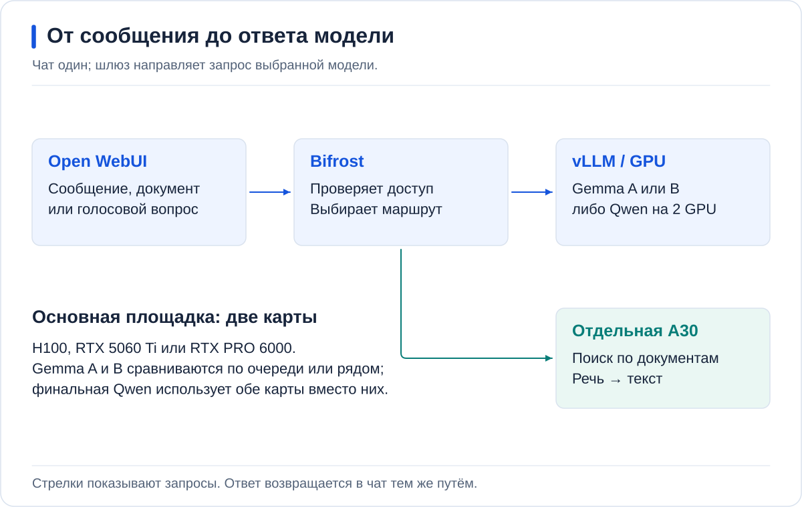
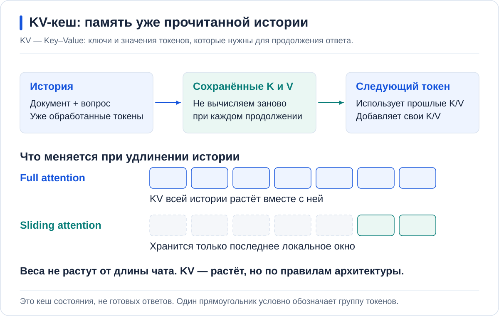
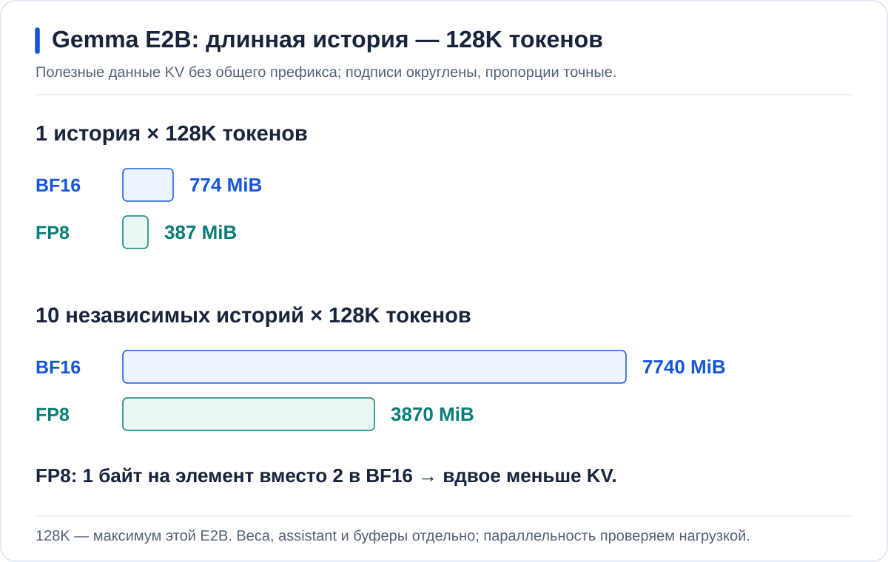
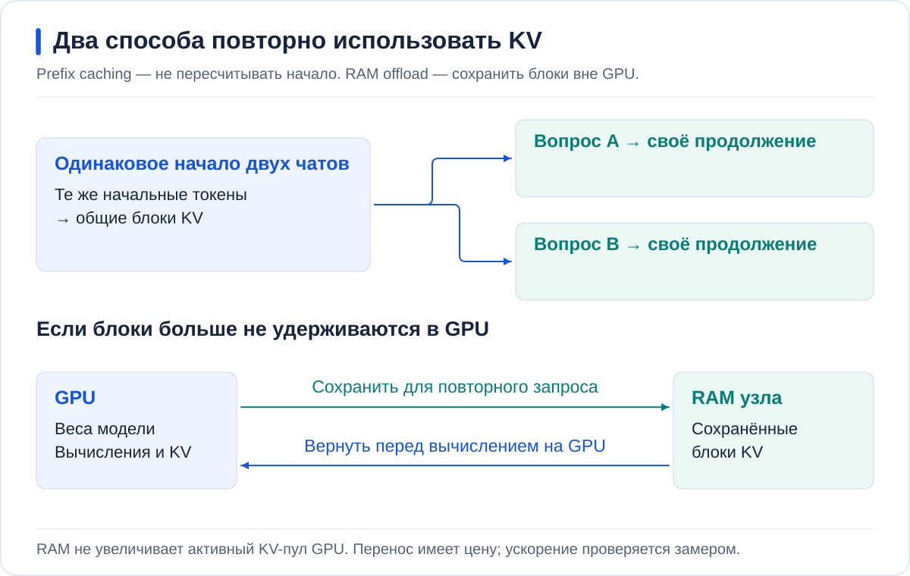
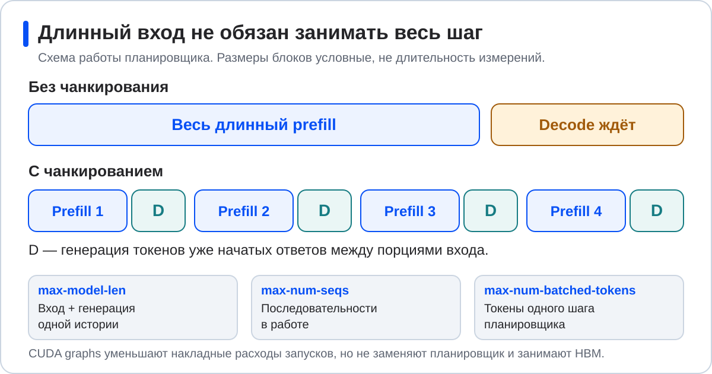
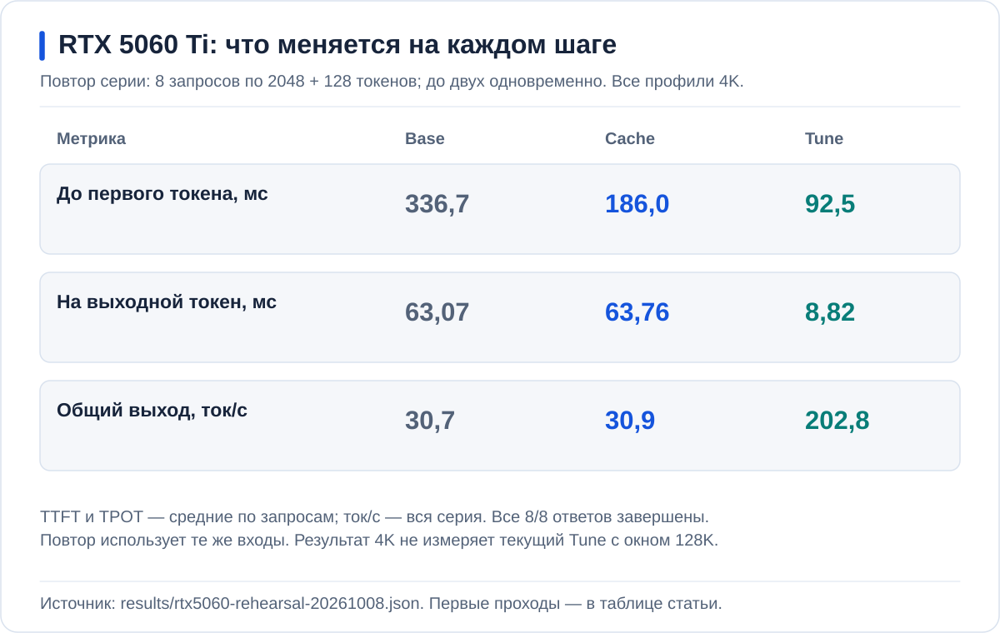
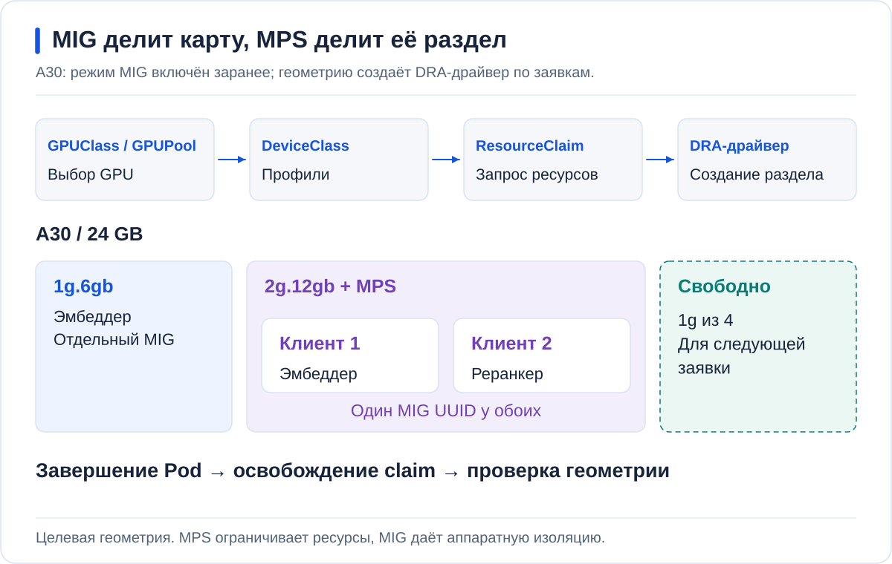
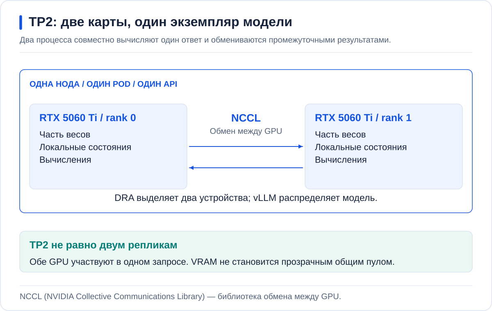
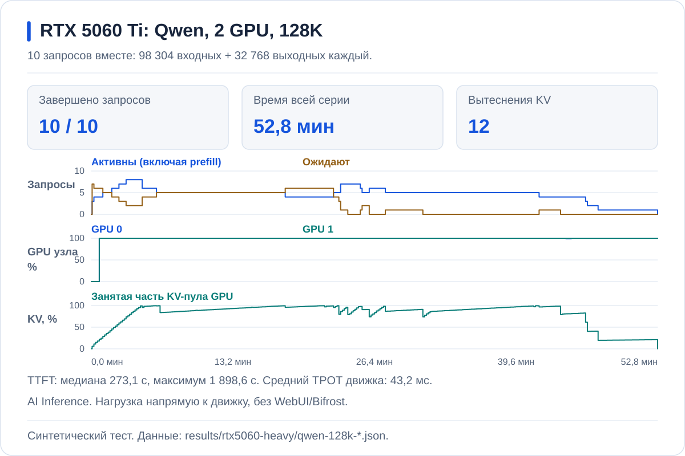

<p align="center">
  <a href="https://github.com/aleksandr-podmoskovniy/hardfest-gpu-workshop">
    
  </a>
</p>

# Инференс без простоя GPU: чиним LLM-сервис руками и делим карту на живом кластере

Александр Подмосковный, Флант / Deckhouse Platform

**Стенд: две RTX 5060 Ti по 16 GiB, Gemma E2B и Qwen3.5-9B; отдельная A30.**

[H100](README.md) | [RTX 5060 Ti](RTX5060.md) | [RTX PRO 6000](RTXPRO6000.md)

<a id="contents"></a>
## Содержание

На двух картах по 16 GiB сравниваются три настройки Gemma.
Затем на отдельной A30 разбирается размещение небольших моделей.
После A30 платформа запускает Qwen на обеих RTX.

1. [Модель под нагрузкой](#ab)
2. [Память: сколько места нужно контексту](#memory)
3. [Вычисления: prefill и decode](#speculation)
4. [Размещение: несколько моделей на одной GPU](#placement)
5. [AI Inference: Qwen на двух GPU](#platform)
6. [Когда нужны дополнительные GPU](#conclusion)
7. [Доступ пользователей и учёт запросов](#topology)

До начала нужны работающая Gemma A, чат и метрики — [подготовка стенда](docs/SETUP.md#rtx).

---

<a id="ab"></a>
## 1. Модель под нагрузкой

**Gemma A — Base** уже работает на первой RTX; вторая свободна. После
регистрации и одобрения аккаунта она доступна в [Open WebUI](https://ai.ap4y.ru).

Обработка запроса моделью называется **инференсом**. Модель получает входной
текст и генерирует ответ по токенам — частям слов и знакам. Успешный ответ
одному пользователю ещё не показывает, как сервис справляется с нагрузкой.

Base допускает две активные последовательности: из восьми одновременных
запросов часть остаётся в очереди. Для сравнения профилей используется
отдельная серия: **восемь запросов, не более двух одновременно**.

<a id="monitoring"></a>
### Что видно в метриках

На дашборде **AI Inference / Service performance** выбираются проект
`hardfest-rtx`, Service `rtx-gemma-base` и интервал нагрузки.
**Running / Waiting** показывают число выполняющихся и ожидающих запросов.
Чтобы понять причину очереди, нужны ещё загрузка вычислений
**GPU utilization** и занятая память.

Веса и кеш могут занимать почти всю VRAM при невысокой загрузке вычислений.
Возможна и обратная ситуация: память свободна, но вычислительные блоки
уже заняты обработкой запросов.

| Область настройки | Какую проблему она решает |
| --- | --- |
| Память | Длинные истории занимают KV-кеш; одинаковые начала запросов обрабатываются повторно |
| Вычисления | Обработка длинного входа и генерация ответа задерживают соседние запросы |
| Размещение на GPU | Небольшой сервис занимает целую карту, а большой не помещается в одну |

Далее изменения разбираются в этом порядке. CPU, сеть и шлюз тоже влияют
на задержку; метрики GPU не описывают весь путь запроса.

### Что находится за чатом



**Open WebUI** отправляет сообщения в **Bifrost**, который проверяет доступ
и направляет запрос нужной модели. Вычисления выполняет сервер **vLLM**.

Gemma A и её настроенный вариант B используют по одной RTX 5060 Ti.
Позже Qwen займёт обе карты. Поиск по документам и распознавание речи
обслуживают отдельные модели на A30, поэтому они не занимают память RTX.

[Полная схема стенда](docs/SETUP.md) и [подготовка RTX](docs/SETUP.md#rtx).

### Нагрузка для сравнения настроек

Base, Cache и Tune получают одинаковую короткую нагрузку:
**8 запросов, вход 2048, выход 128 токенов, параллельность 2**.
Она измеряет задержку и скорость; длинный контекст проверяется отдельно.
128 выходных токенов — условие замера, не ограничение чата.

> [!IMPORTANT]
> Base и Cache — контрольные профили с окном 4K, не рекомендуемые настройки
> для работы с длинным контекстом. Отключение chunked prefill у Gemma E2B
> официально не поддерживается. В Tune этот механизм
> включён; окно составляет 128K, одновременно активны не более двух последовательностей.

<details>
<summary>Профиль Base и воспроизводимая нагрузка</summary>

[Base](values/rtx/gemma-base.yaml) развёрнута через Helm на vLLM 0.31.
В этом контрольном профиле отключены prefix cache, RAM-offload, CUDA graphs,
chunked prefill и speculative decoding. Их назначение и влияние разбираются
далее. Значения `GPU_CONTEXT`, `RTX_DIR`, `NS=hardfest-rtx` заданы
при [подготовке](docs/SETUP.md#rtx).

```bash
export SERVICE=rtx-gemma-base SERIES=base-4k-1
# B1: export SERVICE=rtx-gemma-cache SERIES=cache-4k-1
# B2: export SERVICE=rtx-gemma-tune SERIES=tune-128k-short-1
mkdir -p results/rtx
set -o pipefail
kubectl --context "$GPU_CONTEXT" -n "$NS" exec "deployment/$SERVICE" -c vllm -- \
  vllm bench serve --backend vllm \
    --base-url "http://$SERVICE.$NS.svc.cluster.local:8000" \
    --endpoint /v1/completions --model "$SERVICE" \
    --tokenizer /data/modelcache/models/rtx-gemma-e2b \
    --dataset-name random --seed 42 \
    --random-input-len 2048 --random-output-len 128 --random-range-ratio 0 \
    --num-prompts 8 --max-concurrency 2 --ignore-eos --temperature 0 \
    --ready-check-timeout-sec 0 --num-warmups 0 \
    --save-result --result-dir /dev --result-filename stdout \
  | tee "results/rtx/$SERIES.txt"
```

Успешная серия содержит completed=8, failed=0, 16384 входных и 1024 выходных
токена. Первый проход и повтор сохраняются раздельно: повтор может использовать кеш.

Для опыта с очередью меняются только `--max-concurrency 8` и
`SERIES=base-queue-8`: восемь клиентов обращаются к серверу с лимитом
в две активные последовательности. Для сравнения A/B используется
параллельность 2 без фоновой нагрузки. Клиент внутри Pod делит CPU
с движком, поэтому на всех профилях он запускается одним способом.

</details>

---

<a id="memory"></a>
## 2. Память: сколько места нужно контексту

Длинный разговор требует больше памяти не из-за увеличения самой модели,
а из-за данных, которые она сохраняет для текущей истории.

### Веса модели и кеш истории

**Веса** — параметры, полученные при обучении. Одна загруженная копия
обслуживает все запросы и не растёт вместе с диалогом.

**KV cache (Key–Value cache)** хранит ключи и значения уже обработанных
токенов. Они нужны механизму внимания, чтобы новый токен учитывал предыдущий
текст. Без кеша эти данные пришлось бы вычислять заново при каждом продолжении.

```text
Память GPU ≈ веса + KV-кеш + рабочие буферы
Веса ≈ число параметров × байт на параметр
```

Каждая независимая история требует своего KV, но не копии весов.
Вместимость зависит и от длины контекста, и от числа активных запросов.

<a id="kv-formula"></a>
### Общая формула KV-кеша

Для одинаковых слоёв с **full attention**, которые хранят собственные K/V
одинаковой размерности, и независимых историй одинаковой длины:

```math
\LARGE \boxed{\begin{gathered}
KV = 2\times b\times L \\
{}\times H_{kv}\times D\times S\times N
\end{gathered}}
```

| Множитель | Что означает |
| --- | --- |
| **2** | Два массива: ключи **K** и значения **V** |
| **b** | Байт на элемент: **2 для BF16**, **1 для FP8** |
| **L** | Число слоёв с собственным KV-кешем |
| **Hkv** | Число KV-голов в слое — не число query-голов |
| **D** | Размерность одной KV-головы |
| **S** | Токены одной истории: вход и уже созданная часть ответа |
| **N** | Число независимых историй |

Результат — **байты K/V-данных**. Для GiB делим на `1024³`.
Веса, рабочие буферы и округление блоков сюда не входят.
Это объём для всей копии модели, до распределения между GPU.

### Почему KV зависит от архитектуры

**Attention**, или механизм внимания, связывает токен с контекстом.
Но не все модели хранят всю историю в каждом слое:

- **Full attention** использует всю доступную историю; его KV растёт с её длиной.
- **Sliding-window attention** использует последнее окно токенов; старые данные за его пределами не нужны этому слою.
- Часть слоёв Gemma E2B переиспользует KV других слоёв, не создавая отдельную копию.

В E2B применяем общую формулу **отдельно к полной и локальной группам**,
затем складываем результаты. Для full attention длина истории — `S`,
для локальных слоёв — `min(S, w)`, где `w` — размер локального окна.
Слои, которые переиспользуют чужой KV, второй раз не считаем.



Для истории длиной `S ≥ 512` полезный KV основной E2B сводится к формуле:

```math
\Large KV_{\mathrm{BF16}}(S)=6\,\mathrm{KiB}\times S+6\,\mathrm{MiB}
```

**BF16** хранит элемент в двух байтах, **FP8** — в одном. Переход на FP8
вдвое уменьшает этот объём. В формуле `S` включает вход и ответ:
при окне 128K можно отвести **96K входу и 32K ответу**. Системные сообщения
и шаблон чата также входят во вход.



Одна полная история 128K требует **774 MiB в BF16 или 387 MiB в FP8**
для KV основной модели. Десять независимых историй потребовали бы
**7740 MiB в BF16 или 3870 MiB в FP8**. Это расчёт полезных данных,
а не обещание вместимости. Веса, assistant и рабочие буферы занимают память
отдельно; число одновременно активных запросов проверяем под нагрузкой.

**128K — максимум закреплённой E2B.** Если запросы используют общий префикс
и движок переиспользует его блоки, этот префикс не нужно считать десять раз.

<details>
<summary>Полный расчёт KV: слои, размерности и проверка чисел</summary>

В attention запрос Q сравнивается с ключами K. Результат определяет,
как смешиваются значения V. Для следующих токенов сохраняются K/V, а не Q.
В GQA (Grouped-Query Attention) несколько голов запросов используют общие
KV-головы; в расчёте памяти нужны именно число и размерность KV-голов.

В [общей формуле](#kv-formula) при разной длине историй
вместо `S × N` используется сумма их длин.
В [закреплённой E2B](https://huggingface.co/google/gemma-4-E2B-it/blob/3e22461f65e89153144f8adb70e3b8c2cc9845a7/config.json)
35 слоёв, из которых последние 20 переиспользуют KV. У оставшихся 15 слоёв
по одной KV-голове, но разная размерность и длина хранимой истории:

| Тип | Слоёв | Размерность | Хранимая длина |
| --- | ---: | ---: | --- |
| Full attention | 3 | 512 | `S` |
| Sliding attention | 12 | 256 | `min(S,512)` |

Для одной истории подставляем параметры двух групп слоёв:

```math
\Large KV(S)=2b\left[3\times512\times S+12\times256\times\min(S,512)\right]
```

При 128K и BF16 полная часть занимает 768 MiB, локальная — 6 MiB.
FP8 уменьшает обе части вдвое.

| История | Одна: BF16 / FP8 | Десять: BF16 / FP8 |
| --- | ---: | ---: |
| 64K | 390 / 195 MiB | 3900 / 1950 MiB |
| 128K | 774 / 387 MiB | 7740 / 3870 MiB |

```bash
awk -v S=131072 -v N=10 -v b=2 'BEGIN {
  W = S < 512 ? S : 512
  full = 2*b*3*1*512*S / 1048576
  local = 2*b*12*1*256*W / 1048576
  printf "Full %.0f + sliding %.0f = %.0f MiB/history; %d histories = %.0f MiB\n", full, local, full+local, N, N*(full+local)
}'
```

Переиспользование KV между слоями задано архитектурой. Общий префикс
между запросами — отдельная оптимизация сервера, разобранная ниже.

Расчёт не включает вспомогательную модель assistant, рабочие буферы и
округление до блоков. После их размещения движок определяет доступный
KV-пул. Его фактическая ёмкость видна в логах, а занятость — в метриках:
[сверка расчёта с runtime](docs/MEMORY_BUDGET.md#verify-kv).

</details>

<a id="ram"></a>
### Переиспользование префикса и хранение KV в RAM

Несколько вопросов к одному документу часто начинаются одинаково:
системная инструкция, текст документа и только затем вопрос.
**Prefix caching** позволяет повторно использовать KV этого общего начала.
Ответ при этом генерируется заново — кеш хранит результаты вычислений,
а не готовые ответы.

На GPU такой кеш может быть вытеснен следующими запросами.
**KV-offload** сохраняет блоки в RAM и возвращает их на GPU при повторном
обращении. Это позволяет сохранить больше пригодных для повторного
использования данных, но добавляет время на передачу между RAM и GPU.
**RAM не становится дополнительной VRAM для выполнения attention.**



Для проверки этих изменений на второй RTX запускается
[Gemma B — Cache](values/rtx/gemma-cache.yaml). В её профиле включены
prefix cache, FP8 KV и 4 GiB RAM для хранения кеша; окно пока остаётся 4K.
Base продолжает работать на первой карте, поэтому RAM узла должно хватать
на оба экземпляра.

<details>
<summary>Включение отдельного приложения Cache</summary>

В разделе **Проект / Контейнеризация / Deployments** у `rtx-gemma-cache`
задаётся `spec.replicas: 1`. После готовности и ответа API проверяется
заранее подготовленный маршрут `Gemma B — Cache` в WebUI.

Application заранее синхронизирован с 0 реплик, autosync OFF и исключением
`/spec/replicas` из сравнения и Sync: [подготовка](docs/SETUP.md#rtx).

</details>

Проверка общего префикса использует два новых чата и документ
[«Пятничный релиз пиццерии»](examples/pizza-incident.md).
В первом вопрос — **«Почему появились ошибки оплаты? Подтверди вывод
журналом, метриками и логами».** Во втором — **«Таймаут вернули.
Можно ли всем с ошибкой 502 предложить оплатить ещё раз?»**

В обоих случаях полный текст стоит перед вопросом, без вложений и поиска
по базе знаний. Перед опытом проверяется, что документ, оформление чата
и запас на ответ помещаются в фактические 4K Base/Cache.
Это короткий опыт с общим префиксом, не тест полного окна 128K.

**TTFT**, время до первого токена, показывает, насколько раньше начался
ответ. Попадания в prefix cache связывают это изменение с кешированием входа.

Отдельный опыт проверяет offload: другие запросы вытесняют исходный префикс
из GPU, после чего исходный запрос повторяется. Передача из CPU в GPU
(`CPU_to_GPU`) и external-prefix hits подтверждают возврат кеша.
Одна лишь запись из GPU в CPU этого не доказывает.
[Порядок проверки](docs/MEASUREMENTS.md#offload-replay) приведён отдельно
от нагрузочного сравнения, чтобы эти запросы не влияли на его результат.

### Кеш сократил ожидание первого токена

В повторе одинаковой серии **8 × (2048 входных + 128 выходных)**, по два запроса
одновременно, средний TTFT уменьшился с **336,71 до 185,95 мс**.
При этом общая скорость выдачи токенов почти не изменилась:
**30,67 ток/с у Base и 30,90 ток/с у Cache**.

Ответ начался раньше, но продолжение осталось таким же медленным:
новые токены всё равно нужно вычислять.
Полная таблица, включая первые проходы, приведена
[после включения Tune](#tuning-results).

---

<a id="speculation"></a>
## 3. Вычисления: prefill и decode

Обработка нового входа и генерация ответа устроены по-разному.
Настройки должны учитывать обе части работы.

<a id="latency"></a>
### Prefill и decode

**Prefill** — обработка входных токенов и построение их KV-кеша.
На этой стадии многие токены обрабатываются параллельно.

**Decode** — генерация продолжения. Каждый следующий шаг зависит от
предыдущего, поэтому ответ обычно формируется последовательно.
Рассуждение модели, reasoning, тоже относится к decode и расходует
выходные токены, даже если не показывается как текст ответа.

```text
Tответа ≈ Tочереди + Tprefill + Tdecode + Tпрочее
```

Длинный prefill может надолго занять GPU и задержать ответы соседних
запросов — даже когда всем хватает памяти.

### Обработка входа по частям

**Chunked prefill** делит вход на порции — chunks. Планировщик vLLM может
чередовать их обработку с decode уже начатых ответов. Вход не укорачивается
и не превращается в несколько независимых запросов: меняется порядок
исполнения работы на GPU.



Для проверки нужен не только поток одинаковых запросов. Следом за длинным
входом отправляется короткий; эта пара повторяется сначала на Cache,
затем на Tune. Так видно, сколько короткий запрос ждал обработки соседа.

Меньшие порции дают чаще возвращаться к decode, но требуют больше шагов
для обработки входа. Поэтому сравниваются оба запроса: TTFT и **ITL** —
интервалы между выходными токенами.

### Генерация с помощью draft-модели

Во время **speculative decoding** небольшая draft-модель предлагает
продолжение, а основная target-модель проверяет его за свой проход.
Подходящие токены принимаются; после первого отклонённого предложения
продолжение корректируется. Цель — получать больше принятых токенов
за дорогой проход основной модели.

У Gemma для этого нужен совместимый **assistant**: произвольная маленькая
модель не заменяет его. В данном рецепте используется MTP
(Multi-Token Prediction) с одним предлагаемым токеном.

Draft тоже требует памяти и вычислений. Доля принятых токенов полезна
для диагностики, но ускорение подтверждают время ответа и скорость генерации.

### Полный профиль Tune

[Tune](values/rtx/gemma-spec.yaml) сохраняет настройки кеша и добавляет
chunked prefill, assistant и **CUDA graphs**. Последний механизм позволяет
повторно запускать записанную последовательность операций GPU с меньшими
накладными расходами на их подготовку.

У Tune окно составляет **128K**, целевой лимит ответа в чате — **32K**.
Под вход остаётся **96K**, включая системный текст и шаблон.

**Сначала Cache завершает запросы и освобождает GPU, затем запускается
отдельное приложение Tune.** Base остаётся на первой карте для сравнения;
два варианта B одновременно не работают.

<details>
<summary>Переключение приложений и параметры Tune</summary>

До остановки Cache выполняется смешанная серия: **запрос на 3072 входных
токена и через 50 мс запрос на 128 токенов; выход обоих — 128**.
Та же пара затем повторяется на Tune.
[Клиент vLLM с расписанием запросов](docs/MEASUREMENTS.md#mixed-prefill)
сохраняет фактические времена. Они позволяют проверить перекрытие запросов:
одной назначенной задержки для такого вывода недостаточно.

| Deployment в Console | Готовый профиль | Изменение |
| --- | --- | --- |
| `rtx-gemma-cache` | `values/gemma-cache.yaml` | `spec.replicas: 0` |
| После освобождения GPU: `rtx-gemma-tune` | `values/gemma-spec.yaml` | `spec.replicas: 1` |

Оба приложения подготовлены заранее. Tune — полный профиль,
не дополнительный values поверх Cache. При переключении меняются только реплики.

```yaml
# Параметры готового Tune, не дополнительное расширение окна.
vllm:
  max-model-len: 131072
  gpu-memory-utilization: 0.95
  max-num-seqs: 2
  enable-chunked-prefill: true
  max-num-batched-tokens: 512
```

В профиле также заданы FP8 KV, 4 GiB RAM KV и CUDA graphs capture size 4.
Доля `0.95` выделяет движку больше памяти GPU; фактическая ёмкость KV
после размещения весов и буферов проверяется по логам. Бюджет шага 512
ограничивает размер порции обработки, а не длину входного запроса.

До остановки Cache его маршрут скрывается от новых запросов.
Когда Tune готова и API отвечает, включается `Gemma B — Tune`:
Service `rtx-gemma-tune:8000`, served model `rtx-gemma-tune`.
Личный ключ пользователя менять не требуется.

Первый запуск включает компиляцию. NodeCache хранит веса, но не заменяет
этот этап и не хранит его временные результаты.

</details>

После переключения повторяются короткая и смешанная серии. Сравнение
показывает эффект всего профиля, а не одной speculative decoding.

<a id="tuning-results"></a>
### Задержка и скорость после настройки

**Тяжёлая серия — десять клиентов с полным окном 128K и по 32K фактического
выхода — пока не подтверждена опубликованными результатами.**
Ни короткий прогон, ни успешный одиночный запрос не заменяют её.
[Методика, пределы карты и критерии результата](docs/MEASUREMENTS.md#heavy-load).

<details>
<summary>Отдельная диагностика: короткая серия Base, Cache и Tune</summary>

Ниже — контролируемое сравнение **Base, Cache и Tune при одинаковом окне 4K**:
одна карта на модель, 8 запросов, по два одновременно, вход 2048 и выход 128.
Это короткий тест настроек, **не проверка полного окна**.
Текущий Tune выше запускается сразу с 128K; его длинный вход проверяется отдельно.



**TPOT** — среднее время на выходной токен после первого. Чем оно меньше,
тем быстрее продолжается ответ. Выходные **ток/с** на графике показывают
производительность всей серии, а не скорость одного пользователя.

На повторе Base выдала **30,67 ток/с**, Tune — **202,83 ток/с**.
При этом средний TPOT уменьшился с **63,07 до 8,82 мс**. Настройка помогла
не только раньше начать ответ, но и быстрее его продолжить.

<!-- result:rtx-stages -->
| Профиль / проход | TTFT, мс | TPOT, мс | Выход, ток/с | Вся серия, с |
| --- | ---: | ---: | ---: | ---: |
| Base — первый | 1 345,39 | 70,40 | 24,88 | 41,15 |
| Base — повтор | 336,71 | 63,07 | 30,67 | 33,39 |
| Cache — первый | 1 342,64 | 74,32 | 23,74 | 43,13 |
| Cache — повтор | 185,95 | 63,76 | 30,90 | 33,13 |
| Tune — первый | 563,23 | 9,43 | 139,38 | 7,35 |
| Tune — повтор | 92,45 | 8,82 | 202,83 | 5,05 |
<!-- /result:rtx-stages -->

TTFT и TPOT — средние, не p95. В каждой строке **8/8** запросов завершились
без ошибок, ровно **16 384 входных / 1024 выходных токена**.
Клиент — `vllm bench serve` внутри Pod, напрямую в runtime; серии последовательные.

Перед первым проходом кеш не очищался и были контрольные запросы,
поэтому это не измерение полностью холодного запуска. Повтор использовал
те же входы и seed 42.
У всех трёх профилей окно **4096**, `gpu-memory-utilization=0.90`;
нынешний Tune 128K использует `0.95`.
[Исходные результаты и конфигурации](results/rtx5060-rehearsal-20261008.json).

</details>

<a id="long-context"></a>
### Проверка полного окна 128K

**Вход, шаблон и лимит ответа вместе должны помещаться в окно Tune 128K.**
У короткой нагрузочной серии другая задача: её результат не показывает,
как быстро модель обработает почти заполненное окно. Для этого нужна
отдельная проверка. Base с лимитом 4K такой запрос отклонит ещё до
вычислений; этот отказ не свидетельствует о нехватке VRAM.

Здесь нужны два разных опыта:

- Синтетическая серия проверяет, что сервер обрабатывает заданный вход
  и генерирует все 32K выходных токенов без перезапуска.
- Учебный документ с контрольным фактом в середине проверяет, что модель
  использует переданное содержание. Документ отправляется целиком
  сообщением, а не как вложение для поиска отдельных фрагментов.

В журнале проверяется фактическая длина входа, а в ответе — контрольный факт
и его источник. Так можно отличить работу с полным документом от ответа
по нескольким извлечённым фрагментам.

<details>
<summary>Полное окно 128K с выходом 32K и контрольный факт</summary>

**Нагрузочный клиент работает на отдельной CPU-ноде.** Команда ниже выполняется
в подготовленном CPU Pod `BENCH_POD`, где установлены vLLM 0.31 и токенизатор
Gemma той же версии, что на сервере. Путь к локальному токенизатору задаётся
в `BENCH_TOKENIZER`. Запуск клиента внутри GPU runtime исказил бы сравнение.
В качестве основы подходит [CPU Job](examples/gemma-benchmark-job.yaml):
только manual target, 10 запросов, concurrency 10, вход 98304, выход 32768
и дедлайн не меньше 43200 секунд. Первый проход и повтор сохраняются отдельно.
Job выполняет серию сам. Команда `exec` ниже — альтернатива для уже подготовленного
свободного CPU-клиента, а не второй запуск параллельно с Job.

```bash
export INPUT_TOKENS=98304 OUTPUT_TOKENS=32768
export RUN_NAME=gemma-128k-output-32k
: "${BENCH_POD:?Укажите отдельный CPU Pod клиента}"
: "${BENCH_TOKENIZER:?Путь к токенизатору Gemma в CPU Pod}"
mkdir -p results/rtx
set -o pipefail
kubectl --context "$GPU_CONTEXT" -n "$NS" exec "$BENCH_POD" -- \
  vllm bench serve --backend vllm \
    --base-url "http://rtx-gemma-tune.$NS.svc.cluster.local:8000" \
    --endpoint /v1/completions --model rtx-gemma-tune \
    --tokenizer "$BENCH_TOKENIZER" \
    --dataset-name random --seed 73 \
    --random-input-len "$INPUT_TOKENS" --random-output-len "$OUTPUT_TOKENS" --random-range-ratio 0 \
    --num-prompts 10 --max-concurrency 10 --request-rate inf --random-prefix-len 0 \
    --ignore-eos --temperature 0 \
    --ready-check-timeout-sec 0 --num-warmups 0 \
    --save-result --save-detailed --result-dir /dev --result-filename stdout \
  | tee "results/rtx/$RUN_NAME.txt"
```

Сумма входа и выхода на запрос — **131072**. Успешное завершение серии:
completed=10, failed=0, у каждого 98304 входных и 32768 выходных токенов;
суммарно — **983040 / 327680**, без перезапусков.
Фактическая параллельность измеряется отдельно:
текущий лимит `max-num-seqs` может не разрешать десять активных запросов.
Его повышение требует проверки памяти, а не только правки числа в команде.
`--ignore-eos` принудительно проверяет длину; для проверки содержания
используется отдельный документ:

```bash
mkdir -p results/rtx
awk 'BEGIN {
  for (i=0; i<4681; i++) {
    if (i==2340)
      printf "SPECIAL RECORD: The secret verification phrase for project Orion is COPPER-ORCHID-742. "
    else
      printf "Record %d: This routine report describes a successful scheduled health check. There are no special instructions in this record. ", i
  }
  printf "Question: What is the exact verification phrase for project Orion? Reply with only the phrase."
}' > results/rtx/long-context.txt
```

В чат передаётся весь текст файла, не вложение для поиска фрагментов.
В журнале проверяется фактическая длина; ожидается `COPPER-ORCHID-742`.
Для этой фразы достаточно `max_tokens: 128`; это не ограничение обычного чата.
На время проверки фоновые задачи создания заголовков, тегов и подсказок
выключены: иначе они могут повторно отправлять длинный вход и менять нагрузку.

</details>

Другие способы оптимизации — **cache-aware routing**, направление запроса
на экземпляр с подходящим кешем, и **prefill/decode disaggregation**,
раздельное размещение обработки входа и генерации. Они в этом стенде
не включены; [описания и примеры](docs/SOURCES.md#за-пределами-этого-стенда)
оставлены для самостоятельного изучения.

---

<a id="placement"></a>
## 4. Размещение: несколько моделей на одной GPU

Поиск по документам и распознавание речи требуют отдельных моделей,
но каждой из них не обязательно выделять целую карту. На A30 можно
разобрать два вопроса: как разделить ресурсы GPU и как выдать их Pod
через Kubernetes.

### Device Plugin и DRA

**Device Plugin** публикует целочисленные ресурсы, например
`nvidia.com/gpu: 1`. В Pod задаётся количество ресурса, но такая заявка
сама по себе не описывает выбор устройства по произвольным атрибутам.
Реализации device plugin могут поддерживать MIG и совместное использование;
ограничение не в полном отсутствии этих возможностей, а в способе
их описания и согласования с потребностями приложения.

**DRA (Dynamic Resource Allocation)** отделяет заявку ResourceClaim от Pod.
Она описывает необходимое устройство, а класс DeviceClass и атрибуты
позволяют выбрать подходящий ресурс и передать настройки драйверу.
Так потребность приложения выражается объектом Kubernetes,
а не только числом `gpu: 1`.

[Авторский разбор](https://habr.com/ru/companies/flant/articles/1020276/) и
[документация Kubernetes](https://kubernetes.io/docs/concepts/resource-management/dynamic-resource-allocation/)
подробнее объясняют различия этих подходов.

### Как MIG и MPS разделяют карту

DRA отвечает за заявку и выделение устройства. Способ разделения самой
GPU зависит от оборудования и драйвера. В этом стенде используются два
механизма, которые решают разные задачи:

| Механизм | Что разделяет |
| --- | --- |
| MIG — Multi-Instance GPU | Аппаратные части с выделенной долей памяти и вычислений |
| MPS — Multi-Process Service | Совместное выполнение нескольких процессов без создания новой аппаратной границы памяти |



На A30 эмбеддер и реранкер делят одну MIG-часть через MPS,
а распознавание речи занимает другую. Это три разных сервиса:

| Модель | Работа | Размещение |
| --- | --- | --- |
| Qwen3 Embedding 4B W4A16 | Преобразует текст в векторы для поиска близких по смыслу фрагментов | Первая MIG-часть, MPS |
| Qwen3 Reranker 4B W4A16 | Сравнивает найденные фрагменты с вопросом и уточняет их порядок | Та же часть, MPS |
| Whisper large-v3 | Преобразование речи в текст | Вторая MIG-часть |

W4A16 означает 4-битные веса и 16-битные активации.
Размещение проверяется по MIG UUID — идентификатору части карты:
у эмбеддера и реранкера он совпадает, у Whisper отличается.

**DRA сам не нарезает любую карту: нужны поддержка оборудования и драйвера.**
MIG mode включён заранее. Здесь проверяется подготовленное размещение;
режим карты и чужие workloads не меняются. Динамическое создание частей
можно утверждать только по сравнению состояния до и после выделения ресурса.

<details>
<summary>Проверка частей карты и первоначальное создание сервисов</summary>

На узле A30 выполняются только читающие команды:

```bash
nvidia-smi -L
nvidia-smi mig -lgi
nvidia-smi mig -lci
```

[Проверка заявок и процессов](docs/TROUBLESHOOTING.md#a30-claims)
сопоставляет модели, UUID и MPS. Для неё используются консоль и источник
метрик кластера A30, не RTX. Порядок [создания заказов](#a30-orders)
приведён после объяснения автоматизации. Сравнение до и после их применения
позволяет отличить новое выделение частей от использования уже готовых.

</details>

### Проверка поиска по документу и распознавания речи

**RAG (Retrieval-Augmented Generation)** добавляет к вопросу найденные
фрагменты документов. Эмбеддер помогает найти подходящий текст,
реранкер уточняет выбор, а языковая модель составляет ответ по переданному
контексту. Это не тот же опыт, что передача полного длинного документа:
здесь модель получает только отобранные фрагменты.

В новом чате через `#` выбирается база **«Пятничный релиз пиццерии»**.
Вопрос «Во сколько сократили таймаут, когда вернули его назад и как изменилась
доля 502?» требует журнала изменений и метрик. В ответе нужны ссылки на оба
документа. На вопрос «Какой курьер повёз P-402?» данных нет: правдоподобное
имя не будет правильным ответом.
[Другие базы и вопросы](docs/CHAT_AND_ACCESS.md#что-спросить-у-базы-знаний).

В тот же чат можно прикрепить [дополнение по заказу P-402](examples/pizza-order-update.docx).
Теперь ответ должен учитывать новый факт — кухню в 18:24 — вместе с данными
об оплате из базы. Имя курьера всё ещё неизвестно.

Подтверждение работы — точный ответ со ссылкой на источник и обращения
к эмбеддеру и реранкеру в метриках или логах. Тот же вопрос голосом
дополнительно проверяет Whisper: сначала аудио должно превратиться в текст,
и только затем попасть к языковой модели.

---

<a id="platform"></a>
## 5. AI Inference: Qwen на двух GPU

На Gemma мы разобрали настройку одной модели, на A30 — размещение нескольких
небольших сервисов. При смене модели снова понадобятся расчёт памяти,
подбор параметров движка и выбор GPU. Эту работу можно автоматизировать.

**AI Inference** получает модель и требования к её работе в объекте
**InferenceService**. Планировщик сопоставляет их с доступным оборудованием
и **рецептами** — совместимыми конфигурациями движка — и составляет план запуска.
Он не создаёт отсутствующую память и не заменяет проверку производительности.

Следующая задача — запустить Qwen на двух картах. Модель и веса берутся
из каталога **ai-models**, а сервис создаётся в Deckhouse Console.
Argo CD не должен одновременно управлять тем же InferenceService.

<a id="tp2"></a>
### Почему одной модели нужны две карты

Для Qwen3.5-9B потребуются обе RTX. Её языковые веса вместе с MTP
занимают около **17,13 GiB**, тогда
как одна RTX предоставляет около **15,93 GiB**. Память для KV-кеша
и рабочих буферов нужна сверх этого объёма.

**Tensor parallelism** распределяет вычисления и параметры одной модели
между GPU. Значение **TP2** означает две карты. Это не две независимые
реплики: один запрос использует обе GPU, которые обмениваются промежуточными
результатами.



У Qwen MTP входит в основной checkpoint; отдельный assistant не нужен.
Рецепт использует один предлагаемый токен, **окно 128K, до восьми активных
последовательностей, FP8 KV и 16 GiB RAM-offload**. Лимит последовательностей
не означает, что памяти хватит на восемь одновременно заполненных окон.

До остановки Gemma должны быть готовы Model `rtx-qwen35-9b`, доставка весов
и рецепт TP2/MTP с окном 128K. После завершения текущих запросов обе GPU
освобождаются: все ручные Gemma переводятся в **0 реплик**.
Платформенную Gemma удаляют только если выполнялось необязательное сравнение:
сохраняют YAML, затем удаляют её InferenceService. **Models, PVC и данные сохраняются.**

### Создать Qwen в Console

Имя сервиса — тот же маршрут уже предусмотрен в шлюзе:

```text
rtx-qwen35-tp2
```

| Поле формы | Значение |
| --- | --- |
| Проект | `hardfest-rtx` |
| Модель из каталога | `rtx-qwen35-9b` |
| Класс сервиса | `hardfest-rtx-qwen35` |
| Стратегия | **`Throughput`** |
| Класс устройства | `hardfest-rtx` |

[Готовый YAML Qwen](platform/rtx5060/qwen.yaml) вставляется целиком, без изменений:
проект `hardfest-rtx` → **AI-модели → Сервисы инференса → Создать** → редактор →
**Применить**. Все поля из таблицы уже заполнены, выбирать их заново не нужно.
До создания проверяется рецепт, после — выбранный план: **TP2, окно 131072, FP8 KV,
RAM-offload 16 GiB и до восьми активных последовательностей**.
`Latency` выбирает другой профиль; имя сервиса само по себе не задаёт эти параметры.

<details>
<summary>Остановка Gemma и запуск Qwen через AI Inference</summary>

У всех ручных Gemma — Base, Cache и Tune — задаётся `spec.replicas: 0`
в Console. Если платформенная Gemma не создавалась, удалять её заказ не нужно.
Если создавалась, сохраняется YAML и удаляется только её InferenceService:
остановку дочернего workload контроллер может отменить.

После освобождения двух GPU создаётся **`rtx-qwen35-tp2`**:
Model `rtx-qwen35-9b`, стратегия `Throughput`, класс `hardfest-rtx-qwen35`.
[Готовый заказ](platform/rtx5060/qwen.yaml).
В плане, ResourceClaim и Pod проверяются две GPU,
`tensor-parallel-size: 2` и окно 131072.
Параметры задаёт рецепт; дочерний StatefulSet вручную не меняется.

Когда API отвечает, в WebUI открывается доступ к карточке Qwen 9B для RTX 5060 Ti
**и её базовой модели**: Service `rtx-qwen35-tp2:80`, модель `rtx-qwen35-9b`.
[Какие два элемента переключать](docs/CHAT_AND_ACCESS.md#открыть-или-закрыть-модель-участникам).

### Проверка ответа Qwen

В отдельном терминале открывается порт сервиса:

```bash
kubectl --context "$GPU_CONTEXT" -n hardfest-rtx get service rtx-qwen35-tp2
kubectl --context "$GPU_CONTEXT" -n hardfest-rtx port-forward svc/rtx-qwen35-tp2 18006:80
```

Порт 80 заменяется фактическим, если Service публикует другой.
При политике Token ключ вводится из менеджера секретов в основном терминале.
Для API без Token строка ввода и заголовки авторизации пропускаются;
политика ради теста не меняется.

```bash
set +x
IFS= read -r -s MODEL_API_KEY
curl --fail --max-time 30 \
  --header @<(printf 'Authorization: Bearer %s\n' "$MODEL_API_KEY") \
  http://127.0.0.1:18006/v1/models
```

В следующем запросе `model` должен совпадать с ID из `/v1/models`:

```bash
curl --fail-with-body --max-time 180 \
  --header @<(printf 'Authorization: Bearer %s\n' "$MODEL_API_KEY") \
  -H 'Content-Type: application/json' http://127.0.0.1:18006/v1/chat/completions \
  -d '{"model":"rtx-qwen35-9b","max_tokens":512,"temperature":0,"messages":[{"role":"user","content":"Зачем нужен KV-кеш?"}]}'
unset MODEL_API_KEY
```

512 выходных токенов — короткая проверка ответа, не лимит рабочего чата.
После неё port-forward закрывается. Ключ не сохраняется в Git и не передаётся
в аргументах curl. Затем проверяется законченный ответ в WebUI от участника.

</details>

Если сервис остаётся в **Pending**, причина определяется по Pod и событиям:
ожидание GPU, доставка весов и загрузка образа vLLM — разные этапы.
`ContainerCreating` ещё не означает, что Qwen начала загружать веса на GPU.
После старта сначала проверяется готовность runtime, затем ответ через WebUI.
Наличие карточки в списке моделей не заменяет эти проверки.

<a id="qwen-long-context"></a>
### Память для длинных запросов Qwen

Full-attention KV Qwen с MTP требует **1,125 GiB на GPU для одной истории 128K**.
Десять таких историй — **11,25 GiB на GPU**, без весов и остальных буферов.

**Десять полных историй 128K вместе с весами в этих RTX не помещаются.**
RAM-offload сохраняет пригодный для повторного использования кеш,
но не расширяет рабочую память attention. Поэтому десять одновременно
отправленных запросов могут выполняться с очередью. В замере нужны
и время всей серии, и число действительно активных запросов.

<details>
<summary>Расчёт KV и воспроизводимые длинные серии</summary>

В [закреплённой Qwen](https://huggingface.co/Qwen/Qwen3.5-9B/blob/c202236235762e1c871ad0ccb60c8ee5ba337b9a/config.json)
8 full-attention и 24 linear-attention слоя.
У full — 4 KV-головы размерности 256;
[MTP добавляет ещё один full-слой](https://github.com/vllm-project/vllm/blob/v0.31.0/vllm/model_executor/models/qwen3_5_mtp.py#L111).
TP2 оставляет две головы на GPU.

```text
KV на GPU = 2 × 1 × 9 × (4 / 2) × 256 × S × N байт
```

`S` — вся история, `N` — независимые истории.
Произведение `2 × 1 × 9 × 2 × 256` даёт 9216 байт,
или 9 KiB на токен на GPU.

| История | Одна на GPU | Десять на GPU |
| --- | ---: | ---: |
| 32K | 0,28125 GiB | 2,8125 GiB |
| 128K | 1,125 GiB | 11,25 GiB |
| 256K, только расчёт | 2,25 GiB | 22,5 GiB |

Это только полная attention-часть KV. Состояние linear attention, веса,
рабочие буферы и округление до блоков добавляются отдельно.
Конфигурация модели допускает 262144 позиции, но рецепт этого стенда
ограничен 128K. Строка 256K показывает цену большего окна в памяти,
а не результат запуска с ним.

**Клиент запускается на отдельной CPU-ноде**, не в Pod Qwen.
В [CPU Job](examples/qwen-benchmark-job.yaml) задаются токенизатор
`Qwen/Qwen3.5-9B` с ревизией из ссылки выше, целевой сервис,
10 запросов, concurrency 10, вход 98304, выход 32768 и дедлайн 43200 секунд.
При Token клиенту нужен `OPENAI_API_KEY` из Secret; проверка доступа
не отключается. Ниже `BENCH_POD` — этот CPU Pod,
`BENCH_TOKENIZER` — путь к его локальному токенизатору.
Job уже выполняет свою серию; `exec` ниже используется вместо неё на свободном
CPU-клиенте, а не одновременно с ней.

```bash
export INPUT_TOKENS=98304 OUTPUT_TOKENS=32768 RUN_NAME=qwen-128k-output-32k
: "${BENCH_POD:?Укажите отдельный CPU Pod клиента}"
: "${BENCH_TOKENIZER:?Путь к токенизатору Qwen в CPU Pod}"
mkdir -p results/rtx
set -o pipefail
kubectl --context "$GPU_CONTEXT" -n "$NS" exec "$BENCH_POD" -- \
  vllm bench serve --backend vllm \
    --base-url "http://rtx-qwen35-tp2.$NS.svc.cluster.local" \
    --endpoint /v1/completions --model rtx-qwen35-9b \
    --tokenizer "$BENCH_TOKENIZER" \
    --dataset-name random --seed 73 \
    --random-input-len "$INPUT_TOKENS" --random-output-len "$OUTPUT_TOKENS" --random-range-ratio 0 \
    --num-prompts 10 --max-concurrency 10 --request-rate inf --random-prefix-len 0 \
    --ignore-eos --temperature 0 \
    --ready-check-timeout-sec 0 --num-warmups 0 \
    --save-result --save-detailed --result-dir /dev --result-filename stdout \
  | tee "results/rtx/$RUN_NAME.txt"
```

| Серия | Изменения параметров | Критерии |
| --- | --- | --- |
| Десять полных окон 128K | Параметры команды выше | completed=10, failed=0; каждый 98304 + 32768; всего 983040 + 327680 |
| 256K, отдельный профиль AI Inference | После обновления рецепта и запуска через InferenceService: вход 229376, выход 32768 | completed=10, failed=0; каждый 229376 + 32768; это не результат описанного рецепта 128K |

Running / Waiting показывают, сколько запросов действительно выполнялось
одновременно, а сколько ждало. Рецепт ограничен восемью активными запросами,
поэтому **текущая конфигурация не обеспечивает десять активных сессий**.
Повышение лимита не создаёт VRAM; после проверки бюджета нужен отдельный прогон.
Десять завершённых клиентов с очередью не засчитываются как десять активных историй.
В результатах также сохраняются вытеснения и перезапуски.

</details>

### Что получилось на полном окне

Qwen запустила платформа через **InferenceService со стратегией Throughput**.
Нагрузка шла напрямую в созданный ею движок; путь через WebUI и Bifrost в эти
задержки не входит.

**Qwen завершила 10 из 10 запросов по 98 304 входных + 32 768 выходных токенов.**
Серия заняла **52,8 минуты**. Медиана TTFT — **273,1 секунды**,
максимум — **31,6 минуты**; зафиксированы **12 вытеснений KV**.
Ошибок и перезапусков не было, но для интерактивного чата такое ожидание велико.



Это десять одновременно отправленных запросов, **не десять активных окон**.
Вход синтетический, выход принудительно доведён до 32K; высокая повторяемость
может помогать MTP. Цифры показывают поведение этой конфигурации под такой нагрузкой,
а не типичную скорость ответов пользователю.
[Параметры, все десять ответов и исходные метрики](results/rtx5060-heavy/README.md).

Проверка через WebUI дополняет нагрузочную серию: ответ должен завершиться,
история — сохраниться, а запрос — появиться в шлюзе под личным VK.
Запись KV в RAM и возврат из RAM — разные события: наличие offload в параметрах
ещё не доказывает повторное использование. Для него нужен повтор запроса и
ненулевой перенос CPU → GPU. Принятые draft-токены показывают работу MTP.

<a id="platform-gemma"></a>
<details>
<summary>Необязательное сравнение: та же Gemma через AI Inference</summary>

Это отдельный опыт вместо запуска Qwen или после её остановки. Для него
нужны две GPU: одна для ручной Tune, другая для платформенной Gemma.
Если Qwen уже работает, сначала закрывается доступ к её карточке и базовой
модели в WebUI и завершаются текущие запросы. Затем сохраняется YAML и удаляется
только её InferenceService; после освобождения GPU запускается ручная Tune.
Модели и PVC сохраняются.

Здесь сравнивается одна и та же Gemma с одинаковой нагрузкой, чтобы проверить,
сохранила ли автоматизация характеристики ручной настройки. Для основного
пути с Qwen это сравнение не требуется.

### Платформенная Gemma вместо Base

Для сравнения нужен рецепт Throughput с теми же ключевыми настройками:
vLLM 0.31, **128K, две активные последовательности, FP8 KV, 4 GiB RAM KV
и assistant**. Основные веса и assistant должны быть доставлены заранее,
а RAM — рассчитана на обе Gemma.

Base завершается и освобождает первую GPU для платформенной Gemma.
Ручная Tune остаётся на второй карте. Так можно сравнить два способа
запуска без изменения модели и целевого окна.

Заказ создаётся в Deckhouse Console. **Argo не должен параллельно управлять
тем же объектом**, иначе ручные изменения могут быть перезаписаны.

### Создать платформенную Gemma

Имя сервиса — блок можно скопировать целиком:

```text
rtx-gemma-platform
```

| Поле формы | Значение |
| --- | --- |
| Проект | `hardfest-rtx` |
| Модель из каталога | `rtx-gemma-e2b` |
| Класс сервиса | `hardfest-rtx-gemma` |
| Стратегия | **`Throughput`** |
| Класс устройства | `hardfest-rtx` |

В проекте `hardfest-rtx`: **AI-модели → Сервисы инференса → Создать**.
В редактор вставляется целиком [готовый YAML Gemma](platform/rtx5060/gemma.yaml),
без изменений, затем **Применить**. Все поля из таблицы уже заполнены.
До создания проверяется рецепт, после — выбранный план: **одна GPU, окно 131072, FP8 KV, RAM-offload
4 GiB и assistant**. Выбор `Latency` не равнозначен этому профилю.

### Заказ, маршрут в WebUI и запрос к API

После `spec.replicas: 0` у Base и освобождения GPU применяется готовый YAML выше.
Когда сервис готов и API отвечает, вместо Base открывается доступ
к карточке платформенной Gemma для RTX 5060 Ti:
Service `rtx-gemma-platform:80`, модель `rtx-gemma-e2b`.

Для проверки API в отдельном терминале:

```bash
kubectl --context "$GPU_CONTEXT" -n "$NS" port-forward svc/rtx-gemma-platform 18005:80
```

При политике Token ключ вводится из менеджера секретов,
не помещается в Git или аргументы командной строки:

```bash
set +x
IFS= read -r -s MODEL_API_KEY
curl --fail --max-time 30 \
  --header @<(printf 'Authorization: Bearer %s\n' "$MODEL_API_KEY") \
  http://127.0.0.1:18005/v1/models
curl --fail-with-body --max-time 180 \
  --header @<(printf 'Authorization: Bearer %s\n' "$MODEL_API_KEY") \
  -H 'Content-Type: application/json' http://127.0.0.1:18005/v1/chat/completions \
  -d '{"model":"rtx-gemma-e2b","max_tokens":512,"temperature":0,"messages":[{"role":"user","content":"Зачем нужен KV-кеш?"}]}'
unset MODEL_API_KEY
```

Запросы выполняются в основном терминале; затем port-forward закрывается.
Для API без Token ввод ключа и заголовки авторизации отсутствуют.
Политика ради теста не меняется.

Если в плане оказалось окно 4096 вместо 131072, выбран не тот рецепт.
Обе Gemma проверяются одним [CPU-клиентом](docs/MEASUREMENTS.md#gemma-client-rtx):
одинаковые короткие и длинные входы, первый проход и повтор,
раздельные файлы результатов. В дашборде доступны оба Service.
[Связь каталога, доставки и сервиса](assets/23-rtx-platform.svg).

Одинаковый вопрос к Tune и платформенной Gemma проверяет получение ответа,
одинаковая нагрузка — очередь и задержки. Автоматизация должна воспроизвести
рабочую настройку без ручного подбора каждого параметра. Сама по себе
она не ускоряет вычисления модели.

### Сравнение ручного и платформенного запуска

При окне **128K** ручная Tune и AI Inference прошли ту же короткую серию
**8 × (2048 + 128), два запроса одновременно**. Ниже — общий выход токенов,
а не проверка заполненного окна 128K.

<!-- result:rtx-platform -->
| Окно 128K / проход | Ручная Tune, ток/с | AI Inference, ток/с |
| --- | ---: | ---: |
| Первый проход | 153,76 | 138,29 |
| Повтор | 201,05 | 203,76 |
<!-- /result:rtx-platform -->

Все четыре серии завершились **8/8 без ошибок**. На повторе скорость
отличалась примерно на 1,4%. Эти запуски дали близкий результат,
но один эксперимент не доказывает равенство при любой нагрузке.
Кроме того, CPU-лимиты профилей различались: это сравнение конкретных
конфигураций, а не изолированное измерение накладных расходов платформы.
[Конфигурации и ответы](results/rtx5060-rehearsal-20261008.json).

</details>

<a id="model-names"></a>
### Все варианты для RTX 5060 Ti

Все пять вариантов находятся в проекте **`hardfest-rtx`**. У первых трёх
уже подготовлены Deployment: запуск — одна реплика, остановка — ноль.
Qwen создаётся как InferenceService с точным именем из таблицы.
Платформенная Gemma — необязательный вариант для отдельного сравнения.

| Вариант | Объект в Console | Имя объекта | GPU |
| --- | --- | --- | ---: |
| Gemma A — Base | Deployment | `rtx-gemma-base` | 1 |
| Gemma B — Cache | Deployment | `rtx-gemma-cache` | 1 |
| Gemma B — Tune | Deployment | `rtx-gemma-tune` | 1 |
| Платформенная Gemma | InferenceService | `rtx-gemma-platform` | 1 |
| Qwen 9B, TP2 | InferenceService | `rtx-qwen35-tp2` | 2 |

**Cache и Tune работают по очереди на второй GPU. Qwen занимает обе GPU:**
перед её запуском должны завершиться все экземпляры Gemma.

Запуск в Console и доступ в чате — разные действия. В WebUI у карточки
выбирается **⋯ / Доступ / Публичное**, у базы в административном списке —
**⋯ / Make Public**. Изменения сохраняются сразу; ненужные пары остаются частными.
[Как открыть или закрыть оба элемента](docs/CHAT_AND_ACCESS.md#открыть-или-закрыть-модель-участникам).
Создание сервиса не делает карточку публичной. Маршруты Bifrost при переключении
не удаляются.

<a id="a30-orders"></a>
<details>
<summary>Как создаются подготовленные сервисы A30</summary>

Для эмбеддера, реранкера и Whisper также создаются InferenceService.
Модели заранее импортированы через ai-models в кластер A30.
Для изменения геометрии нужны свободные ресурсы, поддержка драйвера
и включённый MIG mode; существующие чужие workloads не вытесняются.

В Console **кластера A30**, проекте `hardfest-demo`, через **Создать → YAML**
вставляются готовые файлы: [эмбеддер](platform/a30/embedding.yaml),
[реранкер](platform/a30/reranker.yaml), [Whisper](platform/a30/whisper.yaml).
Имена — `hf-embedding`, `hf-reranker`, `hf-whisper`.
Для пересоздания удаляется только нужный сервис, не модель и её веса.
[Порядок и проверка](docs/CHAT_AND_ACCESS.md#пересоздание-эмбеддера-реранкера-и-whisper).
Для другого кластера — [подготовка собственного заказа](docs/SETUP.md#console-order).

Вывод `nvidia-smi` до применения заказов сравнивается с выводом после
готовности сервисов. Повторный Sync уже готовых частей не доказывает,
что они были созданы заново. Проверка заканчивается запросами поиска
и распознавания речи из раздела 4: выделенный ресурс ещё не подтверждает
работу приложения.

</details>

---

<a id="conclusion"></a>
## 6. Когда нужны дополнительные GPU

В короткой контрольной серии с окном 4K настройка на одной RTX уменьшила
повторную обработку входа и ускорила генерацию. На A30 разделение ресурсов
позволило разместить несколько
разных сервисов. AI Inference воспроизводит выбранную конфигурацию
по требованиям к модели и доступному оборудованию.

Следующий GPU нужен тогда, когда после этих изменений всё ещё не
выполняются требования: очередь слишком велика, ответы слишком медленны
или необходимый контекст не помещается при заданной параллельности.
Основание для закупки — конкретный дефицит и метрики нагрузки,
а не только высокий процент занятой памяти или загрузки GPU.

---

<a id="topology"></a>
## 7. Доступ пользователей и учёт запросов

Метрики runtime показывают общую нагрузку, но не объясняют, кто её создал.
Для этого нужен учёт на уровне пользователя, до отправки запроса модели.

WebUI обращается к моделям через **ai-mcp-gateway и Bifrost**.
Личный **VK (Virtual Key)** задаёт доступные пользователю модели и лимиты,
а также связывает его запросы с учётом расхода. После одобрения аккаунта
ключ создаётся автоматически. Он отличается от служебного ключа,
которым шлюз подключается к vLLM.

В журнале запроса видны пользователь, модель, число входных и выходных
токенов и расчётная стоимость. Разные пользователи должны иметь разные
личные ключи; смена модели не требует замены ключа и не удаляет историю
чата или подключённую базу знаний.

Тарифы стенда демонстрационные, деньги с участников не списываются.
[Политика доступа и ограничения учёта](docs/CHAT_AND_ACCESS.md).

---

<a id="results"></a>
### Остановка моделей

После проверки можно освободить GPU, сохранив модели, пользователей
и данные для следующего запуска.

<a id="cleanup"></a>
<details>
<summary>Остановка и возврат к исходному состоянию</summary>

Сначала маршруты скрываются от новых запросов, а текущие завершаются.
У ручных Deployment задаётся `spec.replicas: 0` в Console.
Для созданных вручную заказов сохраняется YAML, затем удаляется только
нужный InferenceService по [процедуре остановки](docs/GITOPS.md#остановка).
**Namespace, Models, PVC, пользователи и чаты сохраняются.**

</details>

<a id="setup"></a>
<details>
<summary>Что подготовлено до начала</summary>

[Подготовка RTX](docs/SETUP.md#rtx) описывает контексты и каталоги частного Git.
К началу работы доставлены веса E2B, assistant и Qwen; RAM рассчитана
на две Gemma. На A30 созданы [заказы небольших моделей](#a30-orders).

Base отвечает новому одобренному пользователю, её метрики собираются.
Cache, Tune и Qwen выключены и запускаются на соответствующем этапе.
Платформенная Gemma подготовлена только для необязательного сравнения.

NodeCache хранит веса, но не заменяет загрузку образа runtime.
Публичные профили выключены по умолчанию; секреты не помещаются в Git.

</details>

[К содержанию](#contents)
