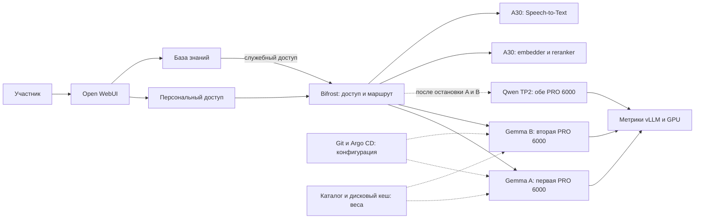
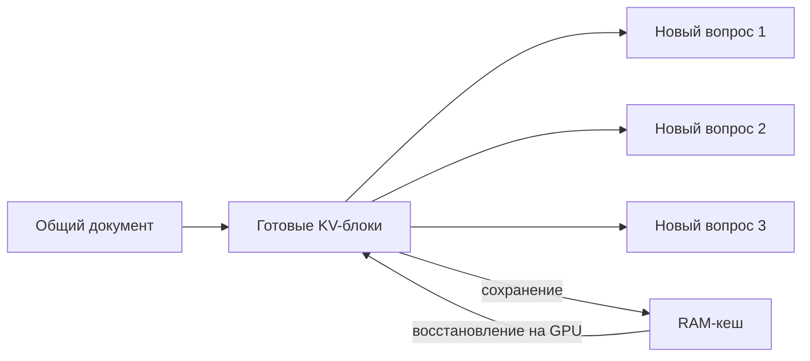
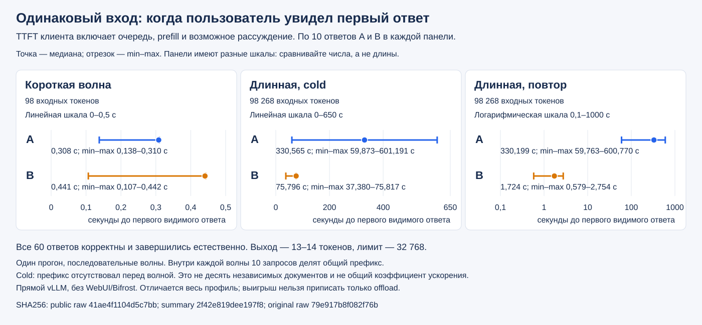
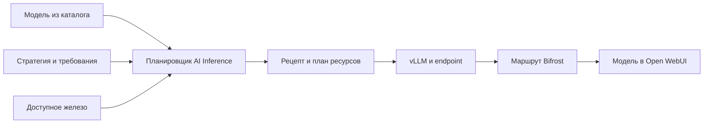

<p align="center">
  <a href="https://github.com/aleksandr-podmoskovniy/hardfest-gpu-workshop">
    
  </a>
</p>

# Инференс без простоя GPU: чиним LLM-сервис руками и делим карту на живом кластере

Александр Подмосковный, Флант / Deckhouse Platform

**Стенд: две RTX PRO 6000 Blackwell по 96 GB, 240 GB RAM и отдельная A30.**
[H100](README.md), [RTX 5060 Ti](RTX5060.md), [подготовка](docs/SETUP.md)

Сценарий начинается с подготовленной **Gemma A — Base**.
Перед показом проверяется её доступность в [Open WebUI](https://ai.ap4y.ru)
для одобренного аккаунта. Дальше меняется второй экземпляр, B:
сначала память, затем вычисления. A остаётся точкой сравнения.

В репозитории все ручные профили сохранены с **нулём реплик**.
Перед показом A включается в Deckhouse Console; B и Qwen остаются выключены.
[Подготовка трёх Argo Applications](docs/GITOPS.md#pro6000-bootstrap)
выполняется заранее.
Создание платформенных сервисов разобрано в [разделе 5](#platform).
Сейчас подтверждены прямые запросы к движкам; сквозная проверка чата
ещё не завершена. Этот сценарий не является отметкой о готовности всего стенда.

### Маршрут на полтора часа

| История | Вопрос, который она закрывает | Время с показом |
| --- | --- | ---: |
| [1. Нагрузка](#ab) | Почему отвечающая модель заставляет ждать? | 10 мин |
| [2. Память](#memory) | Во что обходится длинный контекст? | 20 мин |
| [3. Вычисления](#compute) | Как быстрее обработать вход и построить ответ? | 15 мин |
| [4. Размещение](#placement) | Зачем небольшой модели целая карта? | 15 мин |
| [5. Автоматизация](#platform) | Кто повторит настройку для следующей модели? | 15 мин |
| [6–8. Вывод, учёт и TP2](#conclusion) | Что доказали и когда нужны две карты? | 15 мин |

Предельные прогоны уже выполнены и [сохранены отдельно](results/pro6000/README.md).
Они занимали часы: во время выступления используются короткий ответ,
повтор длинного документа и готовые графики полного испытания.
[Клиент и команды повторения](examples/pro6000-load-client/README.md)
сохраняют разные задачи: предельная ёмкость, одинаковый чат и возврат KV из RAM.

---

<a id="ab"></a>
## 1. Модель отвечает. Откуда берётся ожидание?

Один пользователь получает ответ, десять одновременных запросов создают очередь.
Сам факт запуска модели ещё ничего не говорит о скорости обслуживания.
**Инференс** — обработка входного текста и генерация продолжения;
модель работает с **токенами** — частями слов и знаков.

### Один стенд, два пути



Сплошные стрелки показывают запросы и метрики, пунктир — подготовку
или следующий этап. **Open WebUI** — чат, **Bifrost** — шлюз,
**vLLM** — движок модели. Копирование весов на диск не заменяет запуск движка.
Соседняя A30 обслуживает поиск по документам и распознавание речи.

### Очередь — симптом, а не диагноз

На дашборде **AI Inference / Service performance** профиль A виден как
`hardfest-demo / selectel-gemma-a`. Интервал графика должен совпадать с запросами.

| Наблюдение | Что выясняется дальше |
| --- | --- |
| Waiting растёт, Running почти не меняется | Что ограничивает число активных запросов? |
| Память GPU занята | Сколько занимают веса, кеш и рабочие буферы? |
| GPU utilization меняется | Когда карта вычисляет, а когда ждёт данные? |

Занятая память **не означает** полностью занятые вычисления.
Причину ищем на трёх уровнях: **память → вычисления → размещение на железе**.
CPU, сеть и шлюз тоже входят в путь запроса; их нельзя исключить одним графиком GPU.

**Вопрос для проверки понимания:** если карта занята на 95% по памяти,
обязательно ли она занята на 95% по вычислениям? Нет: это разные ресурсы.
Начнём с памяти — именно здесь длинный контекст меняет стоимость запроса.

---

<a id="memory"></a>
## 2. Память: веса общие, история своя

### Почему длинный разговор занимает больше места

Веса — параметры модели; для этой версии они постоянны и общие для запросов.
**KV cache (Key–Value cache)** хранит промежуточные ключи и значения токенов.
Благодаря ему следующий шаг использует уже обработанную историю,
а не вычисляет её заново целиком.


Это **не кеш готовых ответов**. Новая независимая история требует своего KV.
Кроме весов и KV, GPU нужны рабочие буферы; всё свободное место отдавать кешу нельзя.

### Считаем 128K и 256K на нашей Gemma

**Attention** связывает токен с контекстом. У Gemma 4 31B десять слоёв
сохраняют полную историю, ещё пятьдесят — последние 1024 токена.
**1024 — окно локальных слоёв, а не ограничение пользовательского запроса.**

Для одной истории длиной `S` полезный KV в формате BF16:

```text
KV(S) = 80 KiB × S + 0,78125 GiB, при S ≥ 1024
S = вход + уже созданное продолжение
```

BF16 хранит элемент в двух байтах; FP8 — в одном.
FP8 вдвое уменьшает полезные данные KV, но не веса модели.

| Полное окно | Одна история, BF16 | 10 независимых, BF16 | 10 независимых, FP8 |
| --- | ---: | ---: | ---: |
| **128K = 131 072** | 10,78 GiB | **107,81 GiB** | **53,91 GiB** |
| **256K = 262 144** | 20,78 GiB | **207,81 GiB** | **103,91 GiB** |

Это расчёт **полезных данных**, не прогноз полного выделения vLLM.
Блоки, выравнивание, веса, draft-модель и буферы считаются отдельно.
Совпадающие префиксы могут делить физические блоки — тогда умножение на десять
завышает именно общую часть.

<details>
<summary>Откуда коэффициенты и как повторить расчёт</summary>

Для каждого слоя учитываются число KV-heads, размер head и длина его истории:

```text
KV(S) = 2 × b × [10 × 4 × 512 × S
                 + 50 × 16 × 256 × min(S, 1024)] байт
```

`2` — отдельно K и V, `b` — байт на элемент.
Числа взяты из [закреплённого config.json модели](https://huggingface.co/google/gemma-4-31B-it/blob/842da3794eaa0b77d5f08bae87a17459d91ff475/config.json).
Хранение в движке и отличия архитектур разобраны в [расчёте памяти](docs/MEMORY_BUDGET.md).

```bash
python3 scripts/kv_math.py --tokens 131072 --sessions 10 --element-bytes 2
python3 scripts/kv_math.py --tokens 262144 --sessions 10 --element-bytes 1
```

</details>

### Что меняется в B Cache

Три настройки решают разные задачи:

| Настройка | Что экономит | Чего не обещает |
| --- | --- | --- |
| **Prefix caching** | Повторный расчёт совпадающего начала | Ускорение любого нового документа |
| **FP8 KV** | Место для KV на GPU | Уменьшение весов |
| **KV RAM-offload** | Сохраняет блоки в RAM для восстановления | Десять полных контекстов одновременно на GPU |



Offload переносит **блоки состояния**, а не вычисление ответа на CPU.
Активные данные должны вернуться на GPU; передача имеет свою цену.
В нашем B выделено **80 GiB RAM-кеша**, а лимит контейнера — 92 GiB:
RAM нужна также самому процессу. Размер диска здесь не помогает.

[Профиль B Cache](values/pro6000/gemma-cache.yaml) запускается на свободной карте:
в Deckhouse Console у Deployment `selectel-gemma-cache` задаётся одна реплика.
A остаётся включена. Это отдельное Argo Application, а не скрытая замена A.

Эффект проверяется одинаковым документом и повтором запроса:
сравниваются ожидание первого токена и попадания в prefix cache.
**Отдельного измерения скорости Cache в опубликованной серии нет** —
числа полного B ниже нельзя приписывать только этой ступени.

В отдельной проверке полного B повтор 229 376 входных токенов восстановил
**9,14 GiB из RAM на GPU**. Ответ в один токен проверял именно восстановление,
а не качество длинного ответа. [Сырые данные](results/pro6000/README.md).

Память удалось использовать иначе. Следующий вопрос — как сократить
вычисления, которые всё равно приходится выполнять.

---

<a id="compute"></a>
## 3. Вычисления: обработать вход и продолжить текст

### Почему первый токен и следующие токены ждут по-разному

**Prefill** обрабатывает вход и строит его KV. **Decode** добавляет продолжение
шаг за шагом. Рассуждение модели и видимый ответ расходуют выходные токены:
это не два независимых бюджета по 32K.


**TTFT** — время до первого токена; на клиенте оно включает очередь и путь запроса.
**TPOT** — среднее время следующего выходного токена.
Короткий TTFT ещё не гарантирует быстрое завершение длинного ответа.

### Две оптимизации для двух фаз

**Chunked prefill** делит большой вход на порции. Планировщик может чередовать
их с decode других запросов, чтобы один документ не занимал весь шаг обработки.
Это не обещание параллельного исполнения всех порций одного документа.

**Speculative decoding** использует небольшую draft-модель:
она предлагает продолжение, основная модель проверяет его.
Принимаемые предложения могут удешевить decode; отвергнутые стоят лишней работы.
Ускорение зависит от текста, нагрузки и доли принятых токенов.


### B Tune: тот же экземпляр сравнения, следующий профиль

Сначала `selectel-gemma-cache` переводится в **0 реплик**;
после освобождения карты `selectel-gemma-b` — в **1**.
A продолжает работать. [Точный профиль Tune](values/pro6000/gemma-b.yaml)
добавляет assistant, chunked prefill с бюджетом 4096 токенов на шаг и CUDA graphs.
**4096 здесь не окно и не лимит ответа.** Окно остаётся 262 144, выходной лимит — 32 768.

A использует поддерживаемые настройки планировщика vLLM;
в этом сравнении не утверждается, что chunked prefill у A принудительно выключен.
Полный B меняет несколько настроек, поэтому разницу нельзя отнести к одной из них.

### Что получилось на одинаковых запросах

Три серии по десять одновременно поданных запросов к каждому варианту:
**60 из 60 завершились без ошибки**, с обычным окончанием ответа.
Входы A/B совпадали. Лимит выхода — 32K, реальные ответы — 13–14 токенов.

| Вход и состояние кеша | Медиана TTFT A | Медиана TTFT B |
| --- | ---: | ---: |
| Короткий вход, 98 токенов | **0,31 с** | 0,44 с |
| Первый проход, 98 268 токенов | 330,57 с | **75,80 с** |
| Повтор того же длинного входа | 330,20 с | **1,72 с** |



Шкалы панелей различаются и подписаны; у повторной серии шкала логарифмическая.

В длинной серии запросы имели общий префикс; «первый проход» не означает
десять независимых холодных документов. Серии выполнялись последовательно,
это один измеренный запуск, а не универсальная гарантия задержки.

**B выигрывает на этой длинной нагрузке, но не на каждом коротком запросе.**
А 75,80 секунды до первого токена всё ещё слишком долго для обычного чата.
Настройка улучшила результат, но не отменила цену обработки длинного входа.
[Графики, времена каждого запроса и методика](results/pro6000/README.md).

### Что остаётся за рамками стенда

**Cache-aware routing** направляет запрос к экземпляру с подходящим кешем.
**Prefill/decode disaggregation** размещает две фазы на разных ресурсах
и передаёт между ними KV. Это полезные следующие шаги, но здесь они
не развёрнуты; [ссылки для продолжения](docs/SOURCES.md) вынесены отдельно.

Пока каждой Gemma нужна своя карта. А что делать, если модели гораздо меньше?
Теперь ограничение — не история запроса, а единица выделения железа.

---

<a id="placement"></a>
## 4. Размещение: маленькой модели не нужна целая карта

### От количества устройств к требованиям

Классический **device plugin** сообщает Kubernetes доступное число GPU.
Приложение запрашивает количество; свойства конкретного устройства
приходится учитывать дополнительными соглашениями.
Подробности — в [статье автора](https://habr.com/ru/companies/flant/articles/1020276/).

**DRA (Dynamic Resource Allocation)** позволяет описать запрос к устройству
и его атрибутам через объекты Kubernetes. Драйвер выделяет подходящий ресурс.
DRA сам не создаёт аппаратное разделение: это возможность конкретного GPU и драйвера.

### Два разных способа разделить GPU

| Механизм | Как работает | Когда нужен |
| --- | --- | --- |
| **MIG (Multi-Instance GPU)** | Аппаратные разделы с выделенной памятью и вычислительными ресурсами | Нужна изоляция частей карты |
| **MPS (Multi-Process Service)** | Совместное выполнение процессов на одном GPU или MIG-разделе | Нужно плотнее разместить небольшие сервисы |

MPS не заменяет аппаратную изоляцию MIG.
**Проверочный вопрос:** какой способ выбрать ради отдельной памяти,
а какой — ради совместной работы небольших процессов?


### A30: поиск и голос вместо ещё одной большой LLM

Подготовленная геометрия A30 — два раздела `2g.12gb`.
В одном через MPS размещены **embedder** и **reranker**, в другом — **Speech-to-Text**.
Embedder превращает текст в вектор для поиска; reranker уточняет порядок найденного;
Speech-to-Text превращает речь в текст, а не наоборот.

Фактическая геометрия проверяется на ноде A30:

```bash
nvidia-smi -L
nvidia-smi mig -lgi
nvidia-smi mig -lci
```

Эти команды только читают состояние. Изменение геометрии может потребовать
освободить GPU; данный проход не доказывает безопасную перенарезку под нагрузкой.
[Подготовка A30](docs/SETUP.md) отделена от создания моделей.

Итак, вручную пришлось связать модель, кеш, параметры движка и подходящий ресурс.
Для следующей модели всё это пришлось бы повторить. Здесь появляется автоматизация.

---

<a id="platform"></a>
## 5. Автоматизация уже понятной настройки

### Что делает AI Inference

**InferenceService** — заказ на запуск модели, а не ещё один движок.
AI Inference сопоставляет модель, требования, доступное железо и рецепты запуска.
Планировщик выбирает допустимый вариант; vLLM по-прежнему исполняет модель.
План не заменяет проверку реальной памяти и ответа после запуска.



Последние две стрелки требуют настроенного подключения шлюза и чата.
Произвольное имя сервиса само по себе не создаёт доступ пользователям.

### Создание в Deckhouse Console

A переводится в **0 реплик**, B Tune остаётся на второй карте.
Освободившаяся карта предназначена для платформенной Gemma.

| Поле заказа Gemma | Значение на подготовленном стенде |
| --- | --- |
| Проект | `hardfest-demo` |
| Имя сервиса | **`selectel-gemma31`** |
| Модель из каталога | `gemma-4-31b` |
| Класс сервиса | `hardfest-selectel-gemma31` |
| Стратегия | `Latency` |
| Класс устройства | `hardfest-selectel-blackwell` |

В проекте раздел **AI-модели → Сервисы инференса → Создать** принимает заказ.
Если форма установленной версии не показывает нужные поля,
[YAML Gemma](platform/pro6000/gemma.yaml) задаёт тот же контракт:
в нём заменяются только отмеченные привязки классов, имя сохраняется.
Создание заказа сразу запрашивает ресурсы — поля `replicas` у этого CRD нет.

После создания проверяются выбранный рецепт, размер окна, готовность и endpoint.
Затем — фактический ответ, маршрут в Bifrost и та же модель в WebUI.
Полная [инструкция подготовки](docs/SETUP.md) и [связь имён](docs/CHAT_AND_ACCESS.md)
сохраняют именно этот порядок.

**Платформенный путь 256K через WebUI/Bifrost ещё не принят сквозным тестом.**
Опубликованные измерения ниже получены непосредственно от vLLM.
Они не доказывают равенство ручного и платформенного запуска или исправность чата.
Сравнение возможно после совпадения фактических настроек и повторения одной нагрузки.

---

<a id="conclusion"></a>
## 6. Когда действительно нужны новые GPU

Сначала измеряется задержка, затем находится ограничение,
после изменения повторяется тот же запрос.
Покупка карты обоснована, когда нужная нагрузка и допустимое ожидание
всё ещё не помещаются в существующие ресурсы.

Наши числа показывают две разные вещи:

- **Длинный контекст обслуживается** — предельные серии завершились.
- **Десять пользователей не обязательно обслуживаются одновременно** — часть ждала.

В предельной серии наблюдалось до одного активного запроса у A,
до двух у B и до шести у Qwen. RAM-offload не превращает эти значения в десять.
Поэтому «запустилось» — начало проверки, а не основание обещать интерактивную скорость.

---

<a id="gateway"></a>
## 7. Кто создал нагрузку и сколько она стоит

В обычном чате запрос проходит через Bifrost.
**Virtual Key (VK)** — персональный ключ шлюза: он связывает разрешённые модели,
лимиты и запросы пользователя. Выдача доступа не требует общего ключа в браузере.

В журнале одного запроса сверяются пользовательский VK, маршрут,
модель, входные и выходные токены, статус и задержка.
Расчётная стоимость по тарифу шлюза — **не счёт за аренду GPU**.
Точность суммарного HA-счётчика расходов проверяется отдельно.

Предельные тесты этого отчёта шли напрямую в vLLM и **не создавали расход VK**.
Свежие доказательства персонального учёта через WebUI пока не получены;
старые скриншоты нельзя выдавать за стоимость этих запусков.
[Проверка доступа и журналов](docs/CHAT_AND_ACCESS.md).

Остаётся обратная задача: не несколько маленьких моделей на карте,
а одна модель, которой требуется несколько карт.

---

<a id="tp2"></a>
## 8. Qwen: одна модель на двух картах

**Tensor Parallelism (TP)** распределяет операции модели между GPU.
`TP2` означает две карты; это не две копии модели и не название TensorRT.
Между картами идёт обмен данными, поэтому суммарная память — не единственный фактор скорости.


Перед Qwen все ручные Gemma останавливаются, а платформенный заказ Gemma
удаляется после сохранения его YAML. Модели, классы и PVC сохраняются.
Затем создаётся [заказ Qwen](platform/pro6000/qwen.yaml):
имя **`selectel-qwen38-tp2`**, модель `qwen3-8-flash-next-nvfp4`,
класс `hardfest-selectel-qwen38-tp2`, стратегия `Latency`.
Имя должно совпадать с настроенным маршрутом шлюза.

### Полные окна и большой выход: что действительно выдержал стенд

| Профиль | Вход на запрос | Выход на запрос | Полное окно | Завершилось |
| --- | ---: | ---: | ---: | ---: |
| Gemma A, 1 GPU | 134 752 | **32 768** | 167 520 | 10/10 |
| Gemma B, 1 GPU + 80 GiB offload | 229 376 | **32 768** | **262 144** | 10/10 |
| Qwen TP2, 2 GPU + offload | 229 376 | **32 768** | **262 144** | 10/10 |

Окно включает **вход и выход вместе**: для 32K продолжения в окне 256K
входной бюджет — 224K. У A окно автоматически подобрано движком на данном
стенде; 167 520 не является переносимой гарантией для любой 96 GB карты.

| Метрика предельной серии | Gemma A | Gemma B | Qwen TP2 |
| --- | ---: | ---: | ---: |
| Время всей серии | 333,56 мин | 312,60 мин | 25,65 мин |
| Максимальный клиентский TTFT | 301,91 мин | 255,02 мин | 19,98 мин |
| Средний TPOT движка | 57,97 мс | 109,29 мс | 20,43 мс |
| Наблюдавшийся максимум активных | 1 | 2 | 6 |
| Ошибки / прерывания клиентом | 0 / 0 | 0 / 0 | 0 / 0 |

В Qwen было два вытеснения запросов планировщиком; это не клиентские ошибки.
Серии принудительно генерировали 32K (`ignore_eos`): проверяли ёмкость
и завершение потока, **не качество 32K естественного ответа**.
Разные входные окна A/B не позволяют вычислять из этой таблицы их ускорение.

В прогоне Qwen использовался RAM-offload 160 GiB, но точная конфигурация
этого runtime не сохранена в публичном воспроизводимом профиле.
Заказ платформы не фиксирует рецепт; перед повтором требуется сверить выбранный
план и память. Нельзя подменять это старым профилем Qwen без offload.

[Полный отчёт: запросы, мониторинг, методика и ограничения](results/pro6000/README.md).

### После показа

Ручные Deployment возвращаются в **0 реплик**, автоматическая синхронизация
Argo остаётся выключенной. Платформенные заказы останавливаются отдельно:
масштабирование дочернего Deployment контроллер может отменить.
Веса и их дисковый кеш не удаляются.

Заморозка облачного сервера — отдельное действие после сохранения результатов
и проверки сохранности кеша. Остановка Pod не прекращает аренду GPU.
После разморозки RAM-кеш прогревается заново; сохранённые веса на диске —
не сохранённое состояние работающей модели.
