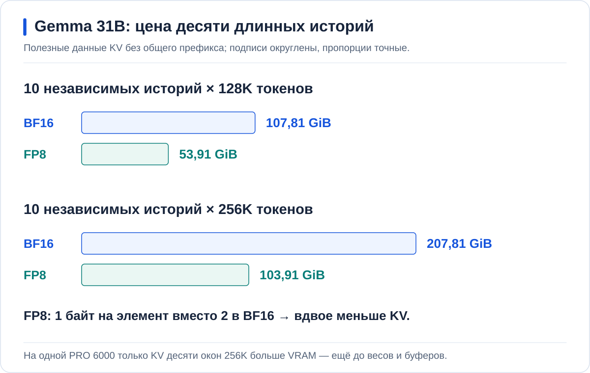
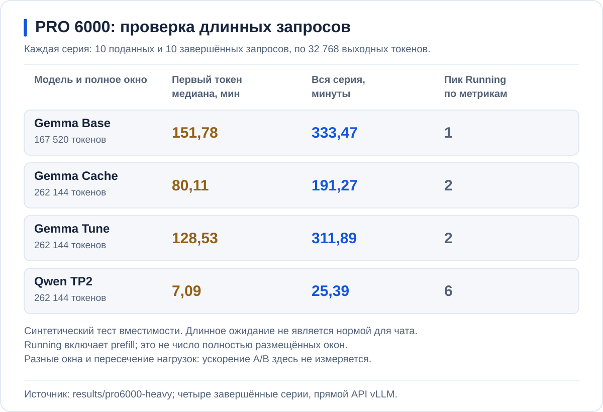
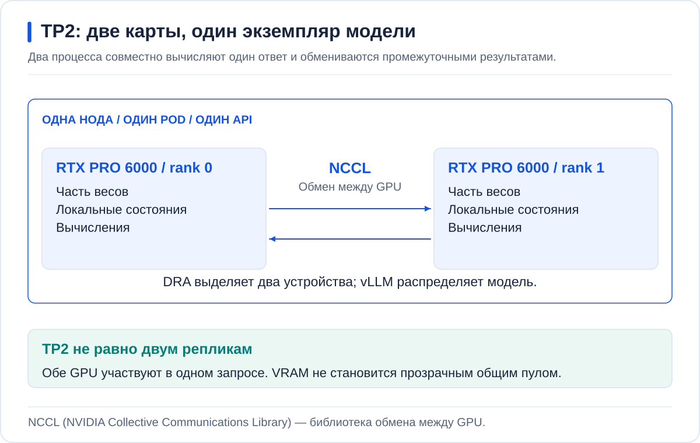
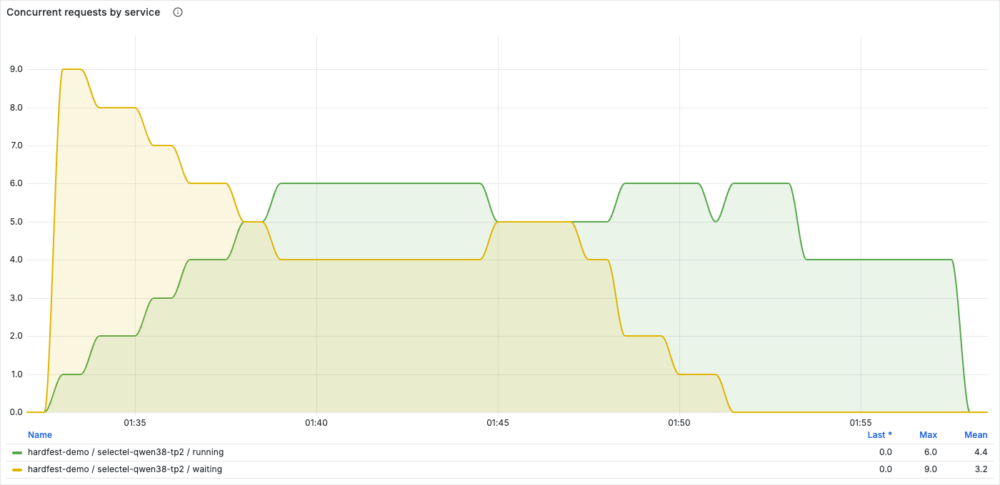
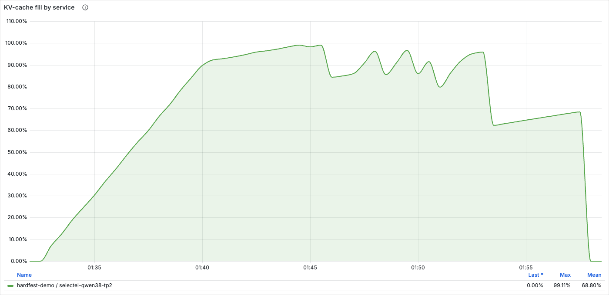
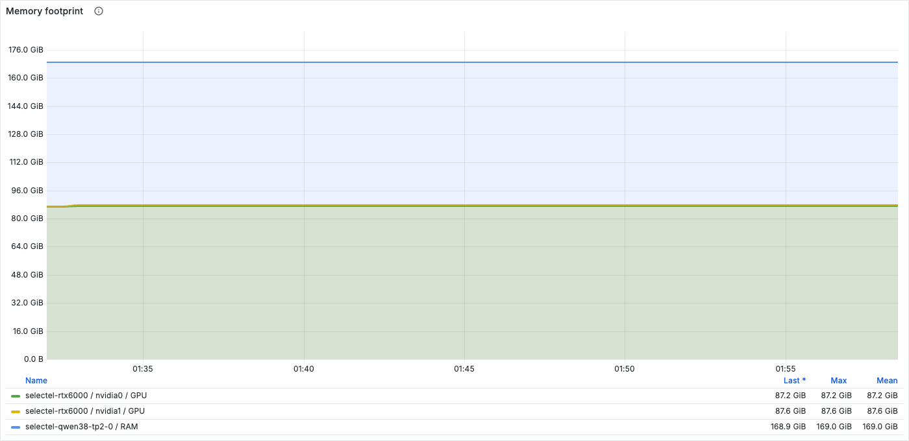
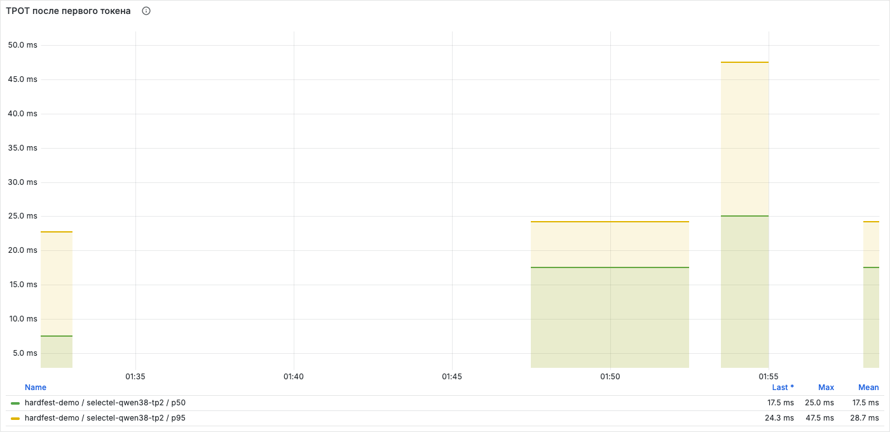
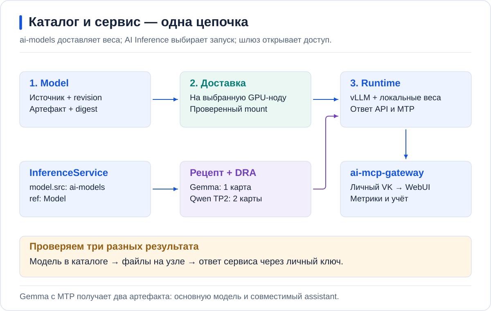

<table>
  <tr>
    <td align="center" width="33%">
      <a href="https://github.com/aleksandr-podmoskovniy/hardfest-gpu-workshop/blob/main/RTXPRO6000.md">
        <br>
        <strong>Материалы на GitHub</strong>
      </a><br>Эта страница
    </td>
    <td align="center" width="33%">
      <a href="https://ai.ap4y.ru">
        <br>
        <strong>Чат мастер-класса</strong>
      </a><br>ai.ap4y.ru
    </td>
    <td align="center" width="33%">
      <a href="https://app.talkmeter.ru/r/HF26/01a0d1e0-33d5-7d71-9e10-c7cfd1996a32">
        <br>
        <strong>Отзыв о докладе</strong>
      </a><br>TalkMeter
    </td>
  </tr>
</table>

# Инференс без простоя GPU: чиним LLM-сервис руками и делим карту на живом кластере

Александр Подмосковный, Флант / Deckhouse Platform

<details>
<summary>Немного обо мне</summary>

**Александр Подмосковный** — директор продуктового направления ML/AI/GPU во «Фланте».

С Kubernetes и DevOps работаю с 2020 года, с ИИ-инфраструктурой — с 2024-го.
Для экспериментов держу собственный кластер.

</details>

**Вариант для двух RTX PRO 6000 Blackwell по 96 GB.** На сервере 240 GB RAM.
На этих картах запускаются Gemma 31B и Qwen3.8; небольшие модели работают
на отдельной A30.

[H100](README.md) | [RTX 5060 Ti](RTX5060.md) | [RTX PRO 6000](RTXPRO6000.md)

<a id="contents"></a>
## Содержание

1. [Модель под нагрузкой](#ab)
2. [Память: сколько места нужно контексту](#memory)
3. [Вычисления: prefill и decode](#speculation)
4. [Размещение: несколько моделей на одной GPU](#placement)
5. [AI Inference: Qwen на двух GPU](#platform)
6. [Когда нужны дополнительные GPU](#conclusion)
7. [Доступ пользователей и учёт запросов](#gateway)

К началу работы Gemma A уже доступна в чате, мониторинг собирает метрики,
а вторая Gemma и Qwen выключены. Подготовка описана отдельно:
[проверка стенда](docs/SETUP.md#acceptance) и
[создание приложений](docs/GITOPS.md#pro6000-bootstrap).

---

<a id="ab"></a>
## 1. Модель под нагрузкой

В [Open WebUI](https://ai.ap4y.ru) доступна **Gemma A — PRO 6000 · базовая**.
Для входа нужен одобренный аккаунт. A — исходный вариант без нашего набора
оптимизаций. На второй карте будет работать Gemma B с теми же весами,
но другими настройками.

Одиночный вопрос может получить ответ сразу, а десять запросов — создать
очередь. Длина разговоров тоже важна: десять коротких вопросов и десять
больших документов создают разную нагрузку.

Обработка входа и генерация продолжения называются **инференсом**.
Длина текста измеряется в **токенах** — частях слов и знаков.

### Что находится за чатом


**Open WebUI** принимает сообщения, шлюз **Bifrost** проверяет доступ
и выбирает модель, а **vLLM** выполняет вычисления на GPU.

Gemma A и B занимают по карте; Qwen потребует обе карты сразу.
A30 обслуживает поиск по документам и распознавание речи.
[Полная схема стенда и подготовка](docs/SETUP.md).

### Графики: очередь, память и загрузка GPU

<a id="monitoring"></a>
> **AI Inference / Service performance**<br>
> Namespace: `hardfest-demo`; Service: `selectel-gemma-a`<br>
> Интервал: текущие запросы. GPU: только нода этой модели.

| Наблюдение | Что выясняется дальше |
| --- | --- |
| Waiting — ожидающие запросы — растёт, Running — активные — почти не меняется | Что ограничивает число активных запросов? |
| Память GPU занята | Сколько занимают веса, кеш и рабочие буферы? |
| GPU utilization меняется | Когда карта вычисляет, а когда ждёт данные? |

### Один симптом — три уровня проверки

**Занятая память не означает, что вычислительные блоки GPU полностью загружены.**
Причины ожидания будем разбирать по отдельности:

1. **Память:** хватает ли места для модели и состояния активных разговоров?
2. **Вычисления:** сколько работы нужно для обработки входа и каждого токена ответа?
3. **Размещение:** соответствует ли выделенная часть GPU размеру задачи?

CPU, сеть и шлюз тоже могут задерживать запрос; график GPU этого не исключает.

<details>
<summary>Команда для сравнения: десять коротких запросов</summary>

Команда сравнивает настройки на короткой нагрузке. Для проверки полного окна
есть отдельный [клиент длинной нагрузки](examples/pro6000-load-client/README.md).
Перед запуском очередь должна быть пуста.

Клиент работает в отдельном CPU Pod, не в Pod модели. Нужны vLLM 0.31
и токенизатор той же версии Gemma: [подготовка клиента](docs/MEASUREMENTS.md#gemma-client-h100).
`BENCH_POD`, `BENCH_CONTAINER` и `TOKENIZER_PATH` ниже — его фактические значения.

```bash
export NS=hardfest-demo SERVICE=selectel-gemma-a SERIES=base-short
: "${BENCH_POD:?Укажите работающий CPU Pod клиента}"
: "${BENCH_CONTAINER:?Укажите контейнер клиента}"
: "${TOKENIZER_PATH:?Укажите путь токенизатора внутри клиента}"
mkdir -p results/pro6000-local
set -o pipefail
kubectl --context "$GPU_CONTEXT" -n "$NS" exec "pod/$BENCH_POD" -c "$BENCH_CONTAINER" -- \
  vllm bench serve --backend vllm \
    --base-url "http://$SERVICE.$NS.svc.cluster.local:8000" \
    --endpoint /v1/completions --model "$SERVICE" \
    --tokenizer "$TOKENIZER_PATH" \
    --dataset-name random --seed 42 --random-range-ratio 0 \
    --random-input-len 2048 --random-output-len 512 \
    --num-prompts 10 --max-concurrency 10 --ignore-eos --temperature 0 \
    --ready-check-timeout-sec 0 --num-warmups 0 \
    --save-result --result-dir /dev --result-filename stdout \
  | tee "results/pro6000-local/$SERIES.txt"
```

В успешном прогоне `completed=10`, `failed=0`, обработано 20 480 входных
и 5 120 выходных токенов. Running и Waiting покажут, возникла ли очередь.
Её отсутствие на коротких запросах не доказывает вместимость полных окон.

Для Cache: `SERVICE=selectel-gemma-cache SERIES=cache-short`;
для Tune: `SERVICE=selectel-gemma-b SERIES=tune-short`.
Первый проход и повтор сохраняются отдельно. Параметры нагрузки,
версия клиента и способ подключения во всех вариантах одинаковы.

</details>

Веса у запросов общие, а история каждого разговора создаёт дополнительное
состояние в памяти. Чем оно больше, тем меньше разговоров помещается.

---

<a id="memory"></a>
## 2. Память: сколько места нужно контексту

```math
\Large M_{\mathrm{GPU}}=W_{\mathrm{weights}}+K_{\mathrm{KV}}+R_{\mathrm{buffers}}
```

**Веса + KV-кеш + рабочие буферы.** Эти части меняются по-разному,
поэтому одной общей цифры занятой VRAM для диагностики недостаточно.

### Почему длинный разговор занимает больше места

Память GPU занята не только весами. **Веса** — это параметры модели:
при инференсе они не меняются и используются всеми запросами.
А **KV cache (Key–Value cache)** хранит рассчитанные ключи и значения
для токенов истории. Благодаря этому модель при генерации следующего токена
может использовать уже выполненную работу.

KV cache не содержит готовый ответ. Он хранит состояние, необходимое для
продолжения конкретного текста, поэтому независимому разговору нужен свой кеш.
Кроме весов и KV, vLLM нужны рабочие буферы. Их память тоже должна быть учтена.

<a id="kv-formula"></a>
### Общая формула KV-кеша

Для одинаковых слоёв с **full attention**, которые хранят собственные K/V
одинаковой размерности, и независимых историй одинаковой длины:

```math
\LARGE \boxed{\begin{gathered}
KV = 2\times b\times L \\
{}\times H_{kv}\times D\times S\times N
\end{gathered}}
```

| Множитель | Что означает |
| --- | --- |
| **2** | Два массива: ключи **K** и значения **V** |
| **b** | Байт на элемент: **2 для BF16**, **1 для FP8** |
| **L** | Число слоёв с собственным KV-кешем |
| **Hkv** | Число KV-голов в слое — не число query-голов |
| **D** | Размерность одной KV-головы |
| **S** | Токены одной истории: вход и уже созданная часть ответа |
| **N** | Число независимых историй |

Результат — **байты K/V-данных**. Для GiB делим на `1024³`.
Веса, рабочие буферы и округление блоков сюда не входят.
Это объём для всей копии модели, до распределения между GPU.

### Расчёт для Gemma 31B с окном 128K и 256K

Размер KV зависит от архитектуры модели. Механизм **attention** связывает
токен с контекстом. В слоях с full attention доступна полная история,
а в слоях со sliding-window attention — только последнее окно.


Для Gemma применяем общую формулу **отдельно к двум группам слоёв**,
затем складываем результаты. У full attention длина истории — `S`,
у локальных слоёв — `min(S, w)`, где `w` — размер локального окна.

У Gemma 4 31B десять слоёв сохраняют полную историю,
ещё пятьдесят — последние 1024 токена. Поэтому часть KV растёт вместе
с длиной разговора, а часть перестаёт расти после заполнения локального окна.
**1024 — окно локальных слоёв, а не ограничение пользовательского запроса.**

Для одной истории длиной `S` объём самих данных KV в формате BF16 составляет:

```math
\Large KV(S)=80\,\mathrm{KiB}\times S+0{,}78125\,\mathrm{GiB}
```

Здесь `S ≥ 1024`; `S` — вход вместе с уже созданным продолжением.

### Одна история 128K: 10,78 GiB только на KV

```math
\Large 80\,\mathrm{KiB}\times131\,072+0{,}78125\,\mathrm{GiB}=10{,}78125\,\mathrm{GiB}
```

При **256K** — **20,78 GiB на историю**. Для десяти независимых разговоров
получается **207,81 GiB в BF16** ещё до весов и рабочих буферов.

BF16 хранит элемент в двух байтах, FP8 — в одном. Переход на FP8 вдвое
уменьшает объём данных KV, но не размер весов модели. Для десяти независимых
историй получаются следующие объёмы:



Веса, вспомогательная модель, буферы и округление блоков требуют дополнительной
памяти. Зато у разговоров с одинаковым началом его KV можно хранить один раз.

<details>
<summary>Полная формула и проверка расчёта</summary>

| Полное окно | Одна история, BF16 | 10 независимых, BF16 | 10 независимых, FP8 |
| --- | ---: | ---: | ---: |
| **128K = 131 072** | 10,78 GiB | **107,81 GiB** | **53,91 GiB** |
| **256K = 262 144** | 20,78 GiB | **207,81 GiB** | **103,91 GiB** |

В общую формулу подставляем параметры двух групп слоёв.
Для одной истории:

```math
\Large KV(S)=2b\left[10\times4\times512\times S+50\times16\times256\times\min(S,1024)\right]
```

Здесь `2` учитывает отдельно K и V, `b` — число байт на элемент.
Числа взяты из [закреплённого config.json модели](https://huggingface.co/google/gemma-4-31B-it/blob/842da3794eaa0b77d5f08bae87a17459d91ff475/config.json).
Хранение в движке и отличия архитектур разобраны в [расчёте памяти](docs/MEMORY_BUDGET.md).

```bash
python3 scripts/kv_math.py --tokens 131072 --sessions 10 --element-bytes 2
python3 scripts/kv_math.py --tokens 262144 --sessions 10 --element-bytes 1
```

</details>

Формулы зависят от архитектуры, а не только от числа параметров:
[Gemma 31B, Gemma E2B и гибридная Qwen3.5](README.md#kv-architectures).
Разбор с отдельными формулами раскрывается под заголовком «Другие архитектуры».

<a id="ram"></a>
### Повторное использование кеша и хранение в RAM

В рабочих запросах часто повторяется один документ или системная инструкция.
Пересчитывать это начало для каждого разговора необязательно. Вариант
**B Cache** объединяет три настройки:

| Настройка | Что меняет |
| --- | --- |
| **Prefix caching** | Переиспользует рассчитанный KV начала запросов с точно совпадающими токенами |
| **FP8 KV** | Вдвое уменьшает объём самих данных KV |
| **KV RAM-offload** | Сохраняет блоки в RAM и возвращает их на GPU при повторе |


При **KV RAM-offload** блоки кеша хранятся в RAM до следующего использования
и возвращаются на GPU перед вычислением. Ответ по-прежнему вычисляется
на GPU, а передача данных занимает время.

В B выделено **80 GiB RAM-кеша** при лимите контейнера 92 GiB:
память нужна также самому процессу. Увеличение диска для весов этот кеш не расширяет.

### Запуск B Cache рядом с исходной моделью

**Перед запуском:** A работает на одной PRO 6000, вторая карта свободна.
Если после отдельного опыта осталась платформенная Gemma `selectel-gemma31`,
сначала [завершается её работа](docs/SETUP.md#pro6000-initial-state).
После освобождения GPU можно запускать Cache. Модель и веса остаются.

Для запуска подготовленного [профиля B Cache](values/pro6000/gemma-cache.yaml)
в проекте `hardfest-demo` открывается **Контейнеризация → Deployments →
selectel-gemma-cache → ⋮ → Масштабировать**.[^console-scale]

Желаемое число реплик — **1**. Перед подтверждением в показанной под полем
команде проверяются проект `hardfest-demo`, Deployment `selectel-gemma-cache`
и `--replicas=1`. После подтверждения проверяется сохранённое число реплик.

Это действие меняет только реплики; редактор «Конфигурация / Контроллер»
для переключения не нужен. Для этих Deployment автосинхронизация отключена,
а ручное число реплик сохраняется при Sync.
Cache занимает свободную карту. A остаётся включена для сравнения.

[^console-scale]: В текущей версии Console часть подписей диалога не переведена:
    заголовок — `replica_scaler_dialog_header_deployment`, поле желаемого числа
    реплик — `replica_scaler_desired_replicas`, подтверждение —
    `replica_scaler_scale`, отмена — `replica_scaler_abort`.

После готовности Pod администратор получает законченный контрольный ответ
через WebUI. У карточки **Gemma B — PRO 6000 · KV cache** выбирается
**⋯ / Доступ / Публичное**. Затем в административном списке у скрытой базы
`workshop.vllm/selectel-gemma-cache` — **⋯ / Make Public**.
Оба изменения сохраняются сразу. Публичная запись не разрешается;
`Enabled` и значок глаза не заменяют права доступа.

В отдельной сессии обычного участника обновляется страница, проверяются
появление карточки и настоящий ответ. Только после этой проверки залу
предлагается отправлять запросы. [Порядок настройки доступа](docs/CHAT_AND_ACCESS.md#открыть-или-закрыть-модель-участникам).

На обе модели отправляется [«Пятничный релиз пиццерии»](examples/pizza-incident.md)
целиком, с вопросом в конце: **«Почему появились ошибки оплаты? Подтверди
вывод журналом, метриками и логами».** Затем в новом чате повторяется документ
с другим вопросом: **«Таймаут вернули. Можно ли всем с ошибкой 502 предложить
оплатить ещё раз?»** Ответ нужен новый, а префикс остаётся прежним.

Для этого опыта текст вставляется напрямую, без поиска по вложениям.
Короткий кейс показывает механику кеша, а не вместимость полного окна 256K.

Разница во времени до первого токена и попадания в prefix cache показывают,
сколько работы удалось не повторять. Уникальный текст такого выигрыша не даёт.

Работу RAM-offload подтверждает возврат ранее вытесненного префикса:
в метриках растёт **CPU→GPU bytes**. Запись из GPU в RAM без последующего
чтения ещё не доказывает полезный эффект.
[Как проверить повторное использование](docs/MEASUREMENTS.md#offload-replay).

### Графики после Cache: повторный запрос и реальная память

> **AI Inference / Service performance**<br>
> Namespace: `hardfest-demo`; Services: `selectel-gemma-a`, `selectel-gemma-cache`<br>
> Сравнение: одинаковые входы, выходы и число одновременно отправленных запросов.

| Панель | Что проверяется |
| --- | --- |
| TTFT p95, Prefix cache hit | Ускорился ли повтор и был ли использован общий префикс? |
| Running now / Waiting now, GPU KV cache fill | Что стало с очередью и заполнением KV-пула? |
| GPU framebuffer used, Memory by runtime pod | Сколько памяти реально занято на карте и на узле? |
| KV: GPU ↔ RAM, bytes/s — CPU→GPU; External KV hit | Вернулся ли вытесненный кеш из RAM? |

После FP8 общая занятая VRAM не обязана уменьшиться: vLLM заранее резервирует
пул, в который теперь помещается больше токенов. Размер пула берётся из логов,
его заполнение — из метрик. Снижение очереди проверяется одинаковой нагрузкой,
а не просто более поздним интервалом, когда пользователей стало меньше.

Кеш помогает не повторять работу, но новый документ и новые токены ответа
всё равно нужно вычислить. Для этой части работы нужны другие настройки.

---

<a id="compute"></a>
<a id="speculation"></a>
## 3. Вычисления: prefill и decode

```math
\Large T_{\mathrm{answer}}\approx T_{\mathrm{queue}}+T_{\mathrm{prefill}}+T_{\mathrm{decode}}+T_{\mathrm{other}}
```

**Очередь + обработка входа + генерация + остальные задержки.**

<a id="latency"></a>
### Две фазы работы модели

При **prefill** модель обрабатывает входной текст и строит его KV.
При **decode** она генерирует продолжение, добавляя токены шаг за шагом.
У длинного документа может быть дорогая обработка входа, даже если ответ
состоит из одного предложения. А короткий вопрос с большим ответом создаёт
длительную нагрузку на decode.

Если модель сначала рассуждает, а затем формулирует ответ, обе части
расходуют общий выходной бюджет. Лимит 32K не даёт по 32K на каждую часть.


Для этих фаз полезны разные показатели:

- **TTFT** — время до первого токена. В клиентском измерении оно включает
  очередь, обработку входа и передачу запроса и ответа.
- **TPOT** — среднее время на следующий выходной токен. Оно характеризует
  темп уже начавшейся генерации.

Быстрое начало ответа не гарантирует быстрого завершения.

### Две оптимизации для двух фаз

**Chunked prefill** делит обработку большого входа на порции. Планировщик
чередует их с генерацией других ответов. Так уже начатые разговоры могут
продолжаться, пока новый длинный документ ещё обрабатывается.


**Speculative decoding** сокращает работу при генерации. Небольшая
**draft-модель** предлагает несколько следующих токенов, а основная модель
проверяет их. Если предложения часто подходят, за одну проверку принимается
сразу несколько токенов. Если нет, вычисления draft-модели оказываются лишними.
Поэтому наличие draft-модели ещё не означает ускорение: важен результат
на конкретных текстах и при нужной нагрузке.


### Замена B Cache на B Tune

Для следующего сравнения заменяется только B:

1. В WebUI закрывается доступ сначала к базовой модели Cache, затем к её карточке.
   Подтверждается [завершение запросов через весь чат](docs/CHAT_AND_ACCESS.md#before-stop),
   затем у Cache — нулевые Running и Waiting. Одна пустая очередь движка недостаточна.
2. В проекте `hardfest-demo`, **Контейнеризация → Deployments →
   selectel-gemma-cache → ⋮ → Масштабировать** задаётся **0** реплик.
   После подтверждения проверяются сохранённое число, удаление Pod
   и освобождение GPU ResourceClaim.
3. Тем же действием у Deployment `selectel-gemma-b` задаётся **1** реплика.
   Изменение подтверждается, затем проверяется сохранённое число.
   После Ready администратор получает законченный контрольный ответ через WebUI.
4. У карточки **Gemma B — PRO 6000 · полный тюнинг** выбирается
   **⋯ / Доступ / Публичное**, затем в административном списке у скрытой базы
   `workshop.vllm/selectel-gemma-b` — **⋯ / Make Public**.
   Изменения сохраняются сразу, публичное право записи не включается.
   Переключатель `Enabled` не заменяет эту настройку. Обычный участник
   обновляет страницу, видит карточку и получает ответ; затем начинается сравнение.

A продолжает работать. [Профиль B Tune](values/pro6000/gemma-b.yaml)
сохраняет настройки кеша и добавляет draft-модель и CUDA graphs — повторное использование
подготовленных последовательностей GPU-операций.

Chunked prefill на этом стенде уже включён в Base и Cache: стандартный
бюджет vLLM — 8192 токена на шаг. В Tune он уменьшается до **4096**.
Мы меняем размер порций, а не включаем этот механизм впервые.

**4096 — бюджет шага планировщика, не окно контекста и не лимит ответа.**
Окно остаётся 262 144 токена, выходной лимит — 32 768.

A сохраняет стандартные настройки планировщика vLLM. В B меняется набор
параметров, поэтому сравнение покажет их совместный результат.

В этом профиле `num_speculative_tokens: 1`: вспомогательная модель предлагает
один токен за шаг.

### Графики после Tune: начало ответа и темп генерации

> **AI Inference / Service performance**<br>
> Namespace: `hardfest-demo`; Services: `selectel-gemma-a`, `selectel-gemma-b`<br>
> Для сравнения Cache/Tune смешанная серия сохраняется до остановки Cache.

**TTFT** показывает ожидание начала, **TPOT / ITL** — темп продолжения.
Рядом проверяются **Output tokens/s, acceptance, ошибки и фактические длины**.
Более короткий или оборванный ответ не считается ускорением.

<a id="pro-result"></a>
### Два разных вопроса к измерениям

**Вместимость:** завершит ли движок десять запросов, каждый из которых заполняет
всё настроенное окно и действительно получает 32K выходных токенов?

**Работа чата:** что меняется на одинаковых вопросах, когда ответ заканчивается
естественно? Здесь важны первый видимый текст, завершение и фактическая длина
ответа, а не заполнение выходного лимита любой ценой.

Эти проверки проводятся отдельно. Принудительная генерация 32K не показывает
качество диалога, а короткий полезный ответ не доказывает вместимость полного окна.



<details>
<summary>Одинаковые входы для Base, Cache и Tune: обычный ответ</summary>

Для сопоставимого опыта профили проверяются последовательно: короткий вопрос, длинный документ,
повтор того же документа и смешанная волна — два длинных запроса, затем восемь
коротких. Каждая волна содержит десять запросов. Входные токены во всех
профилях одинаковы; длину ответа определяет сама модель.

Сравнивается время до **первого видимого текста ответа**, включая ожидание,
обработку входа и возможное рассуждение перед ним. Отдельно проверяются
естественное окончание потока и реальные выходные токены. Разные длины
ответов нельзя считать одинаковым объёмом работы по генерации.

<!-- result:pro-chat -->
Сопоставимая серия обычных ответов Base, Cache и Tune ещё не завершена; её численные результаты здесь не публикуются.

Проверки вместимости используют разные окна, а нагрузки на узел пересекались. По ним нельзя вычислять ускорение настроек или судить о задержках обычного чата.
<!-- /result:pro-chat -->

Медиана не описывает самое долгое ожидание. Кроме того, общий префикс может
переиспользоваться уже внутри первой волны. Поэтому сравнивается профиль
целиком: ни offload, ни draft-модели нельзя приписать весь эффект без отдельного
опыта. Запросы идут напрямую в vLLM; маршрут WebUI/Bifrost проверяется отдельно.

Условия отдельной проверки описаны в [методике одинаковой нагрузки](results/pro6000-heavy/README.md#обычный-ответ-на-одинаковых-входах).
Короткий тест из раздела 1 использует другие входы и не заменяет эту серию.

</details>

<a id="long-context"></a>
### Проверка ответа по длинному документу

Размер окна ещё не говорит о полезности ответа. В кейсе о пиццерии можно
спросить, какие заказы требуют проверки после отката и что известно об оплате.
Ответ должен опираться на конкретные логи и не придумывать передачу на кухню.
Этот небольшой документ проверяет работу с источником; качество на полном
окне требует отдельного длинного материала, переданного целиком.

В журнале сверяются длины входа и ответа и нормальное окончание потока.
Лимит 32K разрешает длинный ответ, но не требует дописывать законченную мысль.

### Что происходит при заполнении всего окна

В тесте вместимости клиент подаёт десять запросов одновременно и принудительно
доводит **каждый ответ до 32 768 токенов**. Вход заполняет оставшуюся часть окна.
Это синтетические независимые истории, не вопросы участников.

<!-- result:pro-capacity -->
| Gemma: полное окно | Base | Cache | Tune |
| --- | ---: | ---: | ---: |
| Полное окно, токенов | 167 520 | 262 144 | 262 144 |
| Вход на запрос, токенов | 134 752 | 229 376 | 229 376 |
| Фактический выход на запрос, токенов | 32 768 | 32 768 | 32 768 |
| Подано одновременно | 10 | 10 | 10 |
| Завершено | 10 | 10 | 10 |
| Пик Running по метрикам | 1 | 2 | 2 |
| TTFT клиента, медиана, мин | 151,78 | 80,11 | 128,53 |
| TTFT клиента, максимум, мин | 301,81 | 157,78 | 254,47 |
| Средний TPOT движка, мс | 57,96 | 65,20 | 108,99 |
| Суммарный выход за время серии, токенов/с | 16,38 | 28,55 | 17,51 |
| Время всей серии, мин | 333,47 | 191,27 | 311,89 |
| Вытеснения активных запросов | 0 | 0 | 0 |
| Покрытие сетки аппаратных метрик | Полное | Полное | Полное |

**Это перегрузочный тест вместимости, не проверка скорости обычного чата.** На каждый запрос действительно получено 32 768 токенов; остановка по EOS отключена. Нагрузка шла напрямую к vLLM, без WebUI и Bifrost.

Running — наблюдавшийся пик активных запросов, включая prefill, на дискретных замерах. Он не доказывает одновременное размещение десяти полных окон. TTFT — ожидание первого токена, включая очередь; TPOT — средний интервал генерации токена. Суммарный выход делится на время всей серии, включая ожидание.

Серии различаются размером окна, моделью и условиями нагрузки. По этим сериям нельзя вычислять ускорение A/B или обещать приемлемую задержку чата. Аппаратные метрики охватывают обе GPU узла; если на нём работали другие сервисы, их потребление нельзя приписывать измеряемой модели. Полное покрытие сетки не означает непрерывного наблюдения.

Проверенные исходные результаты: [Gemma Base](results/pro6000-heavy/gemma-base-167520ctx-summary.json), [Gemma Cache](results/pro6000-heavy/gemma-cache-262144ctx-summary.json), [Gemma Tune](results/pro6000-heavy/gemma-tune-262144ctx-summary.json).
<!-- /result:pro-capacity -->

**Разные окна и пересечение нагрузок не позволяют считать это ускорением A/B.**
Поданные запросы могут ждать в очереди; RAM-offload сам по себе её не отменяет.
Пик Running — наблюдение по дискретным метрикам, а не доказанный предел
числа запросов или полностью размещённых окон. Running включает и prefill.

В завершённых сериях **Tune не улучшила результат Cache**: вся нагрузка заняла
**311,89 против 191,27 минуты**, медиана TTFT — **128,53 против 80,1 минуты**.
Это наблюдение на предельной синтетической нагрузке, не вывод о скорости
обычного чата или об эффекте одной настройки.
[Полные результаты Tune и пять панелей Grafana](results/pro6000-heavy/README.md#gemma-tune-окно-256k).

Для вывода нужны обе задержки: TTFT показывает ожидание начала, TPOT — темп
уже начавшейся генерации. Завершённый через несколько часов запрос не отвечает
требованиям интерактивного чата, даже если он не получил ошибку памяти.
[Свежие серии, исходные данные и графики](results/pro6000-heavy/README.md),
[методика проверки полного окна](docs/MEASUREMENTS.md#heavy-load).

Есть и другие способы улучшить обслуживание запросов.
**Cache-aware routing** направляет запрос туда, где уже есть нужный префикс.
**Prefill/decode disaggregation** разделяет обработку входа и генерацию
между разными ресурсами. В этом стенде они не включены;
[ссылки для дальнейшего чтения](docs/SOURCES.md#за-пределами-этого-стенда).

Каждая Gemma занимает целую карту. Небольшой модели столько ресурсов
не нужно, но другая модель может не получить к ним доступа.
Здесь важен способ выделения ресурсов GPU в Kubernetes.

---

<a id="placement"></a>
## 4. Размещение: несколько моделей на одной GPU

### Почему запроса количества GPU бывает недостаточно

Классический **device plugin** сообщает Kubernetes доступное число GPU
или подготовленных ресурсов. Приложение запрашивает количество, например
одну карту. Для выбора устройства с нужными свойствами приходится
дополнительно договариваться об именах ресурсов и метках нод.
Подробности — в [статье автора](https://habr.com/ru/companies/flant/articles/1020276/).

**DRA (Dynamic Resource Allocation)** позволяет выразить требования к устройству
и его атрибутам в объектах Kubernetes. Драйвер получает этот запрос и выделяет
подходящий ресурс. Так выбор железа становится частью описания приложения.

Однако стандарт не добавляет GPU новых аппаратных возможностей.
Возможность разделить карту зависит от самой карты и драйвера.

### Два разных способа разделить GPU

| Механизм | Как работает | Когда нужен |
| --- | --- | --- |
| **MIG (Multi-Instance GPU)** | Аппаратные разделы с выделенной памятью и вычислительными ресурсами | Нужна изоляция частей карты |
| **MPS (Multi-Process Service)** | Совместное выполнение процессов на одном GPU или MIG-разделе | Нужно плотнее разместить небольшие сервисы |

MPS не заменяет аппаратную изоляцию MIG.


### Размещение поиска и распознавания речи на A30

A30 в этом стенде разделена на два раздела `2g.12gb`.
В первом через MPS работают две модели поиска, во втором — распознавание речи:

- **Embedder** превращает текст в вектор, по которому можно найти похожие фрагменты.
- **Reranker** повторно оценивает найденные фрагменты и выбирает наиболее подходящие.
- **Speech-to-Text** преобразует речь в текст для дальнейшей обработки.

На ноде A30 следующие команды показывают фактически созданные разделы:

```bash
nvidia-smi -L
nvidia-smi mig -lgi
nvidia-smi mig -lci
```

Команды только читают состояние. Здесь используется заранее подготовленное
разделение, а не демонстрируется его изменение под нагрузкой.
Для изменения геометрии может потребоваться освободить GPU;
это входит в [подготовку A30](docs/SETUP.md).

### Те же документы, теперь через поиск

<details>
<summary>Пересоздать три сервиса A30 через Console</summary>

Полный цикл трёх сервисов относится к подготовке. В десятиминутном блоке
мастер-класса достаточно одного пересоздания — например, эмбеддера — и
проверки нового файла. Остальные сервисы продолжают работать: время запуска
Whisper не должно вытеснить опыт с поиском и следующий этап с Qwen.

В кластере A30, проекте `hardfest-demo`, удаляется только выбранный
сервис инференса. После исчезновения сервиса и его Pod в **Создать → YAML** вставляется
готовый файл:

| Имя сервиса | YAML |
| --- | --- |
| `hf-embedding` | [Эмбеддер](platform/a30/embedding.yaml) |
| `hf-reranker` | [Реранкер](platform/a30/reranker.yaml) |
| `hf-whisper` | [Whisper](platform/a30/whisper.yaml) |

Веса и базы знаний не удаляются. После **Ready** нужен контрольный запрос:
смена адреса может дать переходную задержку. Whisper переподключается
автоматически: проверка раз в минуту, затем обновление прокси.
Настройки Bifrost и WebUI остаются прежними.
[Полный порядок и проверка файлом и голосом](docs/CHAT_AND_ACCESS.md#пересоздание-эмбеддера-реранкера-и-whisper).

</details>

Чат-модель здесь — проверенная и открытая участникам **Gemma B Tune**.
Если она не готова, используется **Gemma A**. Embedder и reranker работают
за поиском; выбирать их вместо чат-модели не нужно.

В новом чате через `#` подключается база **«Пятничный релиз пиццерии»**.
Вопрос «Во сколько сократили таймаут, когда вернули его назад и как изменилась
доля 502?» требует найти журнал изменений и метрики, а не передать весь текст.
В ответе проверяются ссылки на оба источника. Работу embedder и reranker
подтверждают их запросы в метриках или логах; голосовой ввод проверяет Whisper.

Вопрос «Какой курьер повёз P-402?» проверяет другую границу: таких сведений
в базе нет. Модель должна это сказать.
[Другие базы и вопросы](docs/CHAT_AND_ACCESS.md#что-спросить-у-базы-знаний).

В тот же чат можно прикрепить [дополнение по заказу P-402](examples/pizza-order-update.docx).
Теперь ответ должен учитывать новый факт — кухню в 18:24 — вместе с данными
об оплате из базы. Имя курьера всё ещё неизвестно.

Размер кеша, настройки вычислений и выделение железа приходится согласовывать
для каждой модели заново. Эту ручную работу и предстоит автоматизировать.

---

<a id="platform"></a>
## 5. AI Inference: Qwen на двух GPU

На Gemma мы разобрали настройку одной модели, на A30 — размещение нескольких
небольших сервисов. При смене модели снова понадобятся расчёт памяти,
подбор параметров движка и выбор GPU. Эту работу можно автоматизировать.

**AI Inference** получает модель и требования к её работе в объекте
**InferenceService**. Планировщик сопоставляет их с доступным оборудованием
и **рецептами** — совместимыми конфигурациями движка — и составляет план запуска.
Он не создаёт отсутствующую память и не заменяет проверку производительности.

Следующая задача — запустить Qwen на двух картах. Модель и веса берутся
из каталога **ai-models**, а сервис создаётся в Deckhouse Console.
Argo CD не должен одновременно управлять тем же InferenceService.

<a id="tp2"></a>
### Почему одной модели нужны две карты

**Tensor Parallelism (TP)** распределяет операции модели между GPU.
`TP2` означает, что одну модель обслуживают две карты; это не две независимые
копии. Карты обмениваются промежуточными данными, поэтому скорость зависит
не только от суммарной памяти, но и от обмена между ними.



### Подготовка и переключение на Qwen

**До остановки Gemma проверяется рецепт Qwen:** две карты, окно 262 144 токена,
лимит десять последовательностей, до 32 768 выходных токенов, RAM-offload
и MTP — предсказание следующих
токенов встроенным модулем модели для speculative decoding.

Размер RAM-кеша должен оставлять запас для vLLM и системы. YAML сервиса
не фиксирует все параметры движка, поэтому они сверяются с выбранным планом.
Если подходящего рецепта нет, Gemma остаются работать до его подготовки.

В проекте `hardfest-demo` также заранее проверяется, что имени
`selectel-qwen38-tp2` ещё нет. Оставшийся от репетиции заказ сначала
проверяется по YAML и владельцу; чужой сервис не удаляется ради освобождения имени.
Порядок удаления своего заказа описан ниже.

Qwen нужны обе карты. Перед запуском закрывается доступ к Gemma в WebUI
(карточки и базовые модели), проверяется [завершение текущих запросов](docs/CHAT_AND_ACCESS.md#before-stop), и все ручные
Gemma переводятся в 0 реплик через **Контейнеризация → Deployments →
нужный Deployment → ⋮ → Масштабировать**. Изменения подтверждаются,
затем проверяется сохранённое число реплик у каждого Deployment.
Перед созданием Qwen проверяется удаление прежних Pod и освобождение их GPU ResourceClaim.

Платформенную Gemma удаляют только если выполнялось необязательное сравнение:
сначала сохраняют её YAML, затем удаляют InferenceService.
Модели в каталоге, классы и PVC сохраняются.

### Создать Qwen: готовый YAML

В проекте `hardfest-demo`: **AI-модели → Сервисы инференса → Создать**.
В редактор вставляется весь блок ниже, без изменений. Нужные имена, модель
и классы уже заполнены — выбирать их заново не требуется.
[Тот же YAML отдельным файлом](platform/pro6000/qwen.yaml).

```yaml
apiVersion: ai.deckhouse.io/v1alpha1
kind: InferenceService
metadata:
  name: selectel-qwen38-tp2
  namespace: hardfest-demo
spec:
  inferenceServiceClassName: hardfest-selectel-qwen38-tp2
  model:
    src: ai-models
    ref:
      kind: Model
      name: qwen3-8-flash-next-nvfp4-catalog
  launchStrategy: Latency
  resources:
    accelerator:
      deviceClasses: [hardfest-selectel-blackwell]
```

**Применить** запускает модель на обеих картах. У InferenceService нет поля
`replicas`. Этот YAML рассчитан на подготовленный стенд PRO 6000;
для другой площадки используется её вариант статьи.

После создания в рассчитанном плане проверяются две GPU одной ноды, TP2
и параметры рецепта; затем они сверяются с фактическим запуском.
После Ready администратор получает законченный контрольный ответ через WebUI.
Затем у карточки **Qwen 3.8 — PRO 6000 · TP2 · 256K** выбирается
**⋯ / Доступ / Публичное**, в административном списке у скрытой базы
`workshop.vllm/selectel-qwen38-tp2` — **⋯ / Make Public**.
Оба изменения сохраняются сразу. Публичная запись не разрешается;
`Enabled` сам по себе не открывает доступ.

Обычный участник обновляет страницу, выбирает появившуюся карточку и получает
законченный ответ. В Bifrost проверяется запись с правильной моделью
и личным ключом этого участника. Только после этого начинается общая нагрузка
из зала: успешный ответ администратора не проверяет права участника. Имя сервиса совпадает
с заранее подготовленным маршрутом; произвольное имя не подключит его
к чату автоматически. [Соответствие имён и доступ](docs/CHAT_AND_ACCESS.md).

<details>
<summary>Удалить свой заказ и создать его снова с тем же именем</summary>

1. Закрыть чтение скрытой базы Qwen и её карточки в WebUI.
   [Подтвердить завершение запросов в чате и шлюзе](docs/CHAT_AND_ACCESS.md#before-stop),
   затем проверить пустые Running и Waiting. Запрос может ещё ждать перед движком;
   нули в его метриках сами по себе не разрешают удаление.
2. Сохранить YAML своего InferenceService. В Console удалить только
   `hardfest-demo/selectel-qwen38-tp2`, затем дождаться удаления его Pod
   и освобождения ResourceClaim. Модель каталога, классы и PVC не удаляются.
3. Создать заказ заново с тем же именем и настройками из таблицы. У нового
   объекта будет другой UID. Проверить новый план, Ready и законченный ответ
   администратора, затем открыть доступ карточке и базовой модели.
4. В прежнем аккаунте участника обновить страницу и получить новый ответ.
   Подготовленный маршрут и личный ключ остаются прежними; их не нужно
   создавать заново. В Bifrost проверяется запись именно нового запроса.

Это проверка повторяемости запуска, а не дополнительный обязательный этап показа.

</details>

<details>
<summary>Что подтвердило создание и пересоздание Qwen</summary>

Заказ создали, удалили и создали заново через Console. В обоих случаях
обычный участник получил законченный ответ; его личный ключ и подготовленный
маршрут не менялись. У нового заказа и его GPU ResourceClaim другие UID.

| Ответ участнику | Вход / выход, токенов | Длительность запроса в Bifrost |
| --- | ---: | ---: |
| После первого создания | 77 / 481 | 6,530 с |
| После пересоздания | 77 / 132 | 135,978 с |

Это длительность запроса шлюза, **не TTFT**. Во втором интервале также
зафиксирована ошибка фонового запроса длительностью **133,267 с**.
Цикл запуска работает, но эти результаты не подтверждают приемлемые задержки
и надёжность чата. Перед общей нагрузкой нужен контрольный ответ участнику.

[Доказательства цикла и снимок первого ответа](results/pro6000-heavy/README.md#qwen-создание-удаление-и-повторный-запуск)
сохранены отдельно от проверки вместимости.

</details>

### Полное окно для десяти запросов

**229 376 входных + 32 768 выходных = 262 144 токена.**
Это общий бюджет одного окна. Шаблон чата и системный текст входят в число
входных токенов, а не добавляются сверх него. У исходной Gemma A движок
подбирает окно по доступной памяти; этот расчёт её размер не задаёт.

Десять одновременно отправленных запросов ещё не означают десять активных
полных окон. Это проверяется графиками Running и Waiting вместе с TTFT,
TPOT и завершением ответов. RAM-offload не отменяет потребности в памяти
GPU для активных данных.

Для проверки вместимости [клиент нагрузки](examples/pro6000-load-client/README.md)
принудительно генерирует заданное число токенов. Для проверки качества
нужен обычный запрос, без `ignore_eos`: модель должна закончить ответ сама.
Длительная нагрузка выполняется при подготовке; во время показа используется чат.

### Вместимость и задержки Qwen

Для Qwen проверяется **10 × (229 376 входных + 32 768 выходных)**.
В сводку входят только законченные потоки и фактические токены, а не один
выходной лимит в настройке. Это отдельная проверка двух карт; по ней нельзя
сравнивать скорость разных моделей — Qwen и Gemma.

<!-- result:pro-qwen -->
| Qwen TP2: полное окно | Измерено |
| --- | ---: |
| Полное окно, токенов | 262 144 |
| Вход на запрос, токенов | 229 376 |
| Фактический выход на запрос, токенов | 32 768 |
| Подано одновременно | 10 |
| Завершено | 10 |
| Пик Running по метрикам | 6 |
| TTFT клиента, медиана, мин | 7,09 |
| TTFT клиента, максимум, мин | 19,83 |
| Средний TPOT движка, мс | 20,22 |
| Суммарный выход за время серии, токенов/с | 215,10 |
| Время всей серии, мин | 25,39 |
| Вытеснения активных запросов | 2 |
| Покрытие сетки аппаратных метрик | Полное |

**Это перегрузочный тест вместимости, не проверка скорости обычного чата.** На каждый запрос действительно получено 32 768 токенов; остановка по EOS отключена. Нагрузка шла напрямую к vLLM, без WebUI и Bifrost.

Running — наблюдавшийся пик активных запросов, включая prefill, на дискретных замерах. Он не доказывает одновременное размещение десяти полных окон. TTFT — ожидание первого токена, включая очередь; TPOT — средний интервал генерации токена. Суммарный выход делится на время всей серии, включая ожидание.

Серии различаются размером окна, моделью и условиями нагрузки. По этим сериям нельзя вычислять ускорение A/B или обещать приемлемую задержку чата. Аппаратные метрики охватывают обе GPU узла; если на нём работали другие сервисы, их потребление нельзя приписывать измеряемой модели. Полное покрытие сетки не означает непрерывного наблюдения.

Проверенные исходные результаты: [Qwen TP2](results/pro6000-heavy/qwen-262144ctx-summary.json).
<!-- /result:pro-qwen -->

Низкий TPOT не компенсирует долгое ожидание первого токена. Для оценки чата
нужны допустимая задержка, завершённые полезные ответы и подходящая нагрузка,
а не только возможность заполнить окно. Две работающие GPU также не означают
двукратного ускорения: время обмена входит в результат.

[Клиентские потоки](results/pro6000-heavy/qwen-262144ctx-client.json),
[проверенная сводка](results/pro6000-heavy/qwen-262144ctx-summary.json) и
[фактическая конфигурация](results/pro6000-heavy/qwen-262144ctx-runtime.json)
связываются с метриками обеих карт и [проверкой полноты наблюдений](results/pro6000-heavy/qwen-262144ctx-hardware-coverage.json).
Настройки берутся из этого запуска, а не только из YAML заказа.

<details>
<summary>Графики Qwen: очередь, кеш, память и генерация</summary>

Все панели показывают один интервал **01:32–01:58:30 UTC**.
[Манифест снимков](results/pro6000-heavy/grafana-qwen/manifest.json) фиксирует
границы и контрольные суммы; точные значения проверяются по
[исходным метрикам с шагом 10 секунд](results/pro6000-heavy/qwen-262144ctx-prometheus.json).

**Очередь.** Наблюдавшийся пик — 6 активных и 9 ожидающих запросов.
Десять отправленных запросов не обрабатывались одновременно всё время.



**KV-кеш.** Заполнение выделенного кешу пула доходило примерно до 99%.
Это не процент всей памяти GPU.



**Память.** Пики использования двух GPU — около 87,2 и 87,6 GiB;
рабочий набор RAM сервиса — около 169 GiB. Это память сервиса,
а не отдельный счётчик вынесенного KV-кеша.



**Генерация.** Здесь p50 и p95 TPOT считаются по гистограмме завершённых
запросов в коротком окне. Это не средний TPOT всей серии из таблицы выше.
Пропуски означают отсутствие подходящих наблюдений, а не нулевую задержку.



Графики показывают поведение при нагрузке с полным контекстом;
пригодность обычного чата проверяется отдельно.

</details>

<a id="platform-gemma"></a>
<details>
<summary>Необязательное сравнение: та же Gemma через AI Inference</summary>

Основной маршрут заканчивается Qwen. Это отдельный опыт после её остановки. Для него
нужны две GPU: одна для ручной Tune, другая для платформенной Gemma.
Если Qwen уже работает, сначала закрывается доступ к её карточке и базовой
модели в WebUI и завершаются текущие запросы. Затем сохраняется YAML и удаляется
только её InferenceService; после освобождения GPU запускается ручная Tune.
Модели и PVC сохраняются.

Здесь сравнивается одна и та же Gemma с одинаковой нагрузкой, чтобы проверить,
сохранила ли автоматизация характеристики ручной настройки. Для основного
пути с Qwen это сравнение не требуется.



### Создание в Deckhouse Console

До остановки A в каталоге проверяются доступность модели и совместимого
рецепта: одна карта, окно 262 144, FP8 KV, RAM-offload и draft-модель.
Если план не может удовлетворить этим требованиям, A остаётся работать
до подготовки рецепта.

Перед остановкой A в WebUI у базы `workshop.vllm/selectel-gemma-a`
выбирается **⋯ / Make Private**, у карточки **Gemma A — PRO 6000 · базовая** —
**⋯ / Доступ / Частное**; оставшиеся разрешения участников и групп удаляются.
После [подтверждения завершения запросов в чате и шлюзе](docs/CHAT_AND_ACCESS.md#before-stop)
у сервиса `selectel-gemma-a` проверяются **Running = 0 и Waiting = 0**.
Закрытие доступа не прерывает уже принятые запросы; метрики движка не видят
те из них, которые пока ждут в шлюзе.

У Deployment `selectel-gemma-a` через **⋮ → Масштабировать** задаётся **0**
реплик. После подтверждения проверяются сохранённое число, удаление Pod
и освобождение GPU ResourceClaim. B Tune остаётся работать.
Освободившуюся карту займёт Gemma, созданная через AI Inference.

| Поле | Значение для Gemma на этом стенде |
| --- | --- |
| Проект | `hardfest-demo` |
| Имя сервиса | **`selectel-gemma31`** |
| Модель из каталога | `gemma-4-31b-catalog` |
| Класс сервиса | `hardfest-selectel-gemma31` |
| Стратегия | `Latency` |
| Класс устройства | `hardfest-selectel-blackwell` |

В проекте Deckhouse Console: **AI-модели → Сервисы инференса → Создать**.
В редактор вставляется целиком [готовый YAML Gemma](platform/pro6000/gemma.yaml),
без изменений, затем **Применить**. Все поля из таблицы уже заполнены.

**Создание InferenceService сразу запрашивает ресурсы.**
Поля `replicas` у этого CRD нет.

### Как убедиться, что автоматизация сохранила результат

В созданном сервисе проверяются выбранный рецепт, окно контекста и готовность
адреса API. Затем нужен настоящий запрос из WebUI: он проверяет не только
vLLM, но также маршрут Bifrost и права участника.

[Подготовка сервиса](docs/SETUP.md) и
[соответствие имён в чате и шлюзе](docs/CHAT_AND_ACCESS.md) описаны отдельно.

Цель — получить сопоставимую работу модели с меньшим количеством ручной
настройки. Для этого ручная B и платформенная Gemma сравниваются на одинаковых
сообщениях. Готовность сервиса ещё не доказывает равенство скорости.

</details>

---

<a id="conclusion"></a>
## 6. Когда нужны дополнительные GPU

### Самая дорогая карта в кластере — та, которая простаивает

Резерв для отказа или пиков может быть обоснован. Речь о ресурсах,
которые не используются из-за неподходящих настроек или размещения,
пока пользователи ждут ответа.

У очереди нет единственного решения. Иногда помогает повторное использование
кеша, иногда — другая работа планировщика, иногда — более плотное размещение
небольших моделей. Выбор определяется измеренным ограничением.

**Вместимость и скорость — разные требования.** Завершённый прогон Cache
показывает эту границу: все десять запросов прошли, но ожидание первого токена
измерялось десятками минут. Это не приемлемый режим чата.
Дополнительные GPU обоснованы, когда после настройки существующих
ресурсов всё ещё не хватает для нужного числа запросов с допустимой задержкой.

---

<a id="gateway"></a>
## 7. Доступ пользователей и учёт запросов

Метрики GPU показывают общую нагрузку, но не объясняют, кто её создал.
Эту часть обеспечивает Bifrost, через который проходят запросы из чата.

**Virtual Key (VK)** — персональный ключ шлюза. С ним связаны доступные
пользователю модели, лимиты и журнал запросов. Поэтому участникам не нужен
общий ключ, скопированный в браузер.

В записи запроса видны ключ пользователя, маршрут, модель, входные
и выходные токены, статус и задержка. Это позволяет связать нагрузку
с конкретным использованием сервиса.

Стоимость по тарифу шлюза — **не счёт за аренду GPU**.
Учебный тариф для Base, Cache, Tune и Qwen на PRO 6000 — **$10 за миллион
входных и $15 за миллион выходных токенов**. В контрольном запросе Base
30 входных и 62 выходных токена дали **$0,00123** — расчёт совпал
с журналом. Затем Base проверена отдельно на каждой из трёх реплик шлюза:
25 входных + 4 выходных = **$0,00031** на запрос.
[Запись проверки](results/pro6000-heavy/base-tariff-check.json).

**Стоимость запроса и остаток личного бюджета — разные проверки.**
В установленном шлюзе с несколькими репликами показания общего счётчика
не совпадают с журналом. Его пока нельзя показывать как проверенный лимит.
Для Cache, Tune и Qwen новый тариф сохранён; новые списания на этих
остановленных моделях не проверялись.

Нагрузочные тесты напрямую в vLLM обходят шлюз и не попадают в учёт VK.
Персональный учёт проверяется отдельно запросом из чата участника.
[Проверка доступа и журналов](docs/CHAT_AND_ACCESS.md).

Обычный вход и автоматическая выдача персонального доступа проверяются
новым аккаунтом, а не администратором. [Ответ Base такому участнику,
проверка внешнего подключения и ограничения учёта](results/pro6000-heavy/README.md#новый-участник-вход-и-доступ-к-модели)
сохранены отдельно от нагрузочных тестов.

---

<a id="cleanup"></a>
### После показа

Ручные Deployment возвращаются в **0 реплик**. Автоматическая синхронизация
Argo остаётся выключенной. Платформенные InferenceService останавливаются
отдельно: изменение числа реплик дочернего workload контроллер может
отменить. Веса и их дисковый кеш сохраняются.

Остановка Pod не прекращает аренду GPU. После сохранения результатов
и проверки дискового кеша сервер можно заморозить отдельно в облачной панели.
При следующем запуске веса останутся на диске, но RAM-кеш придётся прогреть
заново: состояние работавшей модели в нём не сохраняется.
