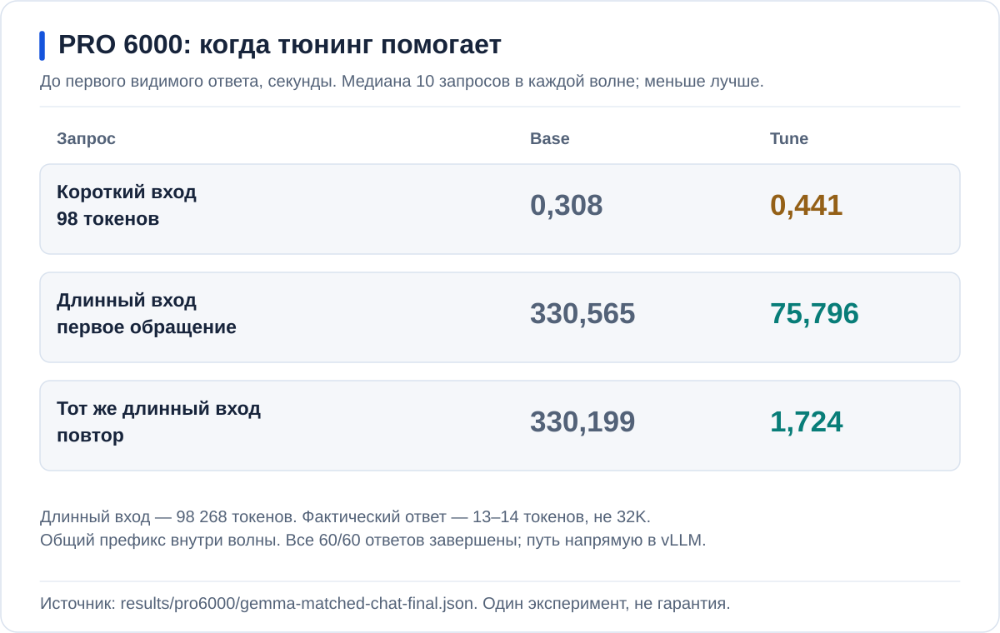

<p align="center">
  <a href="https://github.com/aleksandr-podmoskovniy/hardfest-gpu-workshop">
    
  </a>
</p>

# Инференс без простоя GPU: чиним LLM-сервис руками и делим карту на живом кластере

Александр Подмосковный, Флант / Deckhouse Platform

**Вариант для двух RTX PRO 6000 Blackwell по 96 GB.** На сервере 240 GB RAM.
На этих картах запускаются Gemma 31B и Qwen3.8; небольшие модели работают
на отдельной A30.

[H100](README.md) | [RTX 5060 Ti](RTX5060.md) | [RTX PRO 6000](RTXPRO6000.md)

<a id="contents"></a>
## Содержание

1. [Модель под нагрузкой](#ab)
2. [Память: сколько места нужно контексту](#memory)
3. [Вычисления: prefill и decode](#speculation)
4. [Размещение: несколько моделей на одной GPU](#placement)
5. [Автоматизация ручной настройки](#platform)
6. [Когда нужны дополнительные GPU](#conclusion)
7. [Доступ пользователей и учёт запросов](#gateway)
8. [Большая модель на двух GPU](#tp2)

К началу работы Gemma A уже доступна в чате, мониторинг собирает метрики,
а вторая Gemma и Qwen выключены. Подготовка описана отдельно:
[проверка стенда](docs/SETUP.md#acceptance) и
[создание приложений](docs/GITOPS.md#pro6000-bootstrap).

---

<a id="ab"></a>
## 1. Модель под нагрузкой

В [Open WebUI](https://ai.ap4y.ru) доступна **Gemma A — Base**.
Для входа нужен одобренный аккаунт. A — исходный вариант без нашего набора
оптимизаций. На второй карте будет работать Gemma B с теми же весами,
но другими настройками.

Одиночный вопрос может получить ответ сразу, а десять запросов — создать
очередь. Длина разговоров тоже важна: десять коротких вопросов и десять
больших документов создают разную нагрузку.

Обработка входа и генерация продолжения называются **инференсом**.
Длина текста измеряется в **токенах** — частях слов и знаков.

### Что находится за чатом


**Open WebUI** принимает сообщения, шлюз **Bifrost** проверяет доступ
и выбирает модель, а **vLLM** выполняет вычисления на GPU.

Gemma A и B занимают по карте; Qwen потребует обе карты сразу.
A30 обслуживает поиск по документам и распознавание речи.
[Полная схема стенда и подготовка](docs/SETUP.md).

### Графики: очередь, память и загрузка GPU

<a id="monitoring"></a>
> **AI Inference / Service performance**<br>
> Namespace: `hardfest-demo`; Service: `selectel-gemma-a`<br>
> Интервал: текущие запросы. GPU: только нода этой модели.

| Наблюдение | Что выясняется дальше |
| --- | --- |
| Waiting — ожидающие запросы — растёт, Running — активные — почти не меняется | Что ограничивает число активных запросов? |
| Память GPU занята | Сколько занимают веса, кеш и рабочие буферы? |
| GPU utilization меняется | Когда карта вычисляет, а когда ждёт данные? |

### Один симптом — три уровня проверки

**Занятая память не означает, что вычислительные блоки GPU полностью загружены.**
Причины ожидания будем разбирать по отдельности:

1. **Память:** хватает ли места для модели и состояния активных разговоров?
2. **Вычисления:** сколько работы нужно для обработки входа и каждого токена ответа?
3. **Размещение:** соответствует ли выделенная часть GPU размеру задачи?

CPU, сеть и шлюз тоже могут задерживать запрос; график GPU этого не исключает.

<details>
<summary>Команда для сравнения: десять коротких запросов</summary>

Команда сравнивает настройки на короткой нагрузке. Для проверки полного окна
есть отдельный [клиент длинной нагрузки](examples/pro6000-load-client/README.md).
Перед запуском очередь должна быть пуста.

```bash
export NS=hardfest-demo SERVICE=selectel-gemma-a SERIES=base-short
mkdir -p results/pro6000-local
set -o pipefail
kubectl --context "$GPU_CONTEXT" -n "$NS" exec "deployment/$SERVICE" -c vllm -- \
  vllm bench serve --backend vllm \
    --base-url "http://$SERVICE.$NS.svc.cluster.local:8000" \
    --endpoint /v1/completions --model "$SERVICE" \
    --tokenizer /data/modelcache/models/gemma-4-31b \
    --dataset-name random --seed 42 --random-range-ratio 0 \
    --random-input-len 2048 --random-output-len 512 \
    --num-prompts 10 --max-concurrency 10 --ignore-eos --temperature 0 \
    --ready-check-timeout-sec 0 --num-warmups 0 \
    --save-result --result-dir /dev --result-filename stdout \
  | tee "results/pro6000-local/$SERIES.txt"
```

В успешном прогоне `completed=10`, `failed=0`, обработано 20 480 входных
и 5 120 выходных токенов. Running и Waiting покажут, возникла ли очередь.
Её отсутствие на коротких запросах не доказывает вместимость полных окон.

Для Cache: `SERVICE=selectel-gemma-cache SERIES=cache-short`;
для Tune: `SERVICE=selectel-gemma-b SERIES=tune-short`.
Первый проход и повтор сохраняются отдельно. Клиент делит CPU с vLLM,
поэтому параметры нагрузки и способ запуска во всех вариантах одинаковы.

</details>

Веса у запросов общие, а история каждого разговора создаёт дополнительное
состояние в памяти. Чем оно больше, тем меньше разговоров помещается.

---

<a id="memory"></a>
## 2. Память: сколько места нужно контексту

```math
\Large M_{\mathrm{GPU}}=W_{\mathrm{weights}}+K_{\mathrm{KV}}+R_{\mathrm{buffers}}
```

**Веса + KV-кеш + рабочие буферы.** Эти части меняются по-разному,
поэтому одной общей цифры занятой VRAM для диагностики недостаточно.

### Почему длинный разговор занимает больше места

Память GPU занята не только весами. **Веса** — это параметры модели:
при инференсе они не меняются и используются всеми запросами.
А **KV cache (Key–Value cache)** хранит рассчитанные ключи и значения
для токенов истории. Благодаря этому модель при генерации следующего токена
может использовать уже выполненную работу.

KV cache не содержит готовый ответ. Он хранит состояние, необходимое для
продолжения конкретного текста, поэтому независимому разговору нужен свой кеш.
Кроме весов и KV, vLLM нужны рабочие буферы. Их память тоже должна быть учтена.

<a id="kv-formula"></a>
### Общая формула KV-кеша

Для одинаковых слоёв с **full attention**, которые хранят собственные K/V
одинаковой размерности, и независимых историй одинаковой длины:

```math
\LARGE \boxed{\begin{gathered}
KV = 2\times b\times L \\
{}\times H_{kv}\times D\times S\times N
\end{gathered}}
```

| Множитель | Что означает |
| --- | --- |
| **2** | Два массива: ключи **K** и значения **V** |
| **b** | Байт на элемент: **2 для BF16**, **1 для FP8** |
| **L** | Число слоёв с собственным KV-кешем |
| **Hkv** | Число KV-голов в слое — не число query-голов |
| **D** | Размерность одной KV-головы |
| **S** | Токены одной истории: вход и уже созданная часть ответа |
| **N** | Число независимых историй |

Результат — **байты K/V-данных**. Для GiB делим на `1024³`.
Веса, рабочие буферы и округление блоков сюда не входят.
Это объём для всей копии модели, до распределения между GPU.

### Расчёт для Gemma 31B с окном 128K и 256K

Размер KV зависит от архитектуры модели. Механизм **attention** связывает
токен с контекстом. В слоях с full attention доступна полная история,
а в слоях со sliding-window attention — только последнее окно.


Для Gemma применяем общую формулу **отдельно к двум группам слоёв**,
затем складываем результаты. У full attention длина истории — `S`,
у локальных слоёв — `min(S, w)`, где `w` — размер локального окна.

У Gemma 4 31B десять слоёв сохраняют полную историю,
ещё пятьдесят — последние 1024 токена. Поэтому часть KV растёт вместе
с длиной разговора, а часть перестаёт расти после заполнения локального окна.
**1024 — окно локальных слоёв, а не ограничение пользовательского запроса.**

Для одной истории длиной `S` объём самих данных KV в формате BF16 составляет:

```math
\Large KV(S)=80\,\mathrm{KiB}\times S+0{,}78125\,\mathrm{GiB}
```

Здесь `S ≥ 1024`; `S` — вход вместе с уже созданным продолжением.

### Одна история 128K: 10,78 GiB только на KV

```math
\Large 80\,\mathrm{KiB}\times131\,072+0{,}78125\,\mathrm{GiB}=10{,}78125\,\mathrm{GiB}
```

При **256K** — **20,78 GiB на историю**. Для десяти независимых разговоров
получается **207,81 GiB в BF16** ещё до весов и рабочих буферов.

BF16 хранит элемент в двух байтах, FP8 — в одном. Переход на FP8 вдвое
уменьшает объём данных KV, но не размер весов модели. Для десяти независимых
историй получаются следующие объёмы:


Веса, вспомогательная модель, буферы и округление блоков требуют дополнительной
памяти. Зато у разговоров с одинаковым началом его KV можно хранить один раз.

<details>
<summary>Полная формула и проверка расчёта</summary>

| Полное окно | Одна история, BF16 | 10 независимых, BF16 | 10 независимых, FP8 |
| --- | ---: | ---: | ---: |
| **128K = 131 072** | 10,78 GiB | **107,81 GiB** | **53,91 GiB** |
| **256K = 262 144** | 20,78 GiB | **207,81 GiB** | **103,91 GiB** |

В общую формулу подставляем параметры двух групп слоёв.
Для одной истории:

```math
\Large KV(S)=2b\left[10\times4\times512\times S+50\times16\times256\times\min(S,1024)\right]
```

Здесь `2` учитывает отдельно K и V, `b` — число байт на элемент.
Числа взяты из [закреплённого config.json модели](https://huggingface.co/google/gemma-4-31B-it/blob/842da3794eaa0b77d5f08bae87a17459d91ff475/config.json).
Хранение в движке и отличия архитектур разобраны в [расчёте памяти](docs/MEMORY_BUDGET.md).

```bash
python3 scripts/kv_math.py --tokens 131072 --sessions 10 --element-bytes 2
python3 scripts/kv_math.py --tokens 262144 --sessions 10 --element-bytes 1
```

</details>

Формулы зависят от архитектуры, а не только от числа параметров:
[Gemma 31B, Gemma E2B и гибридная Qwen3.5](README.md#kv-architectures).
Разбор с отдельными формулами раскрывается под заголовком «Другие архитектуры».

<a id="ram"></a>
### Повторное использование кеша и хранение в RAM

В рабочих запросах часто повторяется один документ или системная инструкция.
Пересчитывать это начало для каждого разговора необязательно. Вариант
**B Cache** объединяет три настройки:

| Настройка | Что меняет |
| --- | --- |
| **Prefix caching** | Переиспользует рассчитанный KV начала запросов с точно совпадающими токенами |
| **FP8 KV** | Вдвое уменьшает объём самих данных KV |
| **KV RAM-offload** | Сохраняет блоки в RAM и возвращает их на GPU при повторе |


При **KV RAM-offload** блоки кеша хранятся в RAM до следующего использования
и возвращаются на GPU перед вычислением. Ответ по-прежнему вычисляется
на GPU, а передача данных занимает время.

В B выделено **80 GiB RAM-кеша** при лимите контейнера 92 GiB:
память нужна также самому процессу. Увеличение диска для весов этот кеш не расширяет.

### Запуск B Cache рядом с исходной моделью

Для запуска подготовленного [профиля B Cache](values/pro6000/gemma-cache.yaml)
в Deckhouse Console у Deployment `selectel-gemma-cache` задаётся **1 реплика**.
Он занимает свободную карту. A остаётся включена для сравнения.

На обе модели отправляется один и тот же документ, затем запрос повторяется.
Разница во времени до первого токена и попадания в prefix cache показывают,
сколько работы удалось не повторять. Уникальный текст такого выигрыша не даёт.

Работу RAM-offload подтверждает возврат ранее вытесненного префикса:
в метриках растёт **CPU→GPU bytes**. Запись из GPU в RAM без последующего
чтения ещё не доказывает полезный эффект.
[Как проверить повторное использование](docs/MEASUREMENTS.md#offload-replay).

### Графики после Cache: повторный запрос и реальная память

> **AI Inference / Service performance**<br>
> Namespace: `hardfest-demo`; Services: `selectel-gemma-a`, `selectel-gemma-cache`<br>
> Сравнение: одинаковые входы, выходы и число одновременно отправленных запросов.

| Панель | Что проверяется |
| --- | --- |
| TTFT p95, Prefix cache hit | Ускорился ли повтор и был ли использован общий префикс? |
| Running now / Waiting now, GPU KV cache fill | Что стало с очередью и заполнением KV-пула? |
| GPU framebuffer used, Memory by runtime pod | Сколько памяти реально занято на карте и на узле? |
| KV: GPU ↔ RAM, bytes/s — CPU→GPU; External KV hit | Вернулся ли вытесненный кеш из RAM? |

После FP8 общая занятая VRAM не обязана уменьшиться: vLLM заранее резервирует
пул, в который теперь помещается больше токенов. Размер пула берётся из логов,
его заполнение — из метрик. Снижение очереди проверяется одинаковой нагрузкой,
а не просто более поздним интервалом, когда пользователей стало меньше.

Кеш помогает не повторять работу, но новый документ и новые токены ответа
всё равно нужно вычислить. Для этой части работы нужны другие настройки.

---

<a id="compute"></a>
<a id="speculation"></a>
## 3. Вычисления: prefill и decode

```math
\Large T_{\mathrm{answer}}\approx T_{\mathrm{queue}}+T_{\mathrm{prefill}}+T_{\mathrm{decode}}+T_{\mathrm{other}}
```

**Очередь + обработка входа + генерация + остальные задержки.**

<a id="latency"></a>
### Две фазы работы модели

При **prefill** модель обрабатывает входной текст и строит его KV.
При **decode** она генерирует продолжение, добавляя токены шаг за шагом.
У длинного документа может быть дорогая обработка входа, даже если ответ
состоит из одного предложения. А короткий вопрос с большим ответом создаёт
длительную нагрузку на decode.

Если модель сначала рассуждает, а затем формулирует ответ, обе части
расходуют общий выходной бюджет. Лимит 32K не даёт по 32K на каждую часть.


Для этих фаз полезны разные показатели:

- **TTFT** — время до первого токена. В клиентском измерении оно включает
  очередь, обработку входа и передачу запроса и ответа.
- **TPOT** — среднее время на следующий выходной токен. Оно характеризует
  темп уже начавшейся генерации.

Быстрое начало ответа не гарантирует быстрого завершения.

### Две оптимизации для двух фаз

**Chunked prefill** делит обработку большого входа на порции. Планировщик
чередует их с генерацией других ответов. Так уже начатые разговоры могут
продолжаться, пока новый длинный документ ещё обрабатывается.


**Speculative decoding** сокращает работу при генерации. Небольшая
**draft-модель** предлагает несколько следующих токенов, а основная модель
проверяет их. Если предложения часто подходят, за одну проверку принимается
сразу несколько токенов. Если нет, вычисления draft-модели оказываются лишними.
Поэтому наличие draft-модели ещё не означает ускорение: важен результат
на конкретных текстах и при нужной нагрузке.


### Замена B Cache на B Tune

Для следующего сравнения заменяется только B. В Deckhouse Console:

1. Deployment `selectel-gemma-cache` переводится в **0 реплик**.
2. После освобождения карты Deployment `selectel-gemma-b` переводится в **1 реплику**.

A продолжает работать. [Профиль B Tune](values/pro6000/gemma-b.yaml)
сохраняет настройки кеша и добавляет draft-модель, chunked prefill
с бюджетом 4096 токенов на шаг и CUDA graphs — повторное использование
подготовленных последовательностей GPU-операций.

**4096 — бюджет шага планировщика, не окно контекста и не лимит ответа.**
Окно остаётся 262 144 токена, выходной лимит — 32 768.

A сохраняет стандартные настройки планировщика vLLM. В B меняется набор
параметров, поэтому сравнение покажет их совместный результат.

В этом профиле `num_speculative_tokens: 1`: вспомогательная модель предлагает
один токен за шаг.

### Графики после Tune: начало ответа и темп генерации

> **AI Inference / Service performance**<br>
> Namespace: `hardfest-demo`; Services: `selectel-gemma-a`, `selectel-gemma-b`<br>
> Для сравнения Cache/Tune смешанная серия сохраняется до остановки Cache.

**TTFT** показывает ожидание начала, **TPOT / ITL** — темп продолжения.
Рядом проверяются **Output tokens/s, acceptance, ошибки и фактические длины**.
Более короткий или оборванный ответ не считается ускорением.

<a id="pro-result"></a>
### Что изменилось на одинаковых запросах

В измеренном сравнении обе Gemma получили **одинаковые входные токены**,
по десять запросов в волне. Измерялось время до **первого видимого ответа**:
с учётом очереди, обработки входа и возможного рассуждения перед ответом.



**На коротком входе B Tune начинает немного позже, а на длинном — заметно раньше.**
Повторное обращение к тому же документу даёт самый большой выигрыш.
Оптимизация длинных документов может не окупаться на коротких вопросах.

В длинном запросе было **98 268 входных токенов**. Ответы занимали всего
**13–14 токенов**, хотя лимит позволял 32K. Все **60/60** ответов завершились
естественно. Из этого эксперимента можно судить о начале ответа,
но **не о скорости длинной генерации** и не о вместимости окна 256K.

<details>
<summary>Точные значения, разброс и условия сравнения</summary>

<!-- result:pro-chat -->
| Одинаковый запрос A/B | Base, с | Tune, с | Изменение |
| --- | ---: | ---: | ---: |
| Короткий вход, 98 токенов | 0,308 | 0,441 | на 0,133 с позже |
| Длинный вход, первое обращение | 330,565 | 75,796 | на 254,769 с раньше |
| Тот же длинный вход, повтор | 330,199 | 1,724 | на 328,476 с раньше |
<!-- /result:pro-chat -->

В таблице приведены медианы, не максимальное ожидание. У десяти запросов
внутри волны общий префикс. При первом обращении его ещё нет в кеше до начала
волны, но внутри неё он уже может использоваться повторно.
Результат нельзя приписать только offload или только draft-модели:
между A и B изменилось несколько настроек.

Запросы этого эксперимента направлялись в vLLM, без WebUI и Bifrost.
[Ответы и хеши входных токенов](results/pro6000/gemma-matched-chat-final.json),
[проверенная сводка](results/pro6000/gemma-matched-chat-validated-summary.json),
[график медиан и min–max](results/pro6000/gemma-matched-chat-ttft.svg).
[Команда повторения эксперимента](results/pro6000/README.md#matched-reproduction)
отличается от короткого теста в разделе 1: у них разные входы и длины ответов.

</details>

<a id="long-context"></a>
### Проверка ответа по длинному документу

Размер окна ещё не говорит о полезности ответа. Для проверки в чат передаётся
документ целиком, без предварительного поиска фрагментов. Вопрос относится
к известному факту в середине документа; ответ должен назвать факт и источник.

В журнале сверяются длины входа и ответа и нормальное окончание потока.
Лимит 32K разрешает длинный ответ, но не требует дописывать законченную мысль.

### Что происходит при заполнении всего окна

В отдельном тесте вместимости **каждый ответ принудительно доводился до
32 768 токенов**. Десять запросов подавались одновременно, но не выполнялись
все одновременно: часть ожидала освобождения GPU.

<!-- result:pro-capacity -->
| Gemma / проверка вместимости | Base | Tune |
| --- | ---: | ---: |
| Вход + выход на запрос | 134 752 + 32 768 | 229 376 + 32 768 |
| Завершено / подано одновременно | 10 / 10 | 10 / 10 |
| Максимум активных по метрикам | 1 | 2 |
| Максимальный TTFT, мин | 301,9 | 255,0 |
| Время всей серии, мин | 333,6 | 312,6 |
<!-- /result:pro-capacity -->

**Входы различаются, поэтому эта таблица не измеряет ускорение A/B.**
B Tune обработал более длинный контекст. Однако ожидание первого токена
вплоть до нескольких часов неприемлемо для чата. Даже при RAM-offload 80 GiB
одновременно активны были не десять запросов, а максимум два по метрикам.
[Графики очереди A](results/pro6000/gemma-a-capacity-monitoring.png)
и [B](results/pro6000/gemma-b-capacity-monitoring.png),
[результаты и условия](results/pro6000/README.md).

Есть и другие способы улучшить обслуживание запросов.
**Cache-aware routing** направляет запрос туда, где уже есть нужный префикс.
**Prefill/decode disaggregation** разделяет обработку входа и генерацию
между разными ресурсами. В этом стенде они не включены;
[ссылки для дальнейшего чтения](docs/SOURCES.md#за-пределами-этого-стенда).

Каждая Gemma занимает целую карту. Небольшой модели столько ресурсов
не нужно, но другая модель может не получить к ним доступа.
Здесь важен способ выделения ресурсов GPU в Kubernetes.

---

<a id="placement"></a>
## 4. Размещение: несколько моделей на одной GPU

### Почему запроса количества GPU бывает недостаточно

Классический **device plugin** сообщает Kubernetes доступное число GPU
или подготовленных ресурсов. Приложение запрашивает количество, например
одну карту. Для выбора устройства с нужными свойствами приходится
дополнительно договариваться об именах ресурсов и метках нод.
Подробности — в [статье автора](https://habr.com/ru/companies/flant/articles/1020276/).

**DRA (Dynamic Resource Allocation)** позволяет выразить требования к устройству
и его атрибутам в объектах Kubernetes. Драйвер получает этот запрос и выделяет
подходящий ресурс. Так выбор железа становится частью описания приложения.

Однако стандарт не добавляет GPU новых аппаратных возможностей.
Возможность разделить карту зависит от самой карты и драйвера.

### Два разных способа разделить GPU

| Механизм | Как работает | Когда нужен |
| --- | --- | --- |
| **MIG (Multi-Instance GPU)** | Аппаратные разделы с выделенной памятью и вычислительными ресурсами | Нужна изоляция частей карты |
| **MPS (Multi-Process Service)** | Совместное выполнение процессов на одном GPU или MIG-разделе | Нужно плотнее разместить небольшие сервисы |

MPS не заменяет аппаратную изоляцию MIG.


### Размещение поиска и распознавания речи на A30

A30 в этом стенде разделена на два раздела `2g.12gb`.
В первом через MPS работают две модели поиска, во втором — распознавание речи:

- **Embedder** превращает текст в вектор, по которому можно найти похожие фрагменты.
- **Reranker** повторно оценивает найденные фрагменты и выбирает наиболее подходящие.
- **Speech-to-Text** преобразует речь в текст для дальнейшей обработки.

На ноде A30 следующие команды показывают фактически созданные разделы:

```bash
nvidia-smi -L
nvidia-smi mig -lgi
nvidia-smi mig -lci
```

Команды только читают состояние. Здесь используется заранее подготовленное
разделение, а не демонстрируется его изменение под нагрузкой.
Для изменения геометрии может потребоваться освободить GPU;
это входит в [подготовку A30](docs/SETUP.md).

Размер кеша, настройки вычислений и выделение железа приходится согласовывать
для каждой модели заново. Эту ручную работу и предстоит автоматизировать.

---

<a id="platform"></a>
## 5. Автоматизация ручной настройки

### Новая модель — снова все расчёты вручную?

Для одной Gemma уже пришлось согласовать память, кеш, выполнение и GPU.
У другой модели изменятся архитектура и ограничения. Цель следующего шага —
воспроизвести проверенный запуск без повторения всего ручного подбора.

### Что делает AI Inference

В AI Inference пользователь указывает модель и требования к её работе.
Планировщик сопоставляет их с доступным железом и рецептами запуска,
а затем выбирает допустимую конфигурацию. Выполнение модели остаётся за vLLM.

Запрос на запуск описывается объектом **InferenceService**. Он позволяет
получить настроенный сервис без ручной сборки ресурсов и параметров.


Подключение к шлюзу и чату на стенде уже подготовлено для определённых имён.
Произвольное имя сервиса не создаст такое подключение автоматически.

### Создание в Deckhouse Console

До остановки A в каталоге проверяются доступность модели и совместимого
рецепта: одна карта, окно 262 144, FP8 KV, RAM-offload и draft-модель.
Если план не может удовлетворить этим требованиям, A остаётся работать
до подготовки рецепта.

Deployment A переводится в **0 реплик**, а B Tune остаётся работать.
Освободившуюся карту займёт Gemma, созданная через AI Inference.

| Поле | Значение для Gemma на этом стенде |
| --- | --- |
| Проект | `hardfest-demo` |
| Имя сервиса | **`selectel-gemma31`** |
| Модель из каталога | `gemma-4-31b` |
| Класс сервиса | `hardfest-selectel-gemma31` |
| Стратегия | `Latency` |
| Класс устройства | `hardfest-selectel-blackwell` |

В проекте Deckhouse Console сервис создаётся в разделе **AI-модели**,
на странице **Сервисы инференса**, кнопкой **Создать**.
Если установленная форма не показывает нужные поля, тот же объект задаётся
через [YAML Gemma](platform/pro6000/gemma.yaml). В нём заменяются только
отмеченные привязки классов; имя сохраняется.

**Создание InferenceService сразу запрашивает ресурсы.**
Поля `replicas` у этого CRD нет.

### Как убедиться, что автоматизация сохранила результат

В созданном сервисе проверяются выбранный рецепт, окно контекста и готовность
адреса API. Затем нужен настоящий запрос из WebUI: он проверяет не только
vLLM, но также маршрут Bifrost и права участника.

[Подготовка сервиса](docs/SETUP.md) и
[соответствие имён в чате и шлюзе](docs/CHAT_AND_ACCESS.md) описаны отдельно.

Цель — получить сопоставимую работу модели с меньшим количеством ручной
настройки. Для этого ручная B и платформенная Gemma сравниваются на одинаковых
сообщениях. Готовность сервиса ещё не доказывает равенство скорости.

---

<a id="conclusion"></a>
## 6. Когда нужны дополнительные GPU

### Самая дорогая карта в кластере — та, которая простаивает

Резерв для отказа или пиков может быть обоснован. Речь о ресурсах,
которые не используются из-за неподходящих настроек или размещения,
пока пользователи ждут ответа.

У очереди нет единственного решения. Иногда помогает повторное использование
кеша, иногда — другая работа планировщика, иногда — более плотное размещение
небольших моделей. Выбор определяется измеренным ограничением.

**Вместимость и скорость — разные требования.** Наш тест полного окна
это показал: все запросы завершились, но ожидание оказалось слишком большим
для чата. Дополнительные GPU обоснованы, когда после настройки существующих
ресурсов всё ещё не хватает для нужного числа запросов с допустимой задержкой.

---

<a id="gateway"></a>
## 7. Доступ пользователей и учёт запросов

Метрики GPU показывают общую нагрузку, но не объясняют, кто её создал.
Эту часть обеспечивает Bifrost, через который проходят запросы из чата.

**Virtual Key (VK)** — персональный ключ шлюза. С ним связаны доступные
пользователю модели, лимиты и журнал запросов. Поэтому участникам не нужен
общий ключ, скопированный в браузер.

В записи запроса видны ключ пользователя, маршрут, модель, входные
и выходные токены, статус и задержка. Это позволяет связать нагрузку
с конкретным использованием сервиса.

Стоимость по тарифу шлюза — **не счёт за аренду GPU**.
При нескольких экземплярах шлюза суммарный счётчик расходов может
отставать от журнала запросов. В этом стенде он показывает оценку расхода,
но не обеспечивает строгий общий лимит бюджета.

Нагрузочные тесты напрямую в vLLM обходят шлюз и не попадают в учёт VK.
Персональный учёт проверяется отдельно запросом из чата участника.
[Проверка доступа и журналов](docs/CHAT_AND_ACCESS.md).

Небольшие модели могут делить одну карту. Обратная задача возникает,
если ресурсы нескольких карт нужны одной большой модели.

---

<a id="tp2"></a>
## 8. Большая модель на двух GPU

**Tensor Parallelism (TP)** распределяет операции модели между GPU.
`TP2` означает, что одну модель обслуживают две карты; это не две независимые
копии. Карты обмениваются промежуточными данными, поэтому скорость зависит
не только от суммарной памяти, но и от обмена между ними.


### Подготовка и переключение на Qwen

**До остановки Gemma проверяется рецепт Qwen:** две карты, окно 262 144 токена,
лимит десять последовательностей, RAM-offload и MTP — предсказание следующих
токенов встроенным модулем модели для speculative decoding.

Размер RAM-кеша должен оставлять запас для vLLM и системы. YAML сервиса
не фиксирует все параметры движка, поэтому они сверяются с выбранным планом.
Если подходящего рецепта нет, Gemma остаются работать до его подготовки.

Qwen нужны обе карты. Перед запуском все ручные Gemma останавливаются,
а платформенный InferenceService Gemma удаляется после сохранения его YAML.
Модели в каталоге, классы и PVC сохраняются.

Затем создаётся [InferenceService Qwen](platform/pro6000/qwen.yaml):
имя **`selectel-qwen38-tp2`**, модель `qwen3-8-flash-next-nvfp4`,
класс `hardfest-selectel-qwen38-tp2`, стратегия `Latency`.
Имя должно совпадать с настроенным маршрутом шлюза.

### Полное окно для десяти запросов

**229 376 входных + 32 768 выходных = 262 144 токена.**
Это общий бюджет одного окна. Шаблон чата и системный текст входят в число
входных токенов, а не добавляются сверх него. У исходной Gemma A движок
подбирает окно по доступной памяти; этот расчёт её размер не задаёт.

Десять одновременно отправленных запросов ещё не означают десять активных
полных окон. Это проверяется графиками Running и Waiting вместе с TTFT,
TPOT и завершением ответов. RAM-offload не отменяет потребности в памяти
GPU для активных данных.

Для проверки вместимости [клиент нагрузки](examples/pro6000-load-client/README.md)
принудительно генерирует заданное число токенов. Для проверки качества
нужен обычный запрос, без `ignore_eos`: модель должна закончить ответ сама.
Длительная нагрузка выполняется при подготовке; во время показа используется чат.

### Измеренные задержки Qwen

В прогоне **10 × (229 376 входных + 32 768 выходных)** завершились все десять
запросов. По метрикам одновременно активны были максимум шесть.
Это отдельное измерение на двух картах, а не сравнение скорости Qwen и Gemma.

<!-- result:pro-qwen -->
| Qwen TP2: полное окно | Измерено |
| --- | ---: |
| Завершено / подано одновременно | 10 / 10 |
| Максимум активных по метрикам | 6 |
| Время всей серии, мин | 25,65 |
| Максимальный TTFT, мин | 19,98 |
| Средний TPOT движка, мс | 20,43 |
| Вытеснения активных запросов (preemptions) | 2 |
<!-- /result:pro-qwen -->

Средний TPOT около 20 мс описывает темп генерации уже обслуживаемого запроса.
Он не включает ожидание первого токена, которое в этом тесте достигало
почти 20 минут. **Это результат проверки вместимости, а не приемлемое
время ответа в чате.** Для интерактивной работы нужны меньшая нагрузка,
более короткие разговоры или дополнительные ресурсы.

Максимум активных запросов получен по метрикам с шагом 15 секунд,
а не по каждому событию. В прогоне указан RAM-offload **160 GiB**,
но полный набор параметров vLLM не сохранён. Поэтому для воспроизведения
цифр недостаточно применить YAML выше: сначала нужно проверить выбранный план.
[Проверенная сводка](results/pro6000/qwen-10x256k-summary.json),
[графики очереди, токенов/с и загрузки обеих карт](results/pro6000/qwen-capacity-monitoring.png).

<a id="cleanup"></a>
### После показа

Ручные Deployment возвращаются в **0 реплик**. Автоматическая синхронизация
Argo остаётся выключенной. Платформенные InferenceService останавливаются
отдельно: изменение числа реплик дочернего Deployment контроллер может
отменить. Веса и их дисковый кеш сохраняются.

Остановка Pod не прекращает аренду GPU. После сохранения результатов
и проверки дискового кеша сервер можно заморозить отдельно в облачной панели.
При следующем запуске веса останутся на диске, но RAM-кеш придётся прогреть
заново: состояние работавшей модели в нём не сохраняется.
