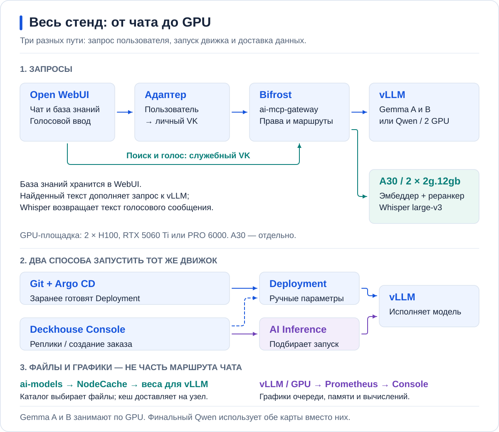

# Подготовка стенда

Участник начинает с работающей Gemma A и переключает готовые ручные Deployment
в Deckhouse. Администратор заранее доставляет модели, настраивает профили,
метрики и доступ. Проверка прямого API и проверка личного чата — отдельные шаги.



| Компонент | Задача |
| --- | --- |
| ai-models | Доставить закреплённые веса в дисковый NodeCache и подключить их к Pod |
| vLLM | Загрузить модель на GPU и отвечать на запросы |
| AI Inference | Создать runtime по заказу InferenceService и подходящему рецепту |
| Bifrost / webui-access | Выбрать маршрут, проверить личный доступ, учесть расход |
| Open WebUI | Чат, документы и голосовой ввод |
| GitLab / Argo CD | Хранить и применять конфигурацию стенда |
| Prometheus / Deckhouse Console | Показать нагрузку и состояние сервисов |

## 1. Проверить доступ и ресурсы

Для подготовки нужны Git, Helm 3+, kubectl, curl и соседние клоны публичного
репозитория и частного `k8s-config`. Namespace, драйвер, DRA и контроллер
GPUClass/GPUPool уже установлены. Используйте созданные ими DeviceClass.

Из частного `k8s-config`, с контекстами своей площадки:

```bash
export ARGO_CONTEXT=management ARGO_NAMESPACE=argocd
export GPU_CONTEXT=gpu-cluster MIG_CONTEXT=a30-cluster
export DEMO_DIR=argo-projects/gpu-cluster/hardfest-demo
export A30_DIR=argo-projects/a30-cluster/hardfest-demo
export WORKSHOP_BRANCH=hardfest-demo
set -o pipefail
kubectl --context "$ARGO_CONTEXT" -n "$ARGO_NAMESPACE" get applications
kubectl --context "$GPU_CONTEXT" get nodes,deviceclasses
kubectl --context "$GPU_CONTEXT" -n hardfest-demo get pods,pvc,resourceclaims
```

Сверьте GPU UUID, доступную RAM, размещение томов и отсутствие новых ECC/Xid.
Для TP2 нужны две подходящие карты на одной ноде и проверенный обмен.
При аппаратных ошибках нагрузка не начинается; драйвер, MIG mode, VFIO,
cordon и чужие workloads в этой инструкции не меняются.

До первого импорта выполните [bootstrap ветки GitOps](GITOPS.md#bootstrap).
Argo должен видеть ветку и иметь доступ к целевому кластеру.

## 2. Доставить модели и ручные профили

[Каталог](../catalog/README.md) закрепляет ревизии весов. У каждого Model нужны
Ready, ненулевой размер и digest; доставку в NodeCache и mount проверяйте
при запуске потребителя. `Model Ready` не подтверждает CUDA или генерацию.
Образ runtime и веса имеют разные кеши.

Подготовьте чарт и values по [GitOps](GITOPS.md#2-подготовить-файлы-площадки).
Для PRO 6000 есть [отдельный bootstrap трёх профилей](GITOPS.md#pro6000-bootstrap)
и [клиент нагрузки](../examples/pro6000-load-client/README.md).
В `modelRefs` у профиля с assistant перечисляются обе модели.
Все ручные профили из Git изначально выключены. Для работы через Console
проверьте autosync OFF и исключение `/spec/replicas` у соответствующих Applications.

| Площадка | Ручные профили | Ограничение подготовки |
| --- | --- | --- |
| RTX PRO 6000 | `selectel-gemma-a`, `selectel-gemma-cache`, `selectel-gemma-b` | Параметры и результаты — в [основном маршруте](../RTXPRO6000.md) |
| H100 | `hf-gemma-a`, затем `hf-gemma-b` Cache/Tune | На 128 GiB RAM запускать последовательно |
| RTX 5060 Ti | `rtx-gemma-base`, `rtx-gemma-cache`, `rtx-gemma-tune` | Две карты по 16 GiB; подготовка ниже |

У H100 B требует 56/80 GiB RAM request/limit, Qwen — 80/104 GiB.
Перед Qwen освобождаются обе GPU. [Полный бюджет](MEMORY_BUDGET.md).
A30 находится на отдельной площадке: две части `2g.12gb`, эмбеддер и реранкер
делят одну через MPS, Whisper занимает другую. Чужие разделы сохраняются.

<a id="inference-readiness"></a>
## 3. Подготовить создание InferenceService

InferenceService — заказ на модель, по которому AI Inference создаёт runtime.
Участник сам создаёт его в Deckhouse из подготовленного YAML.
До освобождения работающих GPU проверьте рецепт, класс сервиса, Model и точное имя заказа.

Для RTX PRO 6000, namespace `hardfest-demo`:

| Имя InferenceService | Model | InferenceServiceClass |
| --- | --- | --- |
| `selectel-gemma31` | `gemma-4-31b` | `hardfest-selectel-gemma31` |
| `selectel-qwen38-tp2` | `qwen3-8-flash-next-nvfp4` | `hardfest-selectel-qwen38-tp2` |

Gemma использует стратегию `Latency` и DeviceClass `hardfest-selectel-blackwell`.
Сверьте фактическую схему установленного модуля и план запуска.
Для Qwen класс должен разрешать две карты: `acceleratorPolicy.maxAcceleratorCount ≥ 2`;
для одной копии модели — `scalingPolicy.minReplicas = maxReplicas = 1`.
Это параметры класса, не поля `replicas` самого InferenceService.

Для закрытого API проверьте `exposurePolicy.authentication: Token` и доставку
ключа в шлюз. Рецепт должен давать нужные окно, TP, KV/offload и assistant/MTP;
название класса или Ready само по себе этого не доказывает.
В живом `v1alpha1` нет `replicas` и `pause`; [остановка заказа](GITOPS.md#остановка).

Для H100 целевые рецепты: Gemma Tune 128K, FP8 KV, assistant, CPU KV 32 GiB;
Qwen TP2 256K, MTP, CPU KV 16 GiB. Эти параметры не переносятся автоматически
на PRO 6000 или RTX 5060.

## 4. Подключить чат и наблюдение

Настройте [маршруты и личный доступ](CHAT_AND_ACCESS.md). Если установка адаптера
переключила ветку, вернитесь перед дальнейшими изменениями:

```bash
git switch "$WORKSHOP_BRANCH" || exit 1
```

Подключите [мониторинг](OBSERVABILITY.md). После создания платформенного заказа
проверьте цепочку: его имя → реальный Service и порт → маршрут Bifrost → модель
в WebUI. Наличие заказа не создаёт проверенный маршрут чата автоматически.

<a id="base-check"></a>
## 5. Запустить A и проверить ответ

В Console задайте ручному Deployment A одну реплику по [инструкции](GITOPS.md#запуск-a).
Для H100 API проверяется через `hf-gemma-a`; для других площадок замените
Service и `model` значениями своего профиля. Port-forward запускается отдельно:

```bash
kubectl --context "$GPU_CONTEXT" -n hardfest-demo port-forward svc/hf-gemma-a 18001:8000
```

```bash
curl --fail http://127.0.0.1:18001/v1/models
curl --fail-with-body --max-time 180 http://127.0.0.1:18001/v1/chat/completions \
  -H 'Content-Type: application/json' \
  -d '{"model":"gemma-4-31b","max_tokens":512,"temperature":0,"messages":[{"role":"user","content":"Объясни KV-кеш двумя предложениями."}]}'
```

Затем проверьте законченный ответ обычным одобренным аккаунтом WebUI,
его личный ключ и запись расхода в Bifrost, изменение метрик A.
B и ещё не созданные платформенные заказы не занимают GPU.

На PRO 6000 прямые прогоны опубликованы в [результатах](../results/pro6000/README.md).
Личный путь WebUI/Bifrost ещё требует проверки после входа; платформенная Gemma —
проверки SSE, каталога и heartbeat. Эти пункты не считаются готовыми по API-тесту.

<a id="rtx"></a>
## RTX 5060 Ti: подготовка отдельной площадки

Это исторический маршрут двух RTX 5060 Ti, не параметры PRO 6000.
Нужны две карты по 16 GiB на одной ноде и RAM с запасом для двух Gemma
с limit 18 GiB каждая. Из частного `k8s-config`:

```bash
export GPU_CONTEXT=gpu-cluster ARGO_CONTEXT=management ARGO_NAMESPACE=argocd
export RTX_DIR=argo-projects/gpu-cluster/hardfest-rtx NS=hardfest-rtx
export WORKSHOP_BRANCH=hardfest-rtx
set -o pipefail
```

Выполните [bootstrap ветки](GITOPS.md#bootstrap). Для нового каталога:

```bash
test ! -e "$RTX_DIR" || exit 1
mkdir -p "$RTX_DIR/charts" "$RTX_DIR/values" "$RTX_DIR/catalog" "$RTX_DIR/platform" "$RTX_DIR/argo-app"
for CHART in vllm-runtime inference-service model-catalog; do
  cp -R "../hardfest-gpu-workshop/charts/$CHART" "$RTX_DIR/charts/" || exit 1
done
cp ../hardfest-gpu-workshop/values/rtx/gemma-*.yaml "$RTX_DIR/values/"
cp ../hardfest-gpu-workshop/catalog/rtx.yaml "$RTX_DIR/catalog/"
cp ../hardfest-gpu-workshop/platform/rtx-*.yaml "$RTX_DIR/platform/"
cp ../hardfest-gpu-workshop/argocd/rtx/*.yaml "$RTX_DIR/argo-app/"
```

Заполните привязки площадки и `REPLACE_*`; секреты доставьте отдельно.
Профили пока `replicaCount: 0`, заказы — `order.enabled: false`.
Каталог проверяется и публикуется до регистрации Applications:

```bash
test "$(git branch --show-current)" = "$WORKSHOP_BRANCH" || exit 1
helm template rtx-models "$RTX_DIR/charts/model-catalog" -n "$NS" \
  -f "$RTX_DIR/catalog/rtx.yaml" |
  kubectl --context "$GPU_CONTEXT" apply --dry-run=server -f - || exit 1
git add -- "$RTX_DIR"
git diff --cached --check || exit 1
git diff --cached
git commit -S -s -m "Prepare RTX models and disabled services" || exit 1
git push origin "HEAD:refs/heads/$WORKSHOP_BRANCH" || exit 1
kubectl --context "$ARGO_CONTEXT" -n "$ARGO_NAMESPACE" apply -f "$RTX_DIR/argo-app/" || exit 1
REVISION=$(git rev-parse HEAD)
kubectl --context "$ARGO_CONTEXT" -n "$ARGO_NAMESPACE" patch application rtx-models \
  --type merge --patch "{\"operation\":{\"sync\":{\"revision\":\"$REVISION\",\"prune\":false}}}" || exit 1
```

При App-of-Apps вместо прямого `apply` синхронизируйте родителя.
Дождитесь Model Ready, проверьте size/digest и рецепты: Gemma Tune — 128K,
assistant, FP8 KV, CPU KV 4 GiB; Qwen — 128K, TP2, MTP, CPU KV 16 GiB,
`max-num-seqs=8`. После [настройки доступа](CHAT_AND_ACCESS.md):

```bash
git switch "$WORKSHOP_BRANCH" || exit 1
```

Подключите [мониторинг](OBSERVABILITY.md) и включите `rtx-gemma-base` в Console.
На исторической площадке без ручного управления репликами задайте
`replicaCount: 1` в `gemma-base.yaml`, commit/push и ручной Sync.
Проверьте ответ по шагу 5 с именами ниже; остальные модели пока выключены.

| Подпись | Маршрут | Service:порт | Upstream |
| --- | --- | --- | --- |
| Gemma A — Base | `vllm/rtx-gemma-base` | `rtx-gemma-base:8000` | `rtx-gemma-base` |
| Gemma B — Cache | `vllm/rtx-gemma-cache` | `rtx-gemma-cache:8000` | `rtx-gemma-cache` |
| Gemma B — Tune | `vllm/rtx-gemma-tune` | `rtx-gemma-tune:8000` | `rtx-gemma-tune` |
| Gemma A — DP | `vllm/rtx-gemma-platform` | `rtx-gemma-platform:80` | `rtx-gemma-e2b` |
| Qwen 9B — TP2 | `vllm/rtx-qwen35-tp2` | `rtx-qwen35-tp2:80` | `rtx-qwen35-9b` |

Service находятся в `hardfest-rtx`. После проверки A, метрик и личного чата
переходите к [маршруту RTX 5060](../RTX5060.md).
