# PRO 6000: вместимость и пользовательский путь

Измерения на RTX PRO 6000 Blackwell. Здесь разделены проверка вместимости,
полезный ответ из WebUI и создание сервиса через Console.
Сопоставимая серия обычных ответов Base/Cache/Tune не завершена:
эта поставка не содержит нового измерения ускорения. Одна проверка не заменяет другую.

## Состав серий полного окна

В каждой серии подаются десять независимых запросов. **Вход вместе с ответом**
заполняет настроенное окно; клиент проверяет фактические **32 768 выходных
токенов**, а не только разрешённый лимит.

| Серия | Окно конфигурации | Завершённая публичная выгрузка |
| --- | ---: | --- |
| Gemma Base | 167 520 | **10/10**, [сводка](gemma-base-167520ctx-summary.json) |
| Gemma Cache | 262 144 | **10/10**, [сводка](gemma-cache-262144ctx-summary.json) |
| Gemma Tune | 262 144 | **10/10**, [сводка](gemma-tune-262144ctx-summary.json) |
| Qwen TP2 | 262 144 | **10/10**, [сводка](qwen-262144ctx-summary.json) |

В общей сводке используются только полные, проверенные комплекты всех четырёх
серий. Отсутствующие результаты не заменяются прежними измерениями.

## Gemma Base: окно 167 520

| Что измерено | Результат |
| --- | ---: |
| Завершено / подано одновременно | **10 / 10** |
| Вход + выход каждого запроса | **134 752 + 32 768 токенов** |
| Время всей серии | **333,47 мин** (20 008,068 с) |
| Пик Running по метрикам | **1** |
| Медиана / максимум клиентского TTFT | **151,78 / 301,81 мин** |
| Средний TPOT движка | **57,96 мс** |
| Выходные токены за всю серию / время серии | **16,38 токена/с** |

Все потоки завершились; это не означает приемлемую задержку чата.
Размер окна отличается от Cache, а нагрузки на узел пересекались:
по этим двум сериям нельзя вычислять ускорение A/B.

<details>
<summary>Реальные панели Grafana за весь прогон Base и границы гистограмм</summary>

**Очередь:** наблюдавшийся пик Running — один, остальные запросы ожидали.

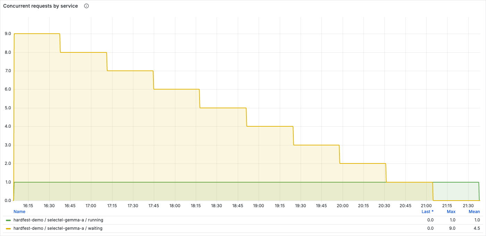

**KV-пул:** заполнение зарезервированного кеша, не всей памяти GPU.

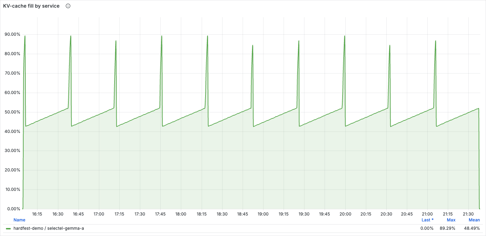

**Память:** VRAM обеих GPU узла и RAM выбранного процесса Base.

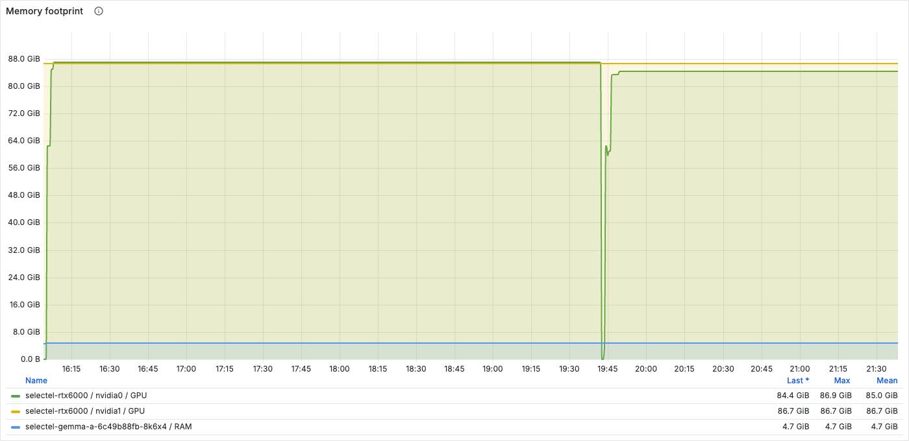

**TPOT:** квантили завершённых запросов в коротком скользящем окне.
Пробелы между завершениями не означают нулевую задержку.

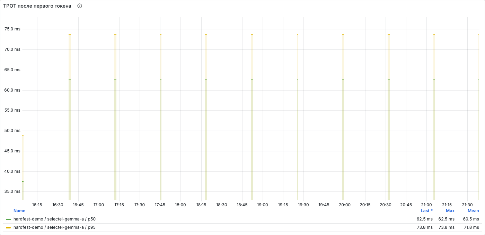

Панель «Первый токен и prefill, p95» скрывает значение, когда квантиль
выходит за конечные границы гистограммы. Последняя граница TTFT — **2560 с**;
**8 из 10** клиентских TTFT этого прогона выше неё. Поэтому пробелы на этой
панели нельзя считать нулевым ожиданием, а p95 — максимумом или средним.
Медиана и максимум TTFT в таблице рассчитаны по клиентским запросам.

Снимки не перерисованы; время — UTC. Числа сверяются с исходными метриками
с шагом 10 секунд. [Интервал и хеши снимков](grafana-base/manifest.json).

</details>

## Gemma Cache: окно 256K

| Что измерено | Результат |
| --- | ---: |
| Запросы, отправленные одновременно | **10** |
| Завершились без ошибок запросов | **10 из 10** |
| Вход каждого запроса | **229 376 токенов** |
| Выход каждого запроса | **32 768 токенов** |
| Время всей серии | **191,27 мин** (11 475,955 с) |
| Пик Running по метрикам | **2** |
| Медиана времени до первого токена | **80,1 мин** |
| Максимальное время до первого токена | **157,8 мин** |
| Средний TPOT движка | **65,2 мс** |
| Выходные токены за всю серию / время серии | **28,55 токена/с** |
| Вытеснения активных запросов | **0** |

**Запросы выполнились, но ждать первый токен больше двух часов для чата неприемлемо.**
Это проверка работы на полном окне, не комфортной параллельности чата.
Running включает обработку входа; наблюдавшийся пик не доказывает предел
активных запросов или одновременное хранение двух полностью заполненных окон.
Суммарные токены/с — результат всей серии, не скорость отдельного пользователя.

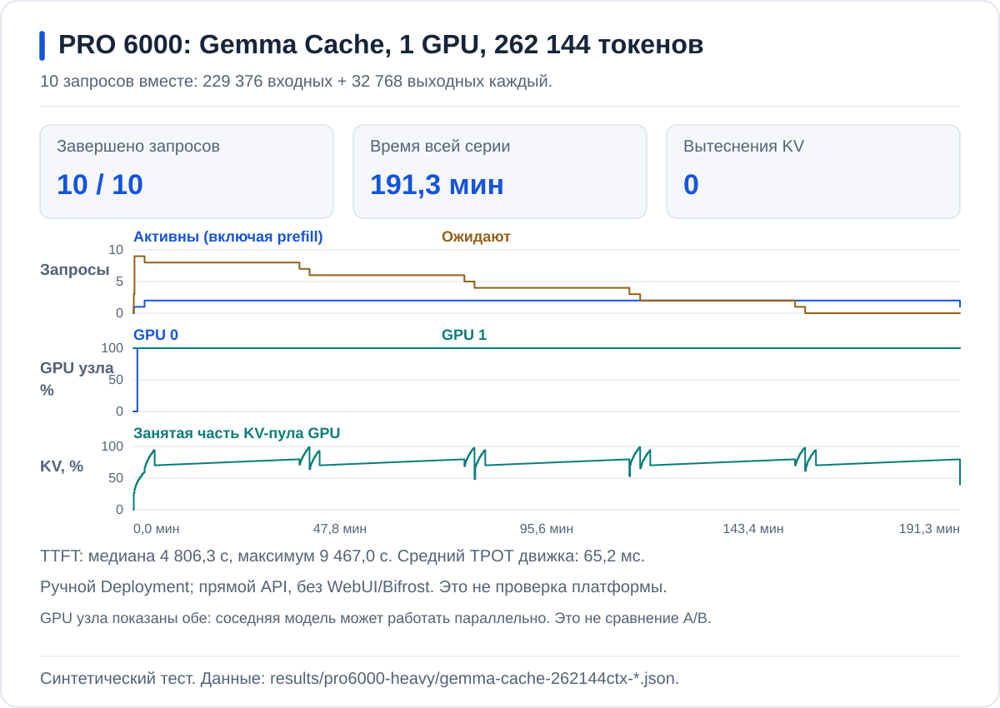

Одна GPU обслуживает Cache, на второй в это время работает Base.
Общие CPU и RAM, а также разные размеры окон не позволяют считать эти
серии скоростным сравнением A/B. Снимок обеих GPU показывает состояние узла,
а не потребление только Cache.

<details>
<summary>Реальные панели Grafana за весь прогон Cache</summary>

**Очередь.** Десять клиентов подали запросы вместе; наблюдавшийся пик Running — два.

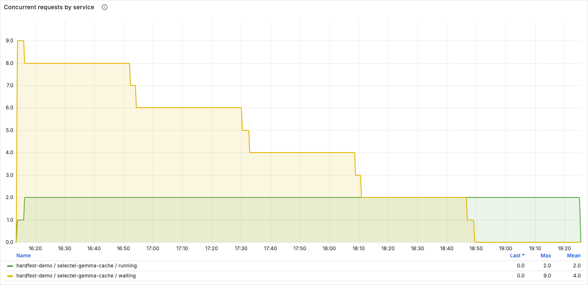

**KV-пул.** Заполняется зарезервированная область GPU, а не вся её память.

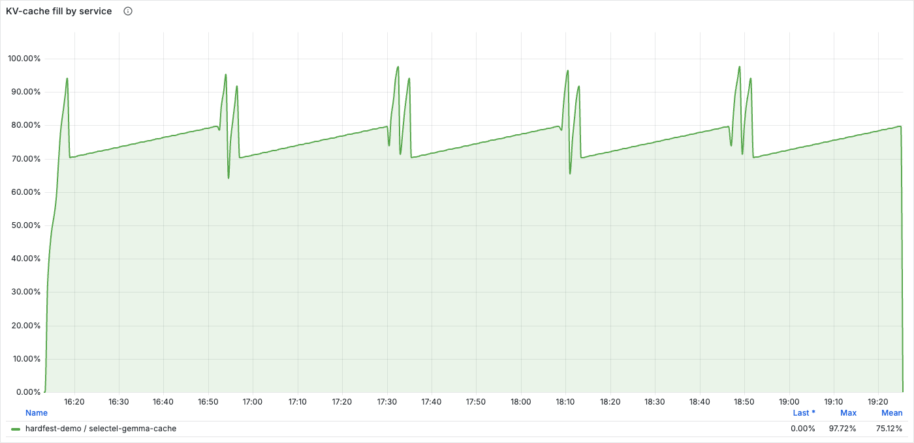

**Память.** Показаны обе GPU узла и RAM выбранного Cache-процесса.
Большая почти постоянная занятость VRAM сама по себе не означает,
что вся она занята полезным KV текущих запросов.

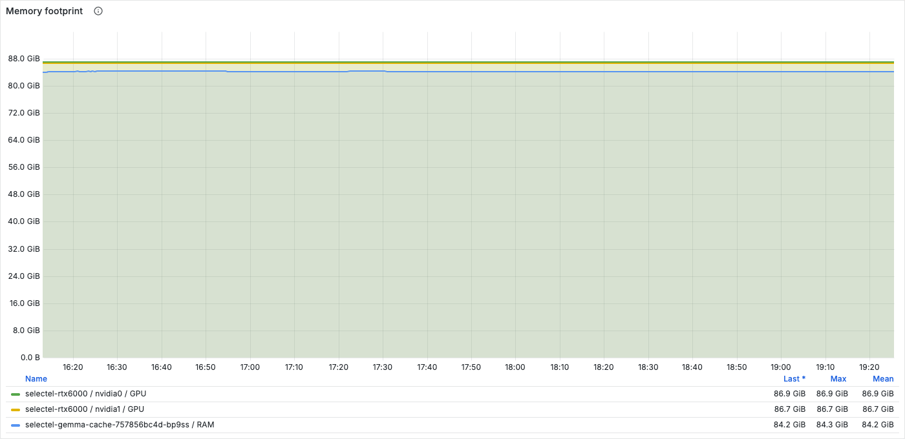

**Темп генерации.** Это p50/p95 из гистограммы завершённых запросов
в коротком скользящем окне. Пробелы между завершениями — не нулевая задержка.
Среднее за всю серию, рассчитанное по исходным счётчикам, — 65,2 мс.


**Переносы KV.** В этой серии префиксы независимы: кеш записывается в RAM,
но возврат CPU → GPU не наблюдается. Проверка повторного использования —
отдельный запрос, не часть этой серии.

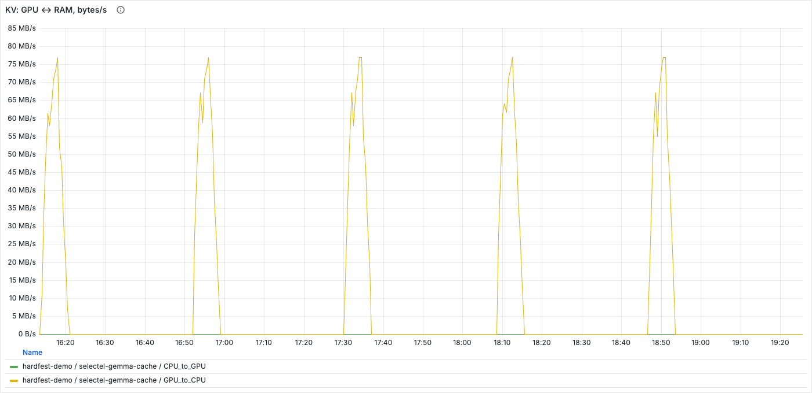

Это снимки Grafana, не перерисованные графики. Ось времени — UTC.
Точные числа берутся из исходной выгрузки с шагом 10 секунд.
[Интервал и хеши снимков](grafana-cache/manifest.json).

</details>

## Gemma Tune: окно 256K

| Что измерено | Результат |
| --- | ---: |
| Завершено / подано одновременно | **10 / 10** |
| Вход + выход каждого запроса | **229 376 + 32 768 токенов** |
| Время всей серии | **311,89 мин** (18 713,548 с) |
| Пик Running по метрикам | **2** |
| Медиана / максимум клиентского TTFT | **128,53 / 254,47 мин** |
| Средний TPOT движка | **108,99 мс** |
| Выходные токены за всю серию / время серии | **17,51 токена/с** |
| Вытеснения активных запросов | **0** |

Все десять запросов получили полный выход, но это не приемлемая задержка чата.
**На этой нагрузке Tune не улучшила результат Cache:** серия заняла
311,89 вместо 191,27 минуты, медиана ожидания первого токена —
128,53 вместо 80,1 минуты. Нагрузки на общий узел пересекались;
эти наблюдения не выделяют эффект draft-модели или другой отдельной настройки.
Сопоставимой серии обычных ответов пока нет.

<details>
<summary>Реальные панели Grafana за весь прогон Tune</summary>

**Очередь:** наблюдавшийся пик Running — два; запросы обслуживались
постепенно. Десять отправленных запросов не означают десять активных окон.

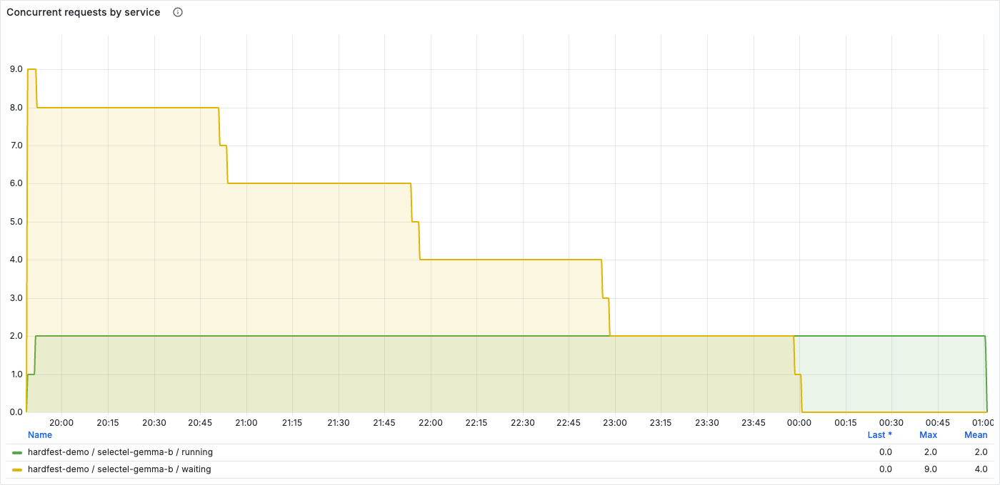

**KV-пул:** график показывает заполнение выделенного кеша,
не всей памяти GPU. Между завершениями запросов занятость растёт.

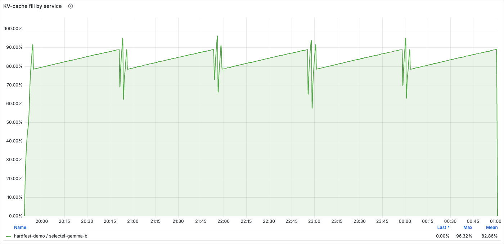

**Память:** на графике обе GPU узла, хотя Tune использует одну.
RAM относится к выбранному процессу Tune. Изменение занятости второй GPU
нельзя приписывать тюнингу этого процесса.

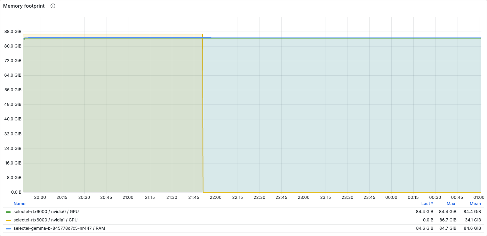

**TPOT:** p50 и p95 появляются по завершённым запросам в коротком
скользящем окне. Это не среднее всей серии; оно равно 108,99 мс.
Пробелы на графике не означают нулевую задержку.

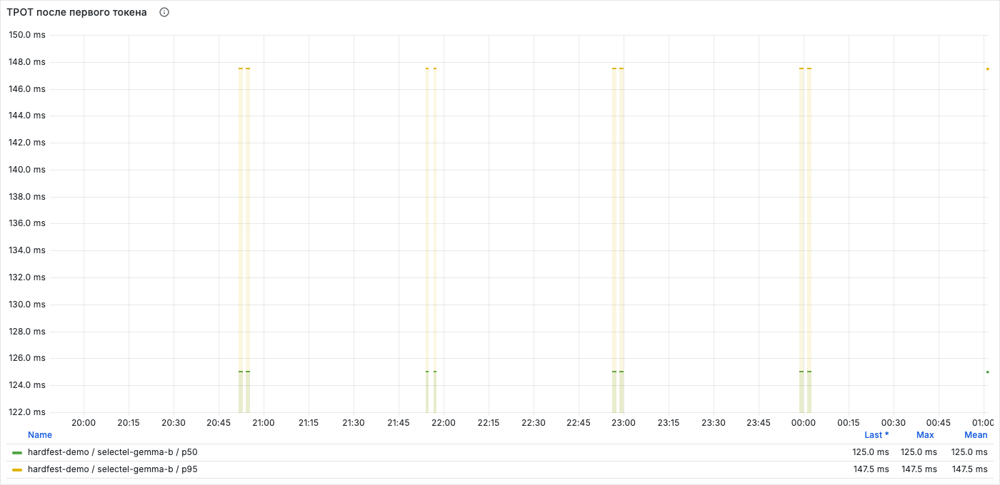

**Переносы KV:** запись GPU → RAM есть, чтения CPU → GPU в этой серии нет.
Независимые префиксы не проверяют повторное использование сохранённого кеша.

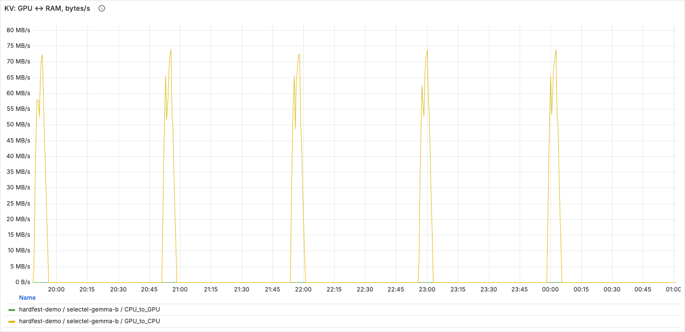

Снимки не перерисованы; время — UTC. График может сглаживать пики:
точные значения в таблице рассчитаны по исходным метрикам с шагом 10 секунд.
[Интервал и хеши снимков](grafana-tune/manifest.json).

</details>

## Qwen TP2: окно 256K

| Что измерено | Результат |
| --- | ---: |
| Завершено / подано одновременно | **10 / 10** |
| Вход + выход каждого запроса | **229 376 + 32 768 токенов** |
| Время всей серии | **25,39 мин** (1 523,375 с) |
| Пик Running по метрикам | **6** |
| Медиана / максимум клиентского TTFT | **7,09 / 19,83 мин** |
| Средний TPOT движка | **20,22 мс** |
| Выходные токены за всю серию / время серии | **215,10 токена/с** |
| Вытеснения активных запросов | **2** |

Движок завершил все потоки на двух GPU, но запросы ожидали в очереди.
Наблюдавшийся пик Running не доказывает одновременное размещение десяти
полных окон; минуты до первого токена не являются приемлемой задержкой чата.
Это другая модель: её результат нельзя считать ускорением Gemma.

[Четыре реальные панели Grafana](../../RTXPRO6000.md#вместимость-и-задержки-qwen)
показывают очередь, заполнение KV-пула, память и генерацию.
[Манифест снимков](grafana-qwen/manifest.json) фиксирует общий UTC-интервал;
числа сверяются с исходными метриками, а не считываются с изображения.
Эта серия проверяет вместимость движка напрямую. Проверка доступа после
создания и пересоздания сервиса через Console описана отдельно ниже.

## Обычный ответ на одинаковых входах

**Сопоставимая серия Base/Cache/Tune не завершена.** Публикуются только
проверенные результаты вместимости и отдельные проверки чата.
Выгрузки `gemma-matched-chat.json` нет; исторические числа её не заменяют.

Для отдельного сравнения Base, Cache и Tune проверяются последовательно четырьмя волнами по десять
запросов: короткий вход, длинный, повтор длинного и смешанная нагрузка.
В смешанной волне два длинных запроса отправляются первыми, восемь коротких —
через секунду. Входные токены одинаковы для всех профилей.

Модель сама заканчивает ответ. Лимит 32K не требует фактических 32K;
сверяются реальные длины, естественное окончание и время до первого
видимого текста. Рассуждение и SSE heartbeat не считаются видимым ответом.
Сравнивается профиль целиком, не эффект одной настройки. Общий префикс
может переиспользоваться уже внутри первой длинной волны.

## Кеш действительно возвращается из RAM

После полной серии повторили один из ранних входов: **229 376 токенов**,
но всего **один выходной токен**. Запрос завершился за **3,70 с**;
счётчик переноса CPU → GPU вырос с нуля на **9 813 360 640 байт**.

Это подтверждает чтение сохранённого KV из RAM. Это **не** повтор
предельного прогона и не отдельное измерение ускорения только от offload.
[Исходные счётчики и ограничения](gemma-cache-offload-replay.json).

## Ответ по базе знаний и своему файлу

Обычный участник вошёл по паролю, выбрал учебную базу о пиццерии
и прикрепил собственное дополнение в DOCX. Gemma связала оба источника:
повторная оплата не нужна, заказ передан на кухню в **18:24**,
время доставки в документах не указано. Ответ завершён: **2582 входных
и 161 выходной токен**.

На время этой проверки доступ к Cache был открыт только тестовому участнику.
Это не проверка стандартного доступа нового пользователя после одобрения.

<details>
<summary>Настоящий ответ в Open WebUI</summary>

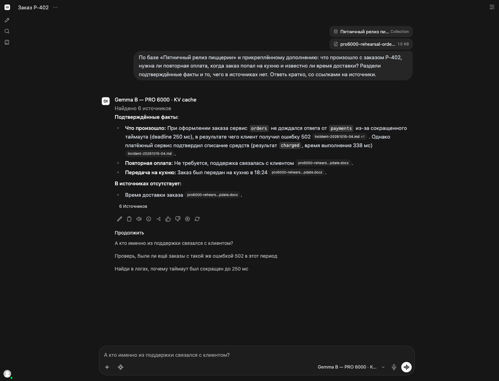

Все документы в этом опыте вымышленные. Шесть источников на экране —
найденные фрагменты из базы и вложения, а не шесть загруженных файлов.
Проверка выполнена через публичное HTTPS-имя из локальной сети;
она не заменяет отдельную проверку внешнего подключения.
[Сведения о проверке](webui-knowledge-receipt.json).

</details>

## Новый участник: вход и доступ к модели

Отдельный новый аккаунт зарегистрировался по почте и паролю. До одобрения
доступ был закрыт; после одобрения персональный ключ выдался автоматически.
Вручную выдавать этому участнику ключ или отдельное разрешение на модель
не потребовалось. Повторный вход сохранил тот же ключ.

При публичном чтении карточки Base **и её скрытой базовой модели** участник
отправил вопрос обычной кнопкой чата и получил законченный ответ:
**37 входных и 42 выходных токена**. Запись Bifrost совпала по модели,
личному ключу, времени и токенам. Инструменты управления кластером
этому аккаунту недоступны.

<details>
<summary>Ответ новичку в браузере и отдельная проверка внешнего подключения</summary>

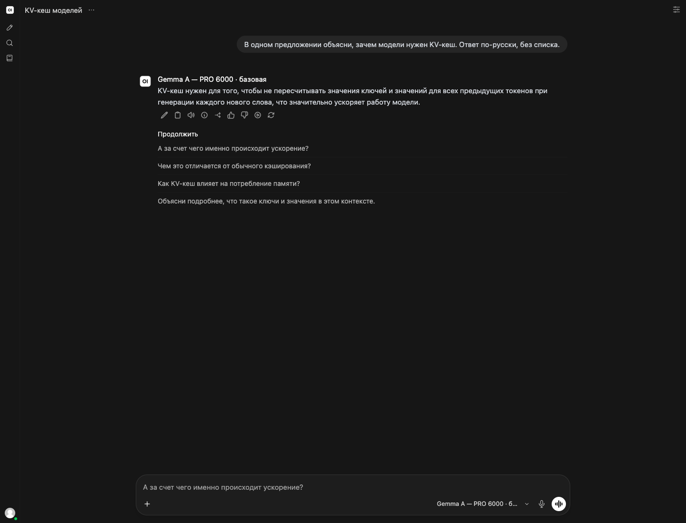

Отдельный запрос через публичный HTTPS-вход, без VPN и прокси, тоже завершился:
**24 входных + 3 выходных токена, 1,1 с**. Это проверка сетевого пути,
не десяти параллельных пользователей и не полного контекстного окна.

У Base в этом опыте стоимость в Bifrost оказалась **нулевой**: в полных
снимках тарифов до и после ответа не было правила для фактического имени
модели. Поэтому учёт стоимости здесь **не прошёл проверку**. Успешный ответ
и совпавшие токены не доказывают правильность расчёта денег.

В отдельной последующей проверке тариф настроен: **$10/M входных,
$15/M выходных**. Новый запрос Base с 37 входными и 35 выходными токенами
стоит **$0,000895**; журнал подтвердил расчёт. Это не исправление прежней
нулевой записи и не проверка общего HA-бюджета — его счётчики всё ещё
расходятся. [Отдельная запись проверки](base-tariff-check.json).

После первоначальной проверки новичка доступ снова закрыли. Создание и повторное создание Qwen
не входят в этот результат. [Границы проверки и исходные хеши](newcomer-acceptance.json).

</details>

## Qwen: создание, удаление и повторный запуск

**Создание, удаление и пересоздание через Console проверены.**
В обоих запусках обычный участник получил законченный ответ из WebUI.
Это функциональная проверка; длительный ответ и фоновая ошибка не позволяют
считать производительность и надёжность чата принятыми.

| Этап | Что подтверждено |
| --- | --- |
| Создание `selectel-qwen38-tp2` в Console | Новый заказ, план TP2, Ready и выделение двух GPU; готовность проверена до и после ответа |
| Ответ в WebUI | Обычный одобренный пользователь вошёл по паролю; запрос сопоставлен с записью Bifrost по личному ключу, модели, токенам и времени |
| Удаление своего заказа | Проверен прежний UID; дочерние Pod удалены, GPU ResourceClaim освобождены; модели и PVC сохранены |
| Создание с прежним именем | Новые UID заказа и дочерних объектов; тот же участник получил новый ответ с прежним личным ключом и маршрутом |

| Ответ участнику | Вход / выход, токенов | Длительность запроса в Bifrost |
| --- | ---: | ---: |
| После первого создания | **77 / 481** | **6,530 с** |
| После пересоздания | **77 / 132** | **135,978 с** |

Это длительности запросов шлюза, **не TTFT**. Во втором интервале наблюдались
одна ошибка фонового запроса длительностью **133,267 с** и один успешный
фоновый запрос. Ошибка совпала по личному ключу, модели и маршруту, но выбранный
ключ провайдера в её записи отсутствует. Полнота журнала по пагинации не доказана:
это число наблюдавшихся ошибок, не полный подсчёт всех ошибок сервиса.

<details>
<summary>Первый ответ участнику и границы проверки</summary>

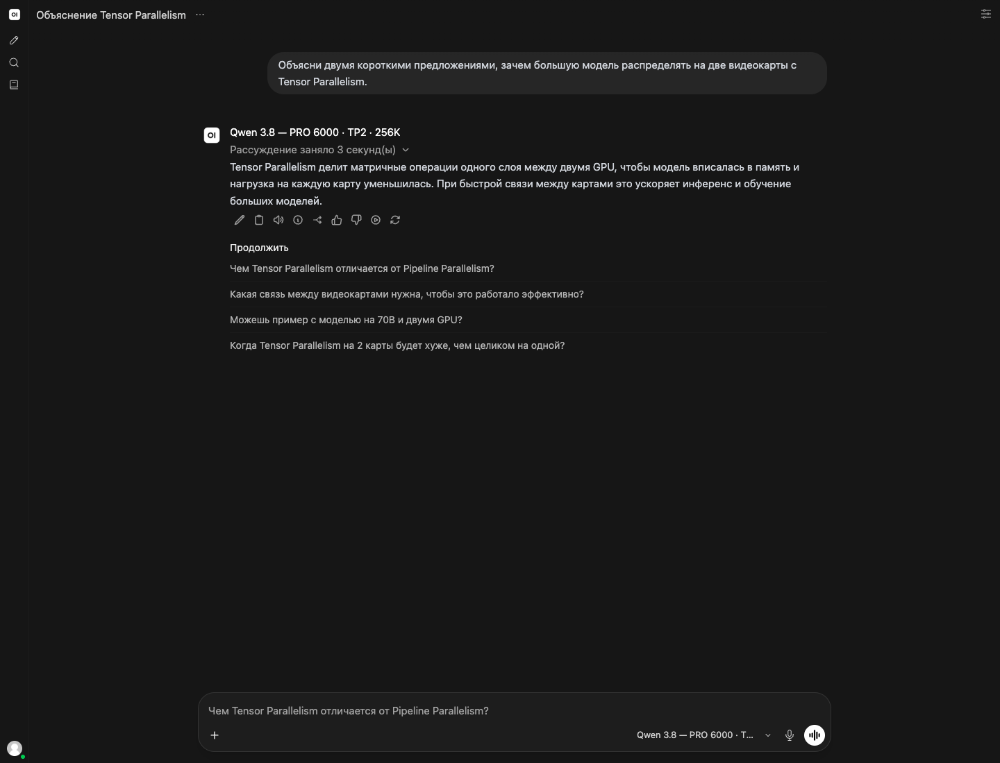

Скриншот показывает **первый ответ**, не ответ после пересоздания.
Из 481 выходного токена 429 относятся к рассуждению.
[Манифест и обезличенный результат полного цикла](qwen-console-lifecycle/manifest.json)
содержат хеш изображения, проверки объектов, оба ответа и найденную ошибку.
Два ответа не доказывают работу десяти пользователей одновременно,
качество чата на полном окне или доступ из внешней сети.

В первом интервале стоимость основного ответа — **0,01039**, сумма трёх
записей — **0,03256**, счётчик расхода личного ключа — **0,01039**.
Это единицы стоимости шлюза; валюта этим свидетельством не установлена.
Сумма журнала и счётчик различаются, поэтому **суммарный учёт расходов
не прошёл проверку**.

</details>

Поля формы и порядок доступа — в [инструкции Qwen](../../RTXPRO6000.md#platform).
Успех администратора не заменяет проверку обычным участником перед общей нагрузкой.

## Как проверить цифры

В capacity-серии запросы синтетические: независимые начала, повторяющийся наполнитель,
`temperature=0`, `ignore_eos=true`. Тест проверяет объём работы и завершение
потоков; он не оценивает качество диалога или принятие draft-токенов на обычных текстах.
Клиент работает на отдельной CPU-ноде и обращается напрямую к движку,
без WebUI и Bifrost.

Префиксы комплектов: `gemma-base-167520ctx`, `gemma-cache-262144ctx`,
`gemma-tune-262144ctx`, `qwen-262144ctx`. В каждом — шесть JSON-файлов:

| Суффикс | Что подтверждает | Base | Cache | Tune | Qwen |
| --- | --- | --- | --- | --- | --- |
| `-client` | Клиентские потоки и фактические токены | [JSON](gemma-base-167520ctx-client.json) | [JSON](gemma-cache-262144ctx-client.json) | [JSON](gemma-tune-262144ctx-client.json) | [JSON](qwen-262144ctx-client.json) |
| `-runtime` | Настройки, версия, GPU и модели | [JSON](gemma-base-167520ctx-runtime.json) | [JSON](gemma-cache-262144ctx-runtime.json) | [JSON](gemma-tune-262144ctx-runtime.json) | [JSON](qwen-262144ctx-runtime.json) |
| `-prometheus` | Метрики движка | [JSON](gemma-base-167520ctx-prometheus.json) | [JSON](gemma-cache-262144ctx-prometheus.json) | [JSON](gemma-tune-262144ctx-prometheus.json) | [JSON](qwen-262144ctx-prometheus.json) |
| `-hardware` | Метрики узла и процесса | [JSON](gemma-base-167520ctx-hardware.json) | [JSON](gemma-cache-262144ctx-hardware.json) | [JSON](gemma-tune-262144ctx-hardware.json) | [JSON](qwen-262144ctx-hardware.json) |
| `-summary` | Пересчитанная сводка | [JSON](gemma-base-167520ctx-summary.json) | [JSON](gemma-cache-262144ctx-summary.json) | [JSON](gemma-tune-262144ctx-summary.json) | [JSON](qwen-262144ctx-summary.json) |
| `-hardware-coverage` | Полнота наблюдений за обеими GPU | [JSON](gemma-base-167520ctx-hardware-coverage.json) | [JSON](gemma-cache-262144ctx-hardware-coverage.json) | [JSON](gemma-tune-262144ctx-hardware-coverage.json) | [JSON](qwen-262144ctx-hardware-coverage.json) |

`scripts/pro6000_capacity_results.py` требует все четыре полных комплекта,
пересчитывает сводки через `heavy_capacity.summarize`, сверяет SHA256,
фактические окна, TP, GPU и полноту метрик. Пропуски не превращаются в нули.
Для обычных ответов проверяются записи всех трёх профилей, одинаковые входы,
времена, фактический выход и хеши исходников опыта.

Для этой поставки выбран явный режим **capacity-only**: четыре полные серии
обязательны, а вместо незавершённого сравнения чата публикуется пояснение.
Режим не подставляет старые ответы и не пропускает проверки исходных данных.
H100 и RTX проверяются независимо. Команды не записывают файлы:

```bash
python3 scripts/article_results.py --scope h100-rtx --check
python3 scripts/article_results.py --scope pro-capacity-only --check
```

При неполной capacity-выгрузке проверка завершается ошибкой. Полные режимы
`--scope pro` и `--scope all` дополнительно требуют завершённый matched-тест.
Если его JSON уже присутствует, capacity-only тоже отказывает: имеющиеся
данные нужно проверить полным режимом, а не скрывать сообщением об их отсутствии.
