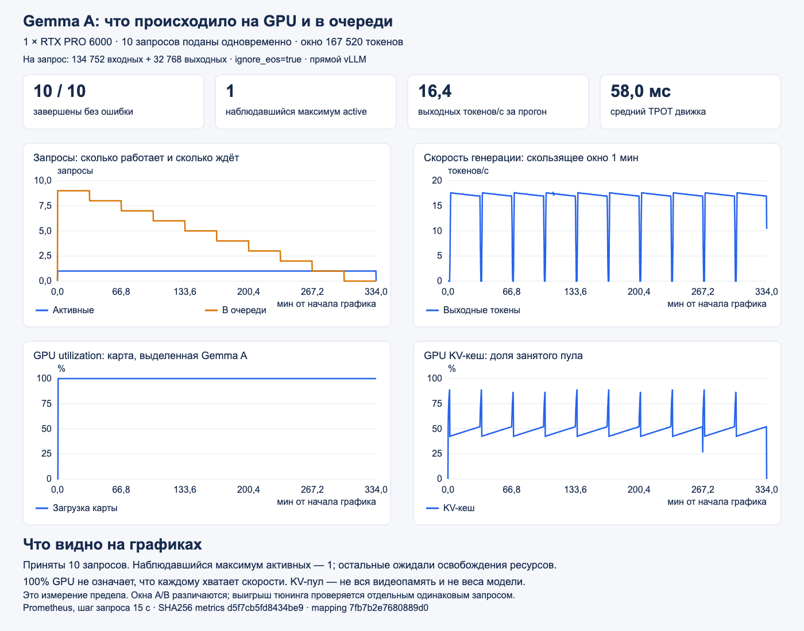
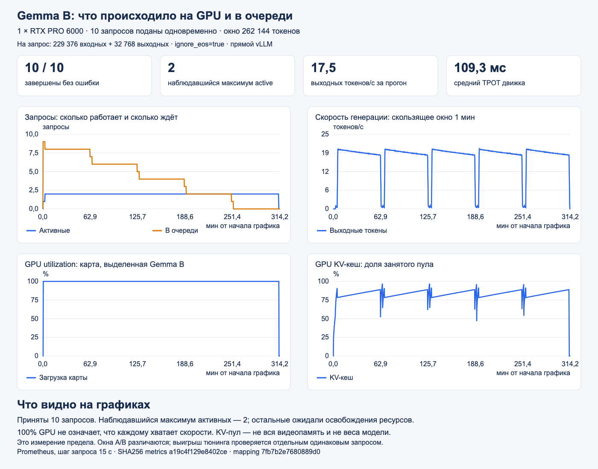
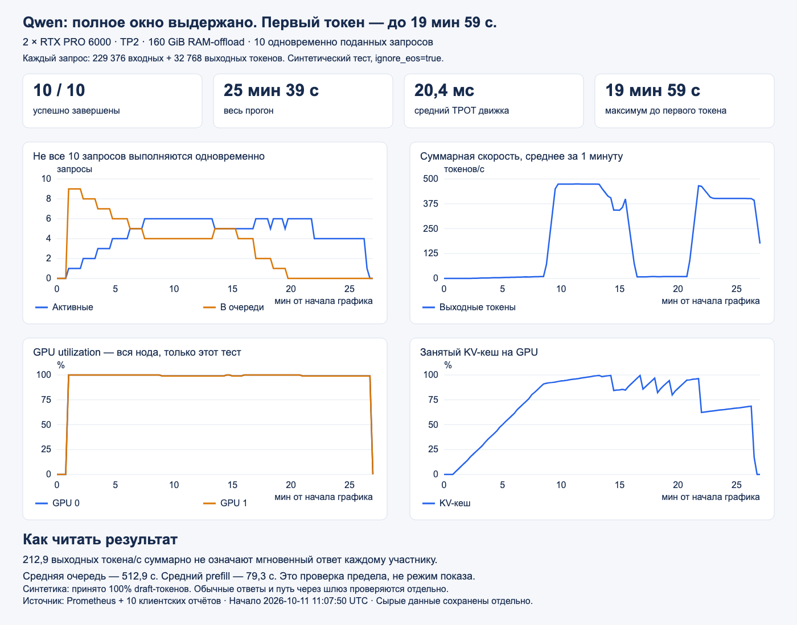
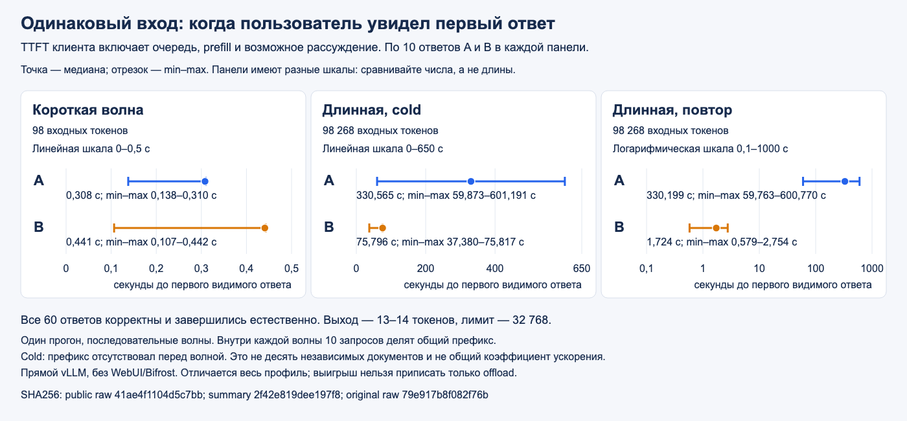

# RTX PRO 6000: измерения 11 октября 2026

Стенд: две RTX PRO 6000 Blackwell по 96 GB. Gemma A и B занимали по одной карте одновременно; Qwen использовал обе карты через TP2 в отдельном прогоне. Все приведённые здесь запросы направлялись прямо в vLLM. Путь через WebUI/Bifrost, авторизация и списание стоимости этими файлами не проверены.

## Полные окна и длинный выход

Во всех трёх прогонах одновременно поданы 10 запросов; каждый завершился с `finish_reason=length`. `ignore_eos=true` принудительно продолжал генерацию до 32768 выходных токенов. Это проверка ёмкости и устойчивости; длительная очередь не соответствует задержкам интерактивного чата. Число активных запросов — наблюдавшийся максимум по метрикам с шагом 15 секунд.

| Профиль | Вход + выход на запрос | Завершено | Наблюдавшийся максимум активных | Весь прогон, с | Максимальный TTFT, с | Preemptions |
|---|---:|---:|---:|---:|---:|---:|
| Gemma A, auto-окно | 134752 + 32768 | 10/10 | 1 | 20013,697 | 18114,370 | 0 |
| Gemma B, 80 GiB KV-offload | 229376 + 32768 | 10/10 | 2 | 18755,978 | 15301,355 | 0 |
| Qwen3.8 Flash Next NVFP4, TP2 | 229376 + 32768 | 10/10 | 6 | 1538,835 | 1198,687 | 2 |

A получил окно 167520, B и Qwen — 262144 токена. Разный объём входа не позволяет вычислять ускорение A/B по этой таблице. Автоматический размер окна A зависит от доступной памяти. Для Qwen в записи эксперимента указан RAM-offload 160 GiB; полный архив runtime-рецепта этого прогона не найден. [Шаблон заказа Qwen](../../platform/pro6000/qwen.yaml) не закрепляет эти параметры: перед повторением надо проверить выбранный рецепт и фактические аргументы Pod.

| Прогон | Ответы клиента | Временные ряды Prometheus | Проверенная сводка |
|---|---|---|---|
| A | [JSON](gemma-a-capacity-sse32k.final.json) | [JSON](gemma-a-sse32k-final-prometheus-isolated.json) | [JSON](gemma-a-sse32k-validated-summary.json) |
| B | [JSON](gemma-b-capacity-sse32k.final.json) | [JSON](gemma-b-sse32k-final-prometheus-isolated.json) | [JSON](gemma-b-sse32k-validated-summary.json) |
| Qwen | [JSON](qwen-10x256k-output32k-offload160-cold.json) | [JSON](qwen-10x256k-prometheus.json) | [JSON](qwen-10x256k-summary.json) |

Графики построены из этих файлов. TTFT включает очередь и prefill, а средний TPOT вычислен по метрике движка. В A/B часть TTFT и общей задержки выходит за последнюю конечную корзину гистограммы; точные максимумы взяты из клиентских отчётов. Отсутствующие метрики не заменены нулями.

Gemma A: очередь сокращалась по мере завершения запросов; наблюдавшийся максимум активных — один.



[SVG мониторинга](gemma-a-capacity-monitoring.svg); дополнительная временная шкала каждого запроса: [PNG](gemma-a-sse32k-capacity.png), [SVG](gemma-a-sse32k-capacity.svg).

Gemma B: окно больше, наблюдавшийся максимум активных — два. Это отдельная проверка ёмкости; разные окна A/B не дают сравнения скорости на одинаковой нагрузке.



[SVG мониторинга](gemma-b-capacity-monitoring.svg); дополнительная временная шкала каждого запроса: [PNG](gemma-b-sse32k-capacity.png), [SVG](gemma-b-sse32k-capacity.svg).

Qwen: обе карты работали в отдельном прогоне TP2; наблюдалось до шести активных запросов, а максимальный TTFT достиг почти 20 минут.



[SVG мониторинга Qwen](qwen-capacity-monitoring.svg).

[Соответствие Gemma → номер GPU](gemma-gpu-mapping.json) подтверждает выделенную физическую карту на интервале измерения. Оно не доказывает исключительную принадлежность всей загрузки GPU процессу модели. График Qwen показывает обе карты целиком во время отдельного прогона.

## Одинаковые запросы A/B

[Исходные ответы](gemma-matched-chat-final.json) и [проверенная сводка](gemma-matched-chat-validated-summary.json) содержат шесть последовательных волн по 10 запросов: короткая, длинная холодная и длинная повторная для каждой модели. Все 60 ответов корректны и завершились естественно, `finish_reason=stop`, `ignore_eos=false`. Проверены совпадение токенов входа по SHA256 и бюджет каждого ответа.

| Волна | Вход на запрос | Медиана до первого видимого ответа A, с | B, с |
|---|---:|---:|---:|
| Короткая | 98 | 0,308 | 0,441 |
| Длинная, cold | 98268 | 330,565 | 75,796 |
| Длинная, warm | 98268 | 330,199 | 1,724 |



[SVG сравнения](gemma-matched-chat-ttft.svg). Точка — медиана, отрезок — min–max. Панели короткой и холодной длинной волны имеют отдельные линейные шкалы; повторная длинная волна — логарифмическую шкалу в секундах. Сравнивать длины отрезков между панелями нельзя. Числа пересчитаны из ответов клиента, сверены со сводкой; SHA256 обоих публичных источников указаны на графике и в manifest.

Лимит выхода — 32768, фактический выход — **13–14 токенов**. Это короткое задание на точный ответ; качество длинных ответов оно не оценивает. Внутри волны все десять запросов используют общий префикс. Cold означает отсутствие префикса перед волной, поэтому результат отражает также совместную обработку и повторное использование префикса. Это один прогон, а не общий коэффициент ускорения модели; на коротком запросе медиана TTFT у B выше.

<a id="matched-reproduction"></a>
<details>
<summary>Повторение фиксированного эксперимента A/B</summary>

Архивный `chat_comparison_probe.py` принимает только завершённые capacity-отчёты
с входом **134752 у A**, **229376 у B**, выходом **32768** и десятью запросами.
Произвольный результат auto-fit не подходит: проверка завершится до запросов.
Для другой конфигурации используется [короткий A/B](../../RTXPRO6000.md#ab).

Для воспроизведения нужны те же профили и завершённые capacity-проверки
с указанными длинами. Подключение и переменные `PROBE`, `URL_A`, `URL_B` —
в [инструкции клиента](../../examples/pro6000-load-client/README.md).
Без `--execute` выполняется только проверка отчётов:

```bash
python3 "$PROBE/chat_comparison_probe.py" \
  --url-a "$URL_A" --url-b "$URL_B" \
  --capacity-report-a .local/pro6000-run/capacity-a.json \
  --capacity-report-b .local/pro6000-run/capacity-b.json \
  --report .local/pro6000-run/matched.json
```

Запуск нагрузки с дедлайном 7200 секунд:

```bash
python3 "$PROBE/run_probe_with_hold.py" --timeout 7200 --hold 0 -- \
  python3 "$PROBE/chat_comparison_probe.py" \
  --url-a "$URL_A" --url-b "$URL_B" \
  --capacity-report-a .local/pro6000-run/capacity-a.json \
  --capacity-report-b .local/pro6000-run/capacity-b.json \
  --report .local/pro6000-run/matched.json --execute
```

Выполняются шесть волн по десять запросов: короткая A/B, длинная A/B и её повтор.
Длинный вход калибруется около 98K, токены A/B проверяются на равенство.
Предел выхода — 32K, но задание требует короткого контрольного ответа;
это не оценка качества длинного текста. Ошибка прерывает сравнение.

</details>

## Возврат KV из RAM

[Отдельный replay](gemma-b-offload-replay-final.json) с одним выходным токеном дал прирост `CPU_to_GPU` на **9813360640 байт**. Он подтверждает восстановление KV из RAM, но не доказывает, что именно offload вызвал ускорение в сравнении A/B. Счётчики передачи байтов не равны текущему объёму занятого RAM-кеша. В capacity B наблюдалась запись на CPU; перенос с CPU обратно подтверждён этим отдельным диагностическим запросом.

## Проверка и происхождение

[manifest.json](manifest.json) содержит SHA256 исходных приватных артефактов, SHA256 опубликованных файлов и описание каждого преобразования. У capacity-клиентов сохранены `run_id`, `ignore_eos`, `passes`; большие встроенные метрики удалены. Из matched-отчёта удалены только `metrics_before`/`metrics_after`; ответы, временные отметки и хеши токенов сохранены. Prometheus JSON уплотнён без изменения рядов и значений. В соответствии GPU удалены внутренние идентификаторы и запрос с именем узла. Скрипты проверок и построения графиков приложены в [tools/](tools/).

Из корня репозитория:

```bash
python3 scripts/pro6000_evidence.py verify
python3 -m unittest discover -s tests -p 'test_pro6000_evidence.py' -v
python3 scripts/pro6000_evidence.py render
python3 scripts/pro6000_evidence.py png --chrome '/path/to/chrome'
```

Первые три команды работают с опубликованными файлами без кластера и приватных источников. SVG воспроизводятся побайтно; PNG зависят от версии Chrome и установленных шрифтов. Для PNG создаётся отдельный временный профиль браузера. [Профили Gemma](../../values/pro6000/) фиксируют проверенные настройки vLLM, а image, DRA-класс, размещение и каталог моделей требуют привязки площадки. SSE heartbeat в ручных профилях не означает, что полный контекст уже проверен через платформенный рецепт и WebUI.
