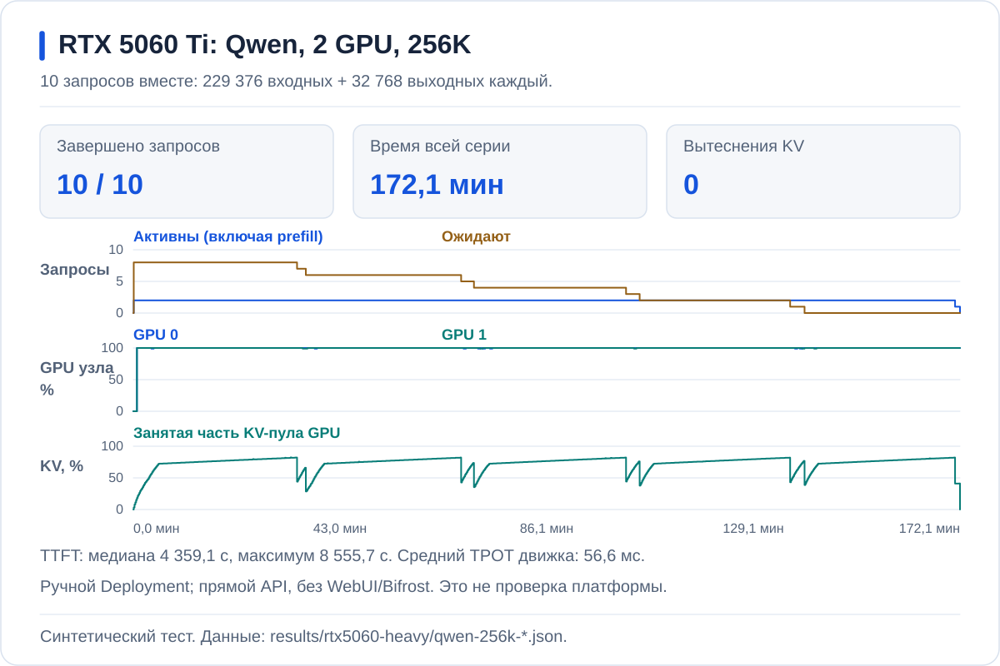

# RTX 5060 Ti: полные окна и ответы 32K

Десять клиентов отправляют запросы вместе. Каждый запрос имеет независимый
начальный префикс и заканчивается только после **32 768 выходных токенов**.
Число одновременно активных запросов ограничивают runtime и доступный KV-пул.

## Qwen: 128K, лимит восемь активных запросов

Модель запустил **AI Inference**, заказ `rtx-qwen35-tp2`, стратегия `Throughput`.
Связь Pod → StatefulSet → InferenceService проверена по владельцам и их UID.
Нагрузочный клиент обращался напрямую к API созданного платформой движка.


| Показатель | Результат |
| --- | ---: |
| Вход + выход каждого запроса | 98 304 + 32 768 |
| Подано вместе / завершено / ошибок | 10 / 10 / 0 |
| Фактический суммарный выход | 327 680 токенов |
| Время серии | 3167,27 с · 52,79 мин |
| TTFT: медиана / максимум | 273,10 / 1898,59 с |
| Средний TPOT движка | 43,21 мс |
| Выход всей серии, с учётом ожидания | 103,46 токена/с |
| Максимум Running / Waiting | 8 / 7, в разные моменты |
| Максимальная занятость KV-пула | 99,51% |
| Вытеснения активного KV | 12 |
| RAM контейнера, пик working set / лимит | 24,85 / 40 GiB |
| Перезапуски runtime | 0 |

**Все запросы закончились, но это не комфортный интерактивный режим.**
Последний первый токен пришлось ждать 31,64 минуты. Средняя скорость
генерации сама по себе скрыла бы это ожидание.

## Qwen: 256K, лимит два активных запроса

Этот запуск выполнен **ручным Deployment**, отдельно от AI Inference.
Установленный платформенный рецепт ограничен 128K; его не обновляли.
Результат ниже показывает возможности движка, **не приёмку платформы с 256K**.



| Показатель | Результат |
| --- | ---: |
| Вход + выход каждого запроса | 229 376 + 32 768 |
| Подано вместе / завершено / ошибок | 10 / 10 / 0 |
| Фактический суммарный выход | 327 680 токенов |
| Время серии | 10 326,78 с — 172,11 мин |
| TTFT: медиана / максимум | 4359,14 / 8555,75 с |
| Средний TPOT движка | 56,57 мс |
| Выход всей серии, с учётом ожидания | 31,73 токена/с |
| Максимум Running / Waiting | 2 / 8 |
| Максимальная занятость KV-пула | 82,26% |
| Вытеснения активного KV | 0 |
| RAM контейнера, пик working set / лимит | 28,64 / 40 GiB |
| Перезапуски runtime после серии | 0 |

**Большое окно работает, но ждать первый токен до 142,60 минуты — неприемлемо
для интерактивного чата.** Очередь позволила закончить десять запросов; десять
полных историй одновременно на GPU не размещались.

Это не A/B-замер влияния одной настройки: изменились и длина входа,
и лимит активных последовательностей — с восьми до двух. Сравнивать время
двух серий как «ускорение» или чистую цену удвоения контекста нельзя.

[Клиентские ответы](qwen-256k-client.json), [метрики движка](qwen-256k-prometheus.json),
[метрики GPU и узла](qwen-256k-hardware.json), [проверенная сводка](qwen-256k-summary.json),
[параметры ручного запуска](qwen-256k-runtime.json).

## Gemma Base: ограничения запуска без chunked prefill

На одной RTX 5060 Ti проверяется Gemma E2B с BF16 KV, без prefix caching,
offload и chunked prefill. Для выбранного Base-профиля получены ошибки
**ещё при запуске движка**, до отправки нагрузки:

| Окно | Лимит токенов одного batch | Результат запуска |
| --- | ---: | --- |
| 128K | 131 072 | CUDA OOM |
| 64K | 65 536 | CUDA OOM |
| 48K | 49 152 | CUDA OOM |
| 40K | 40 960 | После профилирования бюджет KV отрицательный: −0,41 GiB |
| 36K | 36 864 | Для KV одного запроса нужно 0,63 GiB; доступно 0,12 GiB |

Во всех этих попытках `max-num-seqs=10`, `gpu-memory-utilization=0.9`.
Это не десятиклиентские нагрузочные
результаты и не общий предел модели: большой batch без chunked prefill
сам требует памяти. vLLM отдельно предупреждает, что эта модель официально
не поддерживает отключение chunked prefill.
[Профили и выдержки из журналов ошибок](gemma-base-startup-failures.json).

Для Base допускается отдельно подписанный тест меньшего окна; требование
**32 768 выходных токенов на каждый из десяти запросов** сохраняется.
Его нельзя обозначать как 128K или сравнивать по скорости с другим входом
Cache/Tune. Чтобы измерить ускорение, вход и выход должны совпадать.

## Условия и границы замеров Qwen

Две RTX 5060 Ti по 16 311 MiB. Qwen3.5-9B, TP2, vLLM 0.31.0,
веса BF16, KV FP8, RAM-offload 16 GiB на TP-группу, MTP по одному draft-токену,
chunked prefill 512, prefix caching и CUDA graphs.
Пул KV по журналам запуска: **603 518 токенов при профиле 128K** и
**630 974 при профиле 256K**. Это оценка вместимости движка, не десять полных историй.
[Параметры 128K и digest образа](qwen-128k-runtime.json),
[параметры 256K](qwen-256k-runtime.json).
Working set — метрика памяти всего контейнера, не размер одного KV-кеша.
Её нельзя складывать с настроенными 16 GiB offload: offload уже входит в память
контейнера. Свободная RAM узла сохранена отдельно от этой метрики.

Клиент работал на **отдельной CPU-ноде**. Путь — закрытый HTTP напрямую
в vLLM, без WebUI/Bifrost. Других запросов к движку не было.
Все ответы содержат `usage`, `finish_reason=length` и `[DONE]`;
выход независимо сверяется со счётчиками движка.

**Вход синтетический:** независимое начало и повторяющийся заполнитель.
`temperature=0`, `ignore_eos=true`. Счётчики MTP за серию 128K: **163 827 предложенных
и 163 827 принятых draft-токенов — 100%**; за серию 256K — **163 830 из 163 830**.
Повторяемый текст мог этому помогать;
причину этот опыт отдельно не проверял. Это проверка вместимости и устойчивости потока,
не качества ответа, не типичной скорости рабочего чата и не доказательство
готовности всего сервиса к production.

Графики построены из Prometheus за полный интервал. Шаг выгрузки — 10 секунд;
частота исходного сбора метрик отличается. GPU activity не равна занятости
tensor cores. Локальные GPU/health-наблюдатели работали только часть серии;
их покрытие не выдаётся за непрерывное.

**Пробел мониторинга в серии 256K.** Между 12:40:50 и 12:41:30 UTC
15 октября 2026 года у четырёх рядов состояния узла и одного счётчика
перезапусков отсутствуют по три точки. В доступных точках pressure не наблюдался;
состояние в пропуске неизвестно. Метрики движка, GPU и RAM этот пробел не имеют.
Данные не интерполированы. [Точные пропуски и SHA256 исходной выгрузки](qwen-256k-hardware-coverage.json).
[Проверка покрытия 128K](qwen-128k-hardware-coverage.json).

## Повторить и проверить

В этой серии использован [capacity-клиент версии `6bd8c93`](https://github.com/aleksandr-podmoskovniy/hardfest-gpu-workshop/blob/6bd8c93cd687e0f5fcafc21a154367884ff8a339/examples/pro6000-load-client/inference-probe.py)
с [транспортом той же версии](https://github.com/aleksandr-podmoskovniy/hardfest-gpu-workshop/blob/6bd8c93cd687e0f5fcafc21a154367884ff8a339/examples/pro6000-load-client/probe_transport.py).
Хеши всех трёх скриптов сохранены в параметрах прогона.
В [клиенте для новых прогонов](../../examples/capacity-load-client/) дополнительно
запрещены HTTP-перенаправления, а исходный
адрес сохраняется в приватном отчёте. Эта защита не приписывается старому замеру.
На Linux CPU-клиенте с доступом к тому же закрытому runtime:

```bash
: "${BENCH_URL:?Закрытый HTTP endpoint подготовленного runtime}"
python3 examples/capacity-load-client/inference-probe.py \
  --url "$BENCH_URL" --model rtx-qwen35-9b \
  --input-tokens 98304 --output-tokens 32768 --sessions 10 \
  --request-timeout 43200 --stream-idle-timeout 43200 \
  --report capacity-128k.json
```

В этом runtime нет SSE heartbeat: общий дедлайн — 12 часов,
отдельный watchdog прерывает незавершённые потоки после 120 секунд простоя
движка. Это не настройка таймаутов публичного чата. Клиент не поддерживает
персональную авторизацию: ради него **не отключают защиту API**.
Серия `vllm bench serve --dataset-name random` в статье — другой генератор
нагрузки; эти числа нельзя приписывать ему.

Проверка сохранённых данных, без доступа к кластеру:

```bash
python3 scripts/heavy_capacity.py \
  --client results/rtx5060-heavy/qwen-128k-client.json \
  --monitor results/rtx5060-heavy/qwen-128k-prometheus.json \
  --output /tmp/rtx-qwen-capacity-summary.json
python3 scripts/plot_capacity.py --prefix qwen-128k --check
python3 scripts/hardware_coverage.py \
  --hardware results/rtx5060-heavy/qwen-256k-hardware.json \
  --output results/rtx5060-heavy/qwen-256k-hardware-coverage.json --check
```

Путь итогового файла должен быть новым. [Клиентские ответы](qwen-128k-client.json),
[метрики движка](qwen-128k-prometheus.json), [метрики GPU и узла](qwen-128k-hardware.json),
[проверенная сводка](qwen-128k-summary.json). В выгрузке нет адресов узлов,
ключей и идентификаторов пользователей.
